# Claude Certified Associate – Foundations

## 認定試験ガイド（公式ガイドの拡充版）

> **本ガイドについて。** 本書は **Claude Certified Associate – Foundations（CCAO-F）** 試験の拡充版学習ガイドである。公式の *Claude Certified Architect – Foundations Exam Guide*（v0.2）のレイアウトと章順を踏襲しつつ、CCAO-F のブループリント（7 ドメイン）に合わせている。拡充部分はすべて **Anthropic 公式ドキュメントと公式ブログのみ** から作成し、ドメインごとに出典を明記した。公式の試験ポリシー、ブループリント、公式サンプル問題は公式 CCAO-F Exam Guide（v1.0、2026 年 7 月発効、試験コード CCAO-F）から転載した。

---

## はじめに

Claude Certified Associate – Foundations 認定は、Claude を使ってビジネスや生産性のタスクを最小限の支援で完遂できることを認証する。これには、組み込みのプラットフォーム機能やツールを活用したワークフローの効率化、Claude によるプロセス改善の機会を見つけること、品質・効率・コストのバランスを取るアプローチの選択、そして限界を認識してより複雑あるいは技術的な作業を Claude Architect や Developer にエスカレーションすることが含まれる。

想定受験者は、オペレーション、マーケティング、プロジェクト管理、教育、コミュニケーションといった役割で Claude を生産性ツールとして使う専門家である。受験者は概念理解だけでなく、プロンプト作成、出力の評価、製品とモデルの選択、設定、ガバナンス、最適化に関する実践的な判断力を問われる。

本ガイドは試験内容を説明し、測定対象のドメインとタスクステートメントを列挙し、サンプル問題を示したうえで、学習戦略を提案する。実務経験と併用して効果的に学習すること。[Source: CCAO-F Exam Guide, Section 1]

---

## 試験の概要

| 項目 | 内容 |
|---|---|
| 認定資格 | Claude Certified Associate – Foundations |
| 設問数 | 60 |
| 制限時間 | 120 分 |
| 回答形式 | 多肢選択式および複数回答式。各設問は選ぶべき回答数を明示する |
| コンテентドメイン | 7（配点は「コンテントアウトライン」に記載） |
| 受験方式 | プロクタード（オンラインプロクタリングまたはテストセンター、Pearson VUE） |
| 受験料 | 99 米ドル |
| 採点 | 100〜1,000 のスケールスコア。合格最低点は 720 |
| 有効期間 | 認定取得日から 12 か月 |
| 結果通知 | 合否とスケールスコア、ドメインごとの正答率 |

[Source: CCAO-F Exam Guide, Section 5]

---

## 想定受験者像

本認定の想定受験者は、Claude を中核の生産性ツールとして使い、実務のワークフローの中で効率・品質・成果を向上させることができる専門家である。次のような実務経験を持つ。

- 構造化されたビジネスタスクを最小限の支援で完遂する。**プロンプトの構築**、タスクのオーケストレーション、Projects、Artifacts、ワークフローベースの対話といった機能の習得を含む
- 単純な質問応答の先へ進み、プロセスの再設計、タスクの自動化、プロジェクトの開発を行う
- Claude の出力を精度、ハルシネーション、バイアス、適切なフォーマットの観点で評価する
- 適切な Claude 製品機能とモデル（Haiku、Sonnet、Opus）を選び、コスト・速度・品質のバランスを取る
- Claude Projects に指示とナレッジソースを設定し、運用で維持する
- データの機密性、プライバシー、責任ある利用の判断を働かせ、いつエスカレーションや人間のレビューを求めるべきかを知る

想定受験者は日常的にプロフェッショナルな場面で Claude を使う経験を持ち、プラットフォーム上の一般的な生産性タスクやワークフロータスクを自力で完遂できる。オペレーション、マーケティング、プロジェクト管理、教育、コミュニケーション、一般のナレッジワークにまたがる。

本認定は、API に基づいて開発するソフトウェア開発者や、エージェントシステムを設計する者、機械学習・ソフトウェアエンジニアリング・高度な AI システム設計の専門家を想定しない。それらの領域は Claude Architect や Claude Developer 認定の守備範囲であり、Associate はより複雑・技術的な作業をそこにエスカレーションする。

前提条件はない。必須のコースやソフトウェア開発・API の経験は不要。認定は試験の成績のみで与えられる。[Source: CCAO-F Exam Guide, Sections 3–4]

---

## 試験内容

### 回答形式

試験の問題はすべて選択問題である。多くは「4つの選択肢から1つ選ぶ」形式だが、なかには「2つ選べ」のように複数の正解を選ぶ問題もある。問題文には何個選ぶべきかが必ず書かれているので、指示に従う。選択肢には、ひと目では正解に見える「もっともらしい誤り（distractor）」が混ざっており、うろ覚えだと引っかかる作りになっている。

### 採点結果

試験は「合格・不合格」で判定される。他の受験者との競争ではなく、決まった基準（ブループリントの知識とスキル）に届いたかどうかで決まる。つまり、基準に届けば誰でも合格できる仕組みである。

合格点は 100〜1,000 点のスケールで **720 点以上**。これは、専門家が「最低限これだけはできるべき」と定めた水準に合わせて決められている。結果にはドメインごとの正答率も載るが、合否はトータルスコアだけで決まり、ドメイン別の正答率は自分の得意・苦手を知るための参考情報である。[Source: CCAO-F Exam Guide, Sections 5, 9]

### コンテントアウトライン

本ガイドには配点、コンテントドメイン、タスクステートメントを示す。試験のドメインと配点は次のとおり。

- Domain 1: Prompting and Task Execution（プロンプト作成とタスク実行）（採点対象の 14%）
- Domain 2: Output Evaluation and Validation（出力の評価と検証）（21%）
- Domain 3: Product and Model Selection（製品とモデルの選択）（12%）
- Domain 4: Workflow Integration and Solution Design（ワークフロー統合とソリューション設計）（16%）
- Domain 5: Configuration and Knowledge Management（設定とナレッジ管理）（12%）
- Domain 6: Governance, Risk, and Responsible Use（ガバナンス・リスク・責任ある利用）（15%）
- Domain 7: Troubleshooting and Optimization（トラブルシューティングと最適化）（10%）

[Source: CCAO-F Exam Guide, Section 6]

### 問題スタイルと業務場面

実際に受験した印象では、問題は現実の仕事の場面を背景にしていた。固定のシナリオセットがあるわけではなく、各問題が独立している。規制文書の要約、データ分析、プロジェクト設定など、ブループリントの全ドメインからまんべんなく出題された。

公式 Exam Guide の Sample Questions（Section 8）で、問題のスタイルと難しさを確認できる。本ガイドでも「Sample Questions」で実例を揃えた。実際の問題で扱われた業務テーマは、おおむね次のようなものだった。

- ステークホルダー報告書の起案と推敲（Domain 1・2）
- 規制文書の要約と、引用の検証（Domain 2・6）
- 大量の顧客返信と、下流処理向けの構造化出力（Domain 3・2）
- データセットの分析と可視化（Domain 3・4）
- 定常ワークフロー向けのプロジェクト設定（Domain 5・4）
- 機密データの取り扱いと匿名化（Domain 6・5）
- 不適切な出力の診断と改善（Domain 7・1）

[Source: CCAO-F Exam Guide, Section 8]

---

## Domain 1: Prompting and Task Execution（プロンプト作成とタスク実行）

### Task Statement 1.1: Create effective prompts for business and technical tasks（ビジネス・技術タスクのプロンプト作成）

**知識：**
- Claude は明確で明示的・具体的な指示に最もよく応じる。「ゴールデンルール」として、最小限の文脈しか与えない同僚にプロンプトを見せ、従ってもらうように依頼する。同僚が混乱するなら、Claude も混乱する
- 複雑なプロンプトを曖昧さなく解析するために **XML タグ**（`<instructions>`、`<context>`、`<input>`、`<example>`、`<examples>`）を使う。階層的な内容ではネストする
- システムプロンプトが役割、振る舞い、トーンを定める。「あなたは Python を専門とする有用なコーディングアシスタントです」のような一文でもトーンが絞られる
- 指示の背景や理由を添えると、Claude は目標を理解し、的を絞った応答を返しやすくなる

**スキル：**
- 役割、コンテキスト、フォーマット、制約を明示したプロンプトを書く
- XML タグで指示、コンテキスト、例、入力変数を分離する
- 順序や完全性が重要な場合は、番号付きリストで順序付きステップを示す
- 長文コンテキストタスクでは、長い文書を上部に、問いを末尾に置く（品質向上が報告されている）

### Task Statement 1.2: Apply task decomposition techniques to structure complex requests（複雑なリクエストを構造化するタスク分解）

**知識：**
- **プロンプトチェーン**。タスクを逐次の呼び出しに分割し、あるプロンプトの出力を次の入力にする
- 連鎖の各ステップは別の呼び出しであり、任意の地点でログ、評価、分岐ができる
- 自己訂正パターン。草案を生成し、基準でレビューし、レビューに基づいて推敲する
- 複雑なタスクを小さなステップに分けると、モデルの認知負荷が下がり精度が上がる

**スキル：**
- 複雑なリクエストを焦点を絞った逐次ステップに分解する（例: メタデータ抽出 -> データ抽出 -> 検証 -> 推敲）
- 自己訂正チェーン（草案 -> レビュー -> 推敲）を実装する
- 予測可能で反復可能な多段階タスク向けに、チェーン化パイプラインを設計する

### Task Statement 1.3: Iterate prompts to improve output quality（出力品質を高めるプロンプトの反復）

**知識：**
- 反復プロンプトは構造化されたアプローチの恩恵を受ける。最初の草案テンプレートから始め、出力の何が悪いかという具体的フィードバックに基づいて推敲する
- Anthropic はプロンプト改善の指針を公開している。API 開発者にはプロンプトジェネレータやプロンプトインプルーバといったツールも提供される
- プロンプトエンジニアリングには、成功基準、経験的なテスト、反復前の草案プロンプトが必要である
- 評価の失敗はすべてプロンプトエンジニアリングで解決できるわけではない。レイテンシやコストは別のモデル選択で改善することもある

**スキル：**
- 最初の草案テンプレートから始め、出力の問題に関する具体的フィードバックに基づいて推敲する
- 成功基準と評価に基づいて反復し、直感に頼らない
- 不適切な結果がプロンプトに起因するのか、別のモデルやアプローチが必要なのかを見極める

### Task Statement 1.4: Adapt prompting strategies based on task type（タスクタイプ別のプロンプト戦略の適応）

**知識：**
- タスクタイプ別の指針。リサーチや情報収集では、明確な成功基準を設け、複数ソースでの照合を促し、競合する仮説と自己批判を使う
- 数学、コーディング、分析タスクでの **拡張思考（extended thinking）**。適応型思考では Claude が思考の要否と深さを動的に決める。「段階的に考えろ」のような prescriptive な指示より「十分に考えろ」のような一般的指示を優先する
- フォーマットや一貫性のためのフューショット（3〜5個の関連性が高く多様な例）。タスクの複雑さに応じて zero/one/few-shot を選ぶ
- XML フォーマット指示と肯定形指示（「〜するな」ではなく「〜しろ」）によるフォーマット制御

**スキル：**
- タスクタイプ（分析、リサーチ、起案、ブレスト）に応じてプロンプト構造を適応させる
- 複雑な推論では拡張思考を有効にし、「終わる前に [テスト基準] で答えを検証せよ」のような自己チェック指示を付加する

**出典（Domain 1）:**
- Prompt engineering overview — https://platform.claude.com/docs/en/build-with-claude/prompt-engineering/overview
- Prompting best practices — https://platform.claude.com/docs/en/build-with-claude/prompt-engineering/claude-prompting-best-practices
- Chain complex prompts — https://platform.claude.com/docs/en/build-with-claude/prompt-engineering/chain-prompts
- Console prompting tools — https://platform.claude.com/docs/en/build-with-claude/prompt-engineering/prompting-tools
- Extended thinking — https://platform.claude.com/docs/en/build-with-claude/extended-thinking
- Adaptive thinking — https://platform.claude.com/docs/en/build-with-claude/adaptive-thinking

---

## Domain 2: Output Evaluation and Validation（出力の評価と検証）

Claude は流暢で整った文章を生成する。しかしその「整っている」という印象が、かえって利用者を油断させる。CCAO-F では、API ベースの evals フレームワークやコード採点の実装ではなく、「出力を受け取ったビジネスユーザーが、これを信用できるか、要件を満たすかをどう判定するか」を問う。技術的な evals は CCA-F で既に学んだ。ここでは、評価基準をどう設計し、ハルシネーションをどう見抜き、どこで人間に判断を委ねるかという、ビジネスユーザーとしての判断力に焦点を当てる。

### Domain 2 の検証フロー全体像

Domain 2 の6つの Task Statement は、出力を受け取ってから確認を終えるまでの一連の流れとして捉えると理解しやすい。

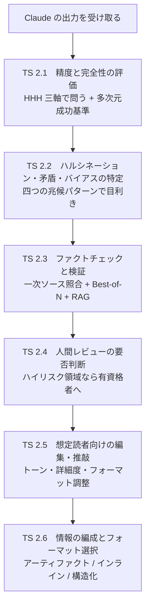

出力の正確性を確認してから（TS 2.1〜2.4）、読者に合わせて磨き上げる（TS 2.5〜2.6）、という順序である。

### Task Statement 2.1: Evaluate Claude-generated outputs for accuracy and completeness（精度と完全性の評価）

> **入門者向けの位置づけ。** CCA-F（Architect）では API ベースの evals フレームワークやコード採点の実装を問うが、CCAO-F では「出力を受け取ったビジネスユーザーが、これを信用できるか、要件を満たすかをどう判定するか」を問う。採点手法の優先順位と多次元の成功基準の考え方を押さえること。技術的 evals は CCA-F 既得なので、ここでは「評価基準をどう設計するか」の判断に絞る。

出力を評価する第一歩は、「何を持って良い出力とするか」を明確にすることである。Anthropic は品質目標として **HHH フレームワーク** を掲げている。HHH とは Helpful（有用）、Honest（誠実）、Harmless（無害）の三軸であり、Claude の訓練方針そのものでもある [Source: Glossary — https://platform.claude.com/docs/en/about-claude/glossary]。

三軸のうち、利用者が最も注意すべきは Honest である。Honest には「正確な情報を提供し、ハルシネーションや捏造をせず、限界を認める」ことが含まれる。つまり「分からないと言えるか」も Honest の基準であり、自信過剰な出力はこの基準を満たさない。出力を受け取ったら、まずこの三軸を順に問いかけるだけで、見落としが大きく減る。

HHH は定性の方針であるため、これを測定可能な指標に落とし込む必要がある。成功基準は Specific（具体的）、Measurable（測定可能）、Achievable（達成可能）、Relevant（関連性あり）を満たすべきである [Source: Define success criteria and build evaluations — https://platform.claude.com/docs/en/test-and-evaluate/develop-tests]。「良い出力」という曖昧な基準は判定に使えない。「正解率」「有害フラグ率」「引用精度」のように測れる指標に変換する。安全性でさえ「10,000回中の毒性フラグ率」のように数値化できる。

| 成功基準の次元 | 問い | 測定例 |
|---------------|------|--------|
| 忠実度 | 出典に忠実か | 引用精度（%） |
| 一貫性 | 同じ質問で同じ答えか | 回答一致率（%） |
| 関連性 | タスクに関連する内容か | 関外情報の有無 |
| トーン・文体 | 指定した文体か | ルーブリック採点 |
| プライバシー | 機密情報を漏らしていないか | PII 検出率 |
| 安全性 | 有害でないか | 毒性フラグ率（/万回） |

重要なのは、単一の指標ではなく複数の次元を組み合わせる多次元評価が基本ということである。医療アプリでは引用精度が致命的だが、カジュアルチャットでは関係ない。ユースケースによって各次元の重みが変わる。

**採点方法の優先順位** は、公式ガイドが明確に示している。コードベース採点が最速かつ最も信頼できる。完全一致、キーワード含有、正規表現マッチなど、コードで判定できる部分は自動化する。人間採点は最も柔軟だが遅く、LLM ベース採点は高速かつ拡張可能だがルーブリック設計に注意を要する [Source: Define success criteria and build evaluations — https://platform.claude.com/docs/en/test-and-evaluate/develop-tests]。

| 採点方法 | 速度 | 信頼性 | 柔軟性 | 使いどころ |
|---------|------|--------|--------|-----------|
| コードベース | 最速 | 最高 | 低 | 完全一致、キーワード、正規表現 |
| 人間 | 遅い | 高 | 最高 | 複雑な判断、トーン、ニュアンス |
| LLM ベース | 高速 | 中 | 高 | 大量の定性評価、ルーブリック採点 |

LLM ベース採点を使う場合は、詳細なルーブリック、経験的なスケール、採点前の推論を促すことで精度を高める。また「少数の高品質な人間採点より、多数のやや粗い自動採点の方が実用上勝る」という原則も覚えておきたい。問いの数は多い方が良く、エッジケースを含めることも忘れない。

**入門者の判断指針。** 出力を受け取ったら、まず「HHH の三軸（Helpful/Honest/Harmless）を満たすか」を問う。次に「タスクの要件（忠実度、トーン、プライバシー）を具体的な指標で満たすか」を確認する。測れない基準（「良い感じ」）は判定に使えない。コードで判定できる部分は自動化し、複雑な判断だけ人間が担う。

### Task Statement 2.2: Identify hallucinations, inconsistencies, and biases in responses（ハルシネーション・矛盾・バイアスの特定）

> **入門者向けの位置づけ。** CCAO-F の核心の一つ。「確信を持って間違える」現象（ハルシネーション）を見抜き、出力の矛盾に気づくのは、ビジネスユーザーとして Claude を使う上で最も重要なスキル。兆候のパターンを体感的に押さえること。技術的なバイアス測定手法は CCA-F 既得なので薄く、検知の「目利き」に集中する。

高度なモデルでも、事実的に誤った、あるいは文脈に不整合なテキストを生成する。Claude 自身のシステムプロンプトも、マイナーな話題や引用でハルシネーションが起きうることを認めている。これは Claude の欠陥ではなく、LLM の構造的性質である。確率的に次のトークンを予測する仕組み上、もっともらしく見える嘘を生成できてしまう。

ここで 重要な核心概念を明確にしておく。**「確信の度合い」と「正確さ」は無関係である。** 自信に満ちた文体でも中身は間違っていることがある。自己申告の自信は精度のシグナルにならない。

ハルシネーションの兆候は、実用的に四つのパターンに分類して覚えると見抜きやすい。

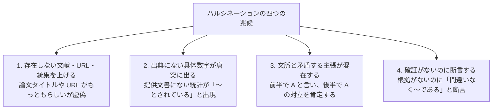

特に注意したいのは、「引用がついているから安全」ではないという点である。引用先を実際に開いて確認しない検証は、検証と呼ばない。この点は TS 2.3 で詳しく扱う。

バイアスについては、Anthropic は 150 のトピックと 9 種類のタスクにわたる 1,350 組の対立する政治的見解を用いて政治的バイアスを測定し、公平性、対立する観点の承認、拒否率を評価している [Source: Transparency Hub — https://www.anthropic.com/transparency]。バイアスには「片方の立場だけを支持する」「対立する観点を無視する」「特定の集団を不当に扱う」の形で現れる。感度の高い話題では「両方の立場を公平に扱っているか」「一方に偏っていないか」を意識的に確認する習慣が必要である。

不正確、偏った、有害な出力を見つけた場合は、`usersafety@anthropic.com` またはプロダクト内のフィードバック（サムズダウンボタン等）で報告すべきである。AUP（Usage Policy）は報告窓口を明示している [Source: Usage Policy — https://www.anthropic.com/legal/aup]。

**入門者の判断指針。** 具体的な数字、固有名詞、引用、URL が出てきたら、それが「もっともらしい嘘」でないか外部ソースで確認する癖をつける。自己申告の自信は精度のシグナルにならない。Claude が自信満々に答えても、それは「正しい」という根拠にならない。疑わしきは検証する。

### Task Statement 2.3: Apply fact-checking and validation techniques（ファクトチェックと検証の手法）

> **入門者向けの位置づけ。** ここは押さえるべき核心。「引用がついている＝検証済み」ではない。検証とは、権威ある外部ソースを自分の目で確認すること。Claude が出した引用を開かずに信用するのは、検証でなく単なる転載である。検証の「深さ」を問う概念を確実に押さえる。

ハルシネーションを削減する基本戦略は三つある。第一に、最も効果が高いのは「分からない」と言うことを許すことである。プロンプトで「情報が足りない場合は推測せず『分からない』と答えて」と明示するだけで、誤情報が大幅に減る。第二に、事実の根拠として直接引用を使う。第三に、引用で主張を検証し、裏付けのない主張を取り下げさせる [Source: Reduce hallucinations — https://platform.claude.com/docs/en/test-and-evaluate/strengthen-guardrails/reduce-hallucinations]。

長文（20k トークン超）を扱うときは、タスクの前に「まず原文から逐語的な引用を抽出せよ」と指示すると効果的である。応答を原文に根拠づけることで、Claude の自由な創作を防ぐ。また「各主張の後に裏付け引用を付けよ。引用が見つからない場合はその主張を取り下げよ」と指示すると、応答が監査可能になる。

| 手法 | 効果 | 使いどころ |
|------|------|-----------|
| 「分からない」と言うことを許す | 誤情報を大幅に減らす（最も効果的） | すべての場面の基本設定 |
| 逐語的引用の先頭抽出 | 原文に根拠づけ、創作を防止 | 長文（20kトークン超）の要約 |
| 裏付け引用の義務化 | 応答を監査可能に | 事実関係の多いレポート作成 |
| 外部知識の制限 | 勝手な記憶の補完を防止 | 提供文書のみを使うタスク |
| Best-of-N 検証 | 不一致をハルシーの兆候として検出 | 確認が必要な重要な回答 |
| 連鎖思考による検証 | 推論過程を段階的に検証 | 複雑な推論を含む出力 |
| 反復推敲 | 出力を洗練・精査 | 品質が求められる最終稿 |

高度な手法として、Best-of-N 検証がある。これは「同じ質問を複数回聞いて答えが一致するか」を見る手法である。違う回答が出たら、その箇所はハルシネーションの可能性が高い。実行回数による一貫性の確認は、安価かつ実用的な検証手段である。外部知識の制限は「提供した文書だけを使い、一般知識を使うな」と明示することで、Claude が勝手に記憶を補完するのを防ぐ。

**RAG（Retrieval Augmented Generation）** は、実行時に外部ナレッジベースから関連情報を検索し、それをコンテキストに渡して応答させる仕組みである [Source: Glossary — https://platform.claude.com/docs/en/about-claude/glossary]。訓練データにない最新情報や、社内文書のような非公開情報を扱うのに有効だが、検索結果自体が不正確ならそれに基づく応答も不正確になる。「RAG を使えば確実」という前提は危険である。

これらの手法はハルシネーションを大幅に減らすが、完全にはなくせない。重要な情報は常に検証する。その際、二つの罠を確実に押さえる必要がある。

第一の罠は**検証の罠**である。引用がついているからといって、その引用が正しいとは限らない。Claude は存在しない文献を出典として提示できる。引用先を実際に開いて確認しない「検証」は検証でない。権威ある外部ソースで自ら確認して初めて検証と呼べる。

第二の罠は**既知の欠落のシグナル**である。一つの事実誤りや欠落を見つけたら、それは「他にも欠落がある」シグナルである。1件見つけたから終わりではなく、同じ出力の他の主張も疑って深掘りする。

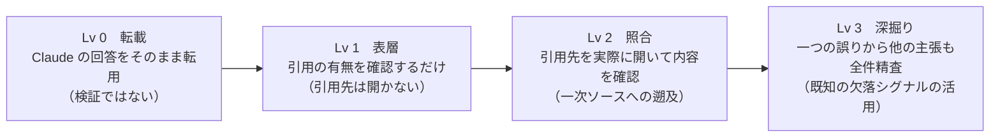

**入門者の判断指針。** 検証とは「Claude の回答を Claude 自身に聞き返す」ことではない。権威ある外部ソース（公式文書、一次資料、専門家）を自分の目で確認すること。一つの誤りを見つけたら「他にもある」と想定して深掘りする。Claude に「これで合ってる？」と自己検証させるのは検証の代わりにならない。

### Task Statement 2.4: Determine when human review or additional verification is required（人間のレビューや追加検証が必要な場面の判断）

> **入門者向けの位置づけ。** ここは押さえるべき核心。「ハイリスク領域では Claude に自己検証させず、有資格者レビューを必ず通す」という原則と、「自己申告の自信は精度のシグナルにならない」という事実を確実に押さえる。技術的なヒューマンインザループ設計は CCA-F 既得なので、ここでは「いつ人間に回すか」の判断基準に集中する。

Claude の出力をそのまま使える場面と、必ず人間の有資格者がレビューすべき場面がある。AUP（Usage Policy）は、人間のレビュー（ヒューマンインザループ）と AI の開示を必須とするハイリスクユースケースを七つ挙げている [Source: Usage Policy — https://www.anthropic.com/legal/aup]。

| ハイリスク領域 | 影響を受けるもの | 例 |
|---------------|-----------------|-----|
| Legal | 権利・自由 | 法律解釈、契約書作成 |
| Healthcare | 健康・生命 | 医療診断、治療方針 |
| Insurance | 金銭・保障 | 保険引受、給付判断 |
| Finance | 金銭・財産 | 融資判断、投資助言 |
| Employment & housing | 機会・生活 | 採用、昇進、入居審査 |
| Academic testing | 機会・公正 | 入試、資格試験 |
| Media / journalism | 名誉・社会 | 報道、記事執筆 |

AUP は「主観的な意思決定が個人や消費者に直接影響する場合」に限りヒューマンインザループを要求する。つまり個人の権利、生活、財産に影響する場面では、必ず資格を持つ専門家が内容をレビューし、影響を受ける人に AI の使用を開示しなければならない。開示は「セッションの開始時」に最低限行う。AI を使ったことを隠してはならない。

ここで最も重要な原則がある。**ハイリスク領域では Claude に自己検証させてはならない。** Claude に「この医療情報は正しいか」と聞き返して安心するのは、レビューの代わりにならない。資格を持つ専門家とは、その分野の免許や専門性を持つ人のことである。Claude 自身にレビューを委ねることは認められない。

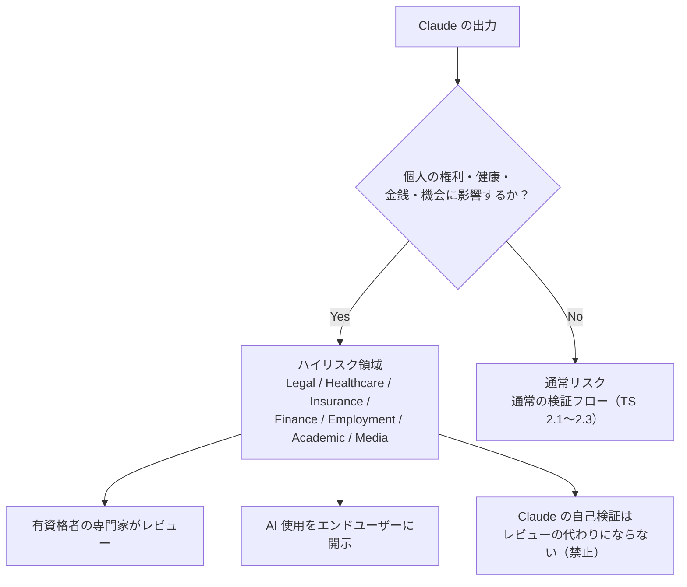

なお、ハイリスク領域かどうかにかかわらず、すべての消費者向けチャットボットは、ユーザーが AI とやり取りしていることを開示しなければならない。これは追加ガイドラインとして AUP に明記されている。

この原則の根拠となる事実を改めて強調する。**自己申告の自信は精度の信頼できるシグナルではない。** Claude は確信を持って間違えることがある。Claude が「これは確実です」と言っても、それは正確さの根拠にならない。自信の表現と事実の正確さには相関がない。だからこそ、ハイリスク領域では Claude 自身が自信を持っても、有資格者の確認が不可換なのである。

**入門者の判断指針。** 出力が「個人の権利・健康・金銭・機会」に影響するなら、それはハイリスクである。Legal、Healthcare、Insurance、Finance、Employment、Academic、Media のいずれかに当たるかを最初に確認する。当たるなら、Claude の出力をそのまま使わず、必ず有資格者にレビューしてもらう。Claude に「これで大丈夫？」と聞くのはレビューの代わりにならない。

### Task Statement 2.5: Edit, adapt, refine, and compare outputs for the intended audience（想定読者向けの編集・適応・推敲・比較）

> **入門者向けの位置づけ。** 出力の「内容が正しい」だけでは不十分。想定読者に合ったトーン、詳細度、フォーマットに編集するビジネス判断を問う。技術的なプロンプトエンジニアリングは CCA-F 既得なので、ここでは「読者に合わせてどう調整するか」の実務判断に絞る。

出力の内容が正しくても、読者に合っていなければ役に立たない。Claude のトーン、フォーマット、文体は三つの手段で調整できる。システムプロンプトで役割と文体を指定する、ユーザー設定（Claude.ai の設定画面）で好みを反映する、スタイル機能で文体を切り替える、の三つである。同じ内容でも読者に合わせて出し分けられる。

読者が変われば、最適な表現も変わる。この関係を一覧にすると次のようになる。

| 想定読者 | トーン | 詳細度 | フォーマット |
|---------|--------|--------|-------------|
| 経営層 | 簡潔・断定的 | 要点中心 | 箇条書き3点 |
| 現場担当者 | 実務的・手順的 | 詳細 | ステップ付き手順 |
| 取引先 | 丁寧・敬語 | 必要十分 | 整った文章 |
| 社内技術者 | 正確・専門的 | 高密度 | コードブロック・表 |

新しいモデルではより直接的な文体が現れる傾向がある。冷たい印象を避けるには、プロンプトで「温かく協調的なトーンを使い、答える前にユーザーの枠組みを認める」のようにトーンを明示する。「答える前にユーザーの枠組みを認める」は共感の技法であり、相手の立場を先に述べてから本題に入るだけで、体感的な温かさが変わる [Source: System Prompts (Release Notes) — https://platform.claude.com/docs/en/release-notes/system-prompts]。

ここで知っておきたい法則がある。**プロンプトの文体が出力の文体に影響する**ということである。プロンプトからマークダウンを除くと、出力のマークダウンが減ることがある。装飾のないプロンプトは装飾のない出力を、箇条書きのプロンプトは箇条書きの出力を生みやすい。意図的に出力の形式を変えたいなら、プロンプト自体をその形式に近づけるのが有効である。

**入門者の判断指針。** 同じ内容でも、読者が変われば最適な表現は変わる。編集の前に「この出力を読むのは誰か」を一言で定義する。経営層向けなら削る、現場向けなら詳細を足す。Claude が出した第一次案をそのまま使わず、必ず一度は読者目線で推敲する。

### Task Statement 2.6: Organize and curate information and select appropriate output formats（情報の編成と適切な出力フォーマットの選択）

> **入門者向けの位置づけ。** 出力フォーマットの選択は「何を作るか」で決まるビジネス判断。アーティファクト、インライン文章、構造化データの使い分けと、構造化出力が保証するもの、しないものの境界を押さえる。技術的な JSON Schema の実装は CCA-F 既得なので、ここでは「どのフォーマットをどの場面で選ぶか」に絞る。

出力フォーマットには三つの選択肢がある。それぞれに向き・不向きがある。

| フォーマット | 特徴 | 向いている場面 |
|-------------|------|--------------|
| アーティファクト | 独立パネルで編集・再利用できる | 後で使い回す文書、コード、図表 |
| インライン文章 | チャットの応答そのもの | その場限りの説明や回答 |
| 構造化データ（JSON/XML） | 下流システムが処理しやすい | API 連携、データ抽出、バッチ処理 |

人間が読む前提ならインライン文章かアーティファクトが適し、下流システムが処理する場面には構造化データが向く。

JSON スキーマへの準拠を保証する仕組みが **構造化出力（Structured Outputs、制約付きデコーディング）** である。これは Claude の応答を必ず指定した JSON スキーマに適合させ、解析エラー、欠落フィールド、型違反をなくす。データ抽出、分類、API フォーマット、構造化レポートで使う [Source: Structured outputs — https://platform.claude.com/docs/en/build-with-claude/structured-outputs]。一般的な一貫性向上の手法（フォーマット指定、例による縛り等）はスキーマ違反を確実に防げない。厳密な JSON が必要なら構造化出力を使う。

ただし、ここで重要な境界がある。**厳密なスキーマは構文エラーをなくすが、意味エラーは防げない。** スキーマが保証するのは「形が正しいこと」だけである。数値の中身が間違っていても、型が合っていれば通ってしまう。

```
 ┌─────────────────────────────────────────────────┐
 │     構造化出力が保証するもの / しないもの      │
 ├────────────────────┬────────────────────────────┤
 │  保証する（構文）   │  保証しない（意味）         │
 ├────────────────────┼────────────────────────────┤
 │  JSON 形式の妥当性 │  数値の中身の正確さ         │
 │  必須フィールドの   │  合計が合うか               │
 │    存在             │  値が正しいフィールドに     │
 │  型の一致           │    入っているか             │
 │  解析エラーの消失   │  内容の論理的正当性         │
 └────────────────────┴────────────────────────────┘
```

構造化出力で安全なのは構文までである。意味の正しさ（合計が合う、値が正しいフィールドに入っている）は別途人間かコードで確認する必要がある。

一貫性を高める手法として、公式ガイドは五つを挙げている [Source: Increase output consistency — https://platform.claude.com/docs/en/test-and-evaluate/strengthen-guardrails/increase-consistency]。フォーマットを明示する（JSON/XML/テンプレートのどれかを正確に指定する）、例で縛る（few-shot 例を与えて具体的な出力例を見せる）、文脈の一貫性のために検索を使う、複雑なタスクはプロンプトをチェーンする（小さな副タスクに分けて各々に集中させる）、Claude をキャラクターに保つ、の五つである。抽象的な指示より具体的な出力例を見せる方が、Claude の理解が正確になる。

**入門者の判断指針。** フォーマットは「成果物をどう使うか」で選ぶ。後で使い回す文書やコードならアーティファクト。下流システムに渡すデータなら構造化出力で JSON。その場限りの回答ならインライン文章。厳密な JSON が必要な場面で、プロンプトで「JSONで出力して」と書くだけでは不十分である。構造化出力を使えばスキーマ違反をなくせる。ただし意味の正しさまでは保証しないので、内容の確認は別途必要である。

> **陥りやすい罠。** 出力の「流暢さ・自信満々さ」は正確性の証明にならない（最大の distractor）。見た目が整っていても、必須項目のチェックリストと突き合わせ、数値、引用、規域名は一次ソース（原文、公式発表）にまで遡って検証する。完全性は「必要な要素がすべて含まれるか」で判定し、読みやすさと混同しない。大規模バッチは全件確認が難しければ代表性のあるサンプリングで誤り率を推定し、skim や自己申告の confidence で済ませない。レビューの深度は内容のリスク（金銭、健康、権利への影響）で決め、同じ形式でも利害が大きいほど厳格に。Claude 自身に「もう一度確認させる」のは検証の代わりにならない。

**出典（Domain 2）:**
- Reduce hallucinations — https://platform.claude.com/docs/en/test-and-evaluate/strengthen-guardrails/reduce-hallucinations
- Increase output consistency — https://platform.claude.com/docs/en/test-and-evaluate/strengthen-guardrails/increase-consistency
- Structured outputs — https://platform.claude.com/docs/en/build-with-claude/structured-outputs
- Define success criteria and build evaluations — https://platform.claude.com/docs/en/test-and-evaluate/develop-tests
- Glossary (HHH, RAG) — https://platform.claude.com/docs/en/about-claude/glossary
- System Prompts (Release Notes) — https://platform.claude.com/docs/en/release-notes/system-prompts
- Transparency Hub — https://www.anthropic.com/transparency
- Usage Policy — https://www.anthropic.com/legal/aup

---

## Domain 3: Product and Model Selection（製品とモデルの選択）

Domain 2 では「出力を受け取った後にどう判定するか」を扱った。Domain 3 はその手前、出力を生成する前の選択にあたる。どのプロダクト機能を組み合わせ、どのモデルを割り当てるか。CCAO-F では API や MCP の技術詳細ではなく、Claude.ai のプロダクト機能とモデル階層を実務判断として使い分ける力を問う。CCA-F で学んだ API の知識は前提とし、ここでは「どの場面で何を選ぶか」の判断に集中する。

### Domain 3 の判断対象全体像

Domain 3 の4つの Task Statement は、二つの問いに分かれる。「どの機能を使うか」（TS 3.1）と「どのモデルを割り当てるか」（TS 3.2〜3.3）、そしてその両方を支える「コンテキストをどう管理するか」（TS 3.4）である。

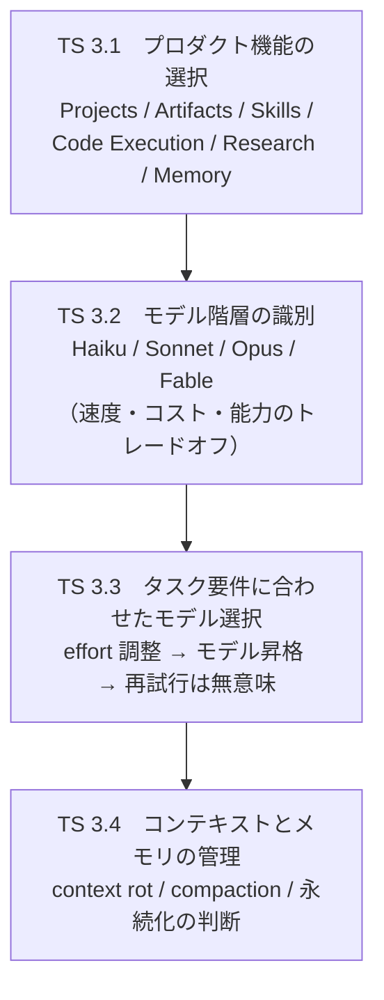

機能を選び（TS 3.1）、モデルを割り当て（TS 3.2〜3.3）、そして走りながらコンテキストを保つ（TS 3.4）のが、Domain 3 の流れである。

### Task Statement 3.1: Select appropriate Claude product features（Claude 製品機能の選択）

> **入門者向けの位置づけ。** CCA-F（Architect）では API や MCP の技術詳細を問うが、CCAO-F では「どの Claude.ai プロダクト機能をどの場面で使い分けるか」を実務判断として問う。各機能の役割と適材適所を押さえること。

Claude.ai は単一のチャットではなく、目的に応じた複数の機能から成る。各機能は異なる課題を解決するために設計されており、目的の動詞から逆算して選ぶのが基本である。外部情報を集めるのか、データを計算するのか、同じ前提で繰り返す定常作業なのか、後で使い回す成果物を作るのか。この問いに答えると、自然に機能が決まる。

六つの主要機能の立ち位置を一覧にする。

| プロダクト機能 | 何をするか | いつ使うか |
|---------------|-----------|-----------|
| **Projects** | 指示とナレッジソースで構成する自己完結型ワークスペース | 同じ前提条件で繰り返す定常作業 |
| **Artifacts** | 独立パネルで編集・再利用できる成果物 | 後で使い回す文書、コード、図表 |
| **Agent Skills** | モジュール化されたオンデマンドの専門知識 | 同じ指示を何度も書く domain 作業 |
| **Code Execution** | サンドボックスコンテナで Python と bash を実行 | 計算、データ分析、ファイル生成 |
| **Research mode** | 複数ソースを横断するエージェント型サーチ | オープンエンドな情報収集 |
| **Memory** | セッションをまたぐ永続的な知識 | 将来のセッションで再利用すべき事実の保持 |

各機能について、特徴と判断の要点を整理する。

**Projects** は、指示とナレッジソースで作業を構成する自己完結型のワークスペースである。ファイルはプロジェクト固有のナレッジベースに保存され、Free ユーザーを含む全ユーザーが使える（Free は最大5個）。有料プラン（Pro/Max/Team/Enterprise）では、ナレッジがコンテキスト上限に近づくと RAG が自動で有効になり、容量が最大10倍に拡張する。つまり大量の参照文書をプロジェクトに置いても、Claude が自動で検索して根拠づける。Team/Enterprise ではプロジェクトを組織内で共有でき、"Can use"（参照のみ）と "Can edit"（編集可）の権限レベルがある [Source: What are projects? — https://support.claude.com/en/articles/9517075-what-are-projects]。

**Artifacts** は、チャットのインライン応答ではなく、独立したパネルで編集・再利用できる成果物である。文書、コード、図、構造化データを作成・管理・共同編集する。下流で使い回す文書やコードは Artifacts にするとよい。

**Agent Skills** は、モジュール化されたオンデマンドの専門知識である。SKILL.md とリソースから成り、PowerPoint、Excel、Word、PDF 向けのビルトイン Skills がある。Skills は **progressive disclosure（段階的開示）** の仕組みを持つ。Level 1（メタデータ、常時読み込み、約100トークン）から Level 2（SKILL.md 本文、トリガ時読み込み、5k トークン未満）を経て Level 3（リソース・スクリプト、必要時のみ）へと段階的に読み込むため、多数の Skill をインストールしてもコンテキストを無駄に消費しない。各 Skill の `description` には「何をするか」と「いつ使うか」の両方を書く。Claude はこの記述を見て Skill の使用可否を判断する [Source: Agent Skills overview — https://platform.claude.com/docs/en/agents-and-tools/agent-skills/overview]。

**Code Execution** は、サンドボックスコンテナで Python と bash を実行する機能である。インターネットアクセスは完全に遮断され、実行時にパッケージを追加インストールできない。代わりに pandas、numpy、scipy、scikit-learn、matplotlib、seaborn、sympy 等の主要ライブラリがプリインストールされている。複雑な計算、データ分析、ファイル生成に適し、Claude は「計算やファイル処理が有用な場面」でコードを自動実行し、「簡単な算術や事実確認」では直接応答する。リソース上限は 5 GiB メモリ、5 GiB ディスク、1 CPU で、コンテナは30日後に期限切れとなる [Source: Code execution tool — https://platform.claude.com/docs/en/agents-and-tools/tool-use/code-execution-tool]。

**Research mode** は、オープンエンドな情報収集向けのエージェント型サーチである。定義済みの経路をたどるワークフロー型の検索ではなく、Claude が自律的に複数ソースを横断し、照合し、まとめる。Code Execution の単発処理とは性質が異なる。

**Memory** は、セッションをまたぐ永続的な知識である。対話履歴の保存ではなく、将来のセッションで再利用すべき事実（ユーザーの好み、プロジェクトの前提条件、確定した決定事項）を選択的に保持する。長い対話履歴をそのまま保持するのは Memory の役割ではない。

これらの機能は、タスクの目的の動詞から逆算して選ぶ。

```
 ┌──────────────────────────────────────────────────┐
 │        目的の動詞 → 推奨プロダクト機能           │
 ├──────────────────────────────────────────────────┤
 │                                                  │
 │  「外部情報を集める」    → Research mode          │
 │  「データを計算する」    → Code Execution         │
 │  「図を作る・分析する」  → Code Execution         │
 │  「同じ前提で繰り返す」  → Projects               │
 │  「後で使い回す成果物」  → Artifacts              │
 │  「専門手順を何度も」    → Agent Skills           │
 │  「設定をセッション間で」→ Memory                 │
 │                                                  │
 │  ※ その場限りの即時回答 → チャットのインライン応答 │
 └──────────────────────────────────────────────────┘
```

**入門者の判断指針。** タスクの目的を一つの動詞で表してみる。その動詞が上の表のいずれかに当てはまれば、対応する機能が第一候補である。どれにも当てはまらない場合は、チャットのインライン応答で足りることが多い。機能を選ぶ前に、まず「このタスクは何をしたいのか」を一言で定義する習慣が判断を早くする。

### Task Statement 3.2: Differentiate between Claude model types (Haiku, Sonnet, Opus)（Claude のモデルタイプの識別）

> **入門者向けの位置づけ。** モデル選択は「コスト・速度・品質」のビジネス判断。各モデルの立ち位置（何が得意で何が得意でないか）と、コスト差の規模感を体感しておくこと。API の技術詳細は CCA-F で既得なので、ここでは「どのモデルをどの業務に割り当てるか」の判断に絞る。

Claude のモデルは四つの階層に分かれる。下から順に Haiku、Sonnet、Opus、Fable であり、能力が上がるほど遅くなり、コストも上がる。このトレードオフは設計上の前提であって、欠陥ではない。タスクの性質に合わせて適切な階層を選ぶのが、Domain 3 の核心的な判断である。

四つのモデルを速度、コスト、能力、コンテキスト、最大出力の観点で比較する。

| モデル | 速度 | 入力 $/MTok | 出力 $/MTok | コンテキスト | 最大出力 | 得意用途 |
|--------|------|-------------|-------------|-------------|---------|---------|
| **Haiku 4.5** | Fastest | $1 | $5 | 200k | 64k | 大量・低複雑度・高頻度 |
| **Sonnet 5** | Fast | $3（導入$2） | $15（導入$10） | 1M | 128k | 速度と品質のバランス |
| **Opus 4.8** | Moderate | $5 | $25 | 1M | 128k | 複雑な推論・エージェント型コーディング |
| **Fable 5** | Slower | $10 | $50 | 1M | 128k | 長時間実行エージェント・最高難度 |

[Source: Models overview — https://platform.claude.com/docs/en/about-claude/models/overview]

コスト差の規模感を把握することが重要である。Haiku の入力コストは Fable の 1/10、出力も 1/10 である。大容量処理では、この差がそのまま料金に直結する。たとえば100万トークンの入力を処理する場合、Haiku なら $1、Fable なら $10 になる。常に最上位モデルを使うと、コストとレイテンシの予算を無駄に消費する。

能力の面では、上位モデルほど推論深度が深く、エッジケースの処理が丁寧である。その代わりレイテンシが大きくなる。公式ドキュメントの評価では、Haiku が "Fastest"、Sonnet が "Fast"、Opus が "Moderate"、Fable が "Slower" である [Source: Models overview — https://platform.claude.com/docs/en/about-claude/models/overview]。

最大出力にも差がある。Opus、Sonnet、Fable は 1 回のリクエストで 128k トークンを生成できるが、Haiku は 64k である。長文レポートや大規模コード生成を1パスで出すには、Haiku の 64k では足りないことがある。

知識の信頼性截止（reliable knowledge cutoff）にも注意が必要である。Haiku が Feb 2025 であるのに対し、他の三つは Jan 2026 である。Haiku はやや古い知識ベースで訓練されている点を留意する [Source: Models overview — https://platform.claude.com/docs/en/about-claude/models/overview]。

adaptive thinking の対応状況も階層で異なる。Fable 5 では adaptive thinking が常にオンである。Opus 4.8 と Sonnet 5 は adaptive thinking に対応する。Haiku 4.5 は adaptive thinking 非対応だが、唯一の extended thinking 対応モデルである。adaptive thinking は推論の深さを自動調整する仕組みであり、対応モデルでは effort パラメータで制御できる（詳細は TS 3.3 で扱う）。

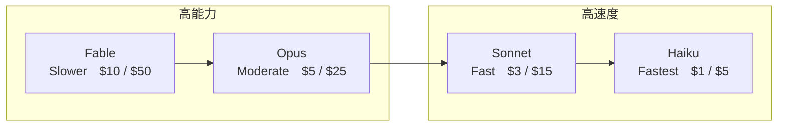

能力が上がるほど遅くなり、コストも上がる。Fable が最高能力・最高コスト、Haiku が最高速度・最低コストである。

**入門者の判断指針。** 三段階を即答できるようにする。「大量・低複雑度の作業は Haiku」「速度と品質のバランスが欲しい中規模タスクは Sonnet」「複雑な推論やエージェント型の長時間作業は Opus、さらに最高難度の長時間実行なら Fable」。この階層構造を頭に入れておけば、タスクを見た瞬間に第一候補が決まる。

### Task Statement 3.3: Align model selection with task requirements (cost, speed, quality)（タスク要件に合わせたモデル選択）

> **入門者向けの位置づけ。** ここは押さえるべき核心。モデル選択は「闇雲に最上位を選ぶ」のではなく、タスクの性質に合わせて3段階（Haiku/Sonnet/Opus）を割り当てるビジネス判断。さらに「能力不足のときは昇格」「同じモデルで再試行は無意味」「effort 調整がモデル切り替えより優先」の3原則を押さえる。

モデル階層が分かったら、次は実際のタスクにどう割り当てるかである。公式ガイドは二つの開始アプローチを挙げている。

**Option 1: Haiku から始める。** コスト重視、大容量、低複雑度の作業に適する。プロトタイピング、レイテンシ要件が厳しい場面、コストセンシティブな処理、大量の定型処理が該当する。実装してテストし、能力不足の箇所だけ上の階層に昇格する、という順で進める。

**Option 2: Opus から始める。** 複雑な推論、科学や数学、ニュアンスが必要な理解、精度がコストに勝る作業に適する。高度なコーディングや高自律性エージェント作業が該当する。実装してプロンプトを最適化し、安定したら effort を下げるかモデルを下げる、という順で効率化する [Source: Choosing a model — https://platform.claude.com/docs/en/about-claude/models/choosing-a-model]。

どちらから始めるにせよ、途中で「このモデルでは足りない」あるいは「このモデルでは高すぎる」という調整が発生する。ここで効いてくるのが **effort パラメータ** である。

effort パラメータは、一つのモデルの中で「どれだけ深く考えるか」を調整する仕組みである。Opus/Sonnet では、知能とレイテンシ・コストを effort で交換できる。Opus 4.8 では全サーフェス（API、Claude Code、claude.ai）で `high` がデフォルトであり、コーディングや高自律性作業では `xhigh`（high と max の中間）が推奨される。

公式ガイドは「モデルを切り替えるより effort を調整する方がしばしば優れたレバーである」と述べている [Source: Choosing a model — https://platform.claude.com/docs/en/about-claude/models/choosing-a-model]。つまり「Sonnet では足りない、Opus では高すぎる」という場面でも、まず effort を上げ下げして覆せる。モデルを切り替えるのはその次の手段である。

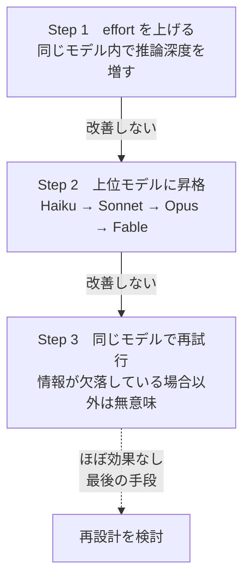

effort 調整が第一、モデル昇格が第二、再試行は最後の手段（ほぼ効果なし）である。

ここで 重要な核心原則を明確にしておく。**能力が足りない場合は、上の階層のモデルに上げるべきである。同じモデルの再実行は改善をもたらさない。** 同じモデルで何度やり直しても、同じ浅さの回答しか返らない。再試行が意味を持つのは「情報が欠落している場合」（つまり必要な情報をプロンプトに足していない場合）だけである。能力の問題なら昇格、情報の問題なら補充、と原因を見極めて正しい対処を選ぶ。

逆に、コストを下げたい場合の罠も押さえる。「コストを下げたいから機能をオフにする」は誤答である。機能を無効にしても、モデルのコスト、速度、能力のトレードオフそのものは変わらない。機能のオンオフは能力を変えない。正しいアプローチは「タスクに合った低コストモデルに切り替える」ことである。プラットフォームを切り替えても同じで、トレードオフは解決しない。

effort 調整とモデル切り替えの関係を整理すると、次の判断フローになる。

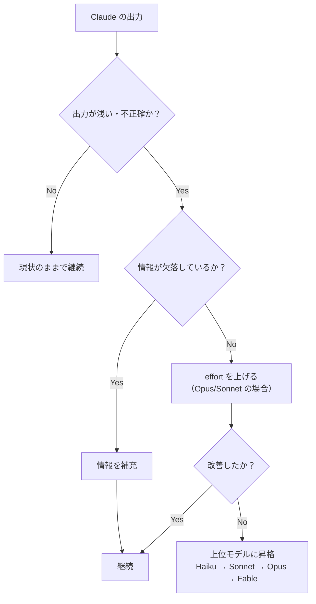

同じモデルでの再試行は、どの分岐でも選ばない。

昇格・降格を判断するときは、感覚ではなく実測に基づくべきである。公式ガイドは次の順を推奨する。ユースケース固有のベンチマークテストを作る、実際のプロンプトとデータでテストする、モデル間で精度・品質・エッジケース処理を比較する、パフォーマンスとコストのトレードオフを秤にかける。この手順を踏めば、「なんとなく Opus の方が良さそう」という思い込みを排除できる。

**入門者の判断指針。** 出力が浅い、不正確、指示を理解しきれていないと感じたら、まず effort を上げる（Opus/Sonnet の場合）。それでも足りなければ上位モデルに昇格する。同じモデルでの再試行を繰り返さない。逆に、コストを下げたいなら機能をオフにするのではなく、タスクに見合った低コストモデルに切り替える。

### Task Statement 3.4: Understand and manage context limitations and memory considerations（コンテキストの制限とメモリの理解・管理）

> **入門者向けの位置づけ。** コンテキストウィンドウは Claude の「短期記憶」。大きさ（200k〜1M）だけではなく、長くなると精度が落ちる（context rot）こと、そして長くなりすぎたときにどう対処するか（圧縮・再開・永続化）を問う。用語定義を確実に押さえること。

モデルと機能を選んでも、もう一つ管理すべきものがある。それがコンテキストである。**コンテキストウィンドウ**とは、モデルが応答を生成する際に参照できる全テキストのことである。これはモデルの学習データではなく、その1回のリクエストでの「作業記憶」にあたる。システムプロンプト、過去の全メッセージ、ツール定義、ツール結果、画像、そしてそのターンで生成される出力と思考トークンすべてがこの枠を消費する。

コンテキストウィンドウの大きさは、Haiku が 200k、Sonnet/Opus/Fable が 1M である。入力だけでこの枠を超えると、API は "prompt is too long" のエラーを返す [Source: Context windows — https://platform.claude.com/docs/en/build-with-claude/context-windows]。

しかし、ここには罠がある。「窓が広いから大丈夫」という考えである。1M トークンが入るからといって、1M トークン詰め込めばよいわけではない。トークン数が増えると、精度と再現率が落ちる。この現象を**コンテキストの劣化（context rot）**と呼ぶ。トークンが増えるほど、中央付近の情報を見落としやすくなる。

公式ガイドは「context の中身を何にするかが、空き容量と同じくらい重要」と強調する [Source: Context windows — https://platform.claude.com/docs/en/build-with-claude/context-windows]。つまり関係ない情報を削ることが性能向上に直結する。ウィンドウの大きさと同じくらい、中身の取捨選択が重要なのである。

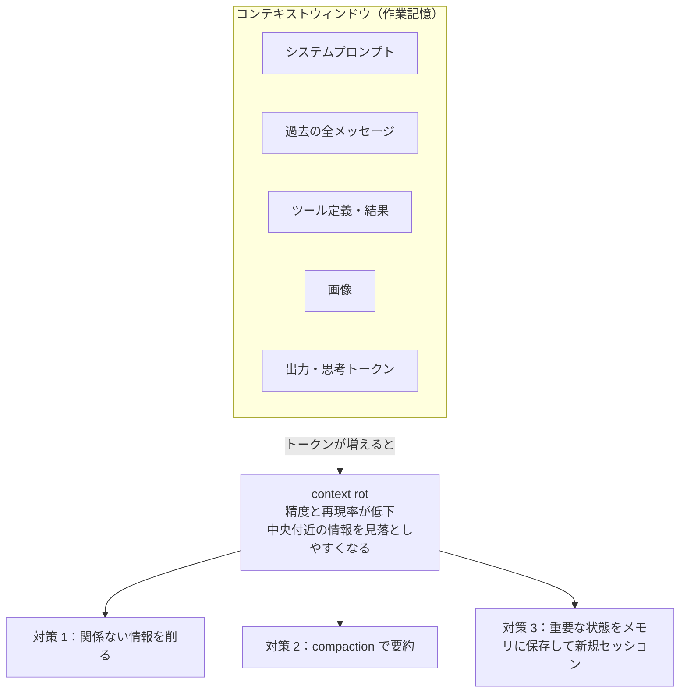

コンテキストが長くなりすぎたときの対処法は三段階ある。

第一に、関係ない情報を削る。これだけで性能が向上する。第二に、**圧縮（compaction）** を使う。会話がコンテキストウィンドウの上限に近づいたとき、サーバー側が自動的に古い対話を要約して空きを作る。会話を切らずに継続できる。compaction は Claude Fable 5、Opus 4.8、Opus 4.7、Opus 4.6、Sonnet 5、Sonnet 4.6 で利用可能（ベータ）である [Source: Compaction — https://platform.claude.com/docs/en/build-with-claude/compaction]。第三に、重要な状態をメモリに保存して新規セッションで再開する。

これら三つの対処法の使い分けを整理する。

| 対処法 | 何时使うか | 効果 |
|--------|-----------|------|
| 情報を削る | 不要なやり取りが混在している | 即座に性能向上 |
| compaction | 長いマルチターン対話を継続したい | 会話を切らずに空きを作る |
| 新規セッション再開 | 会話全体が劣化し、主要な状態だけ残したい | クリーンな状態で再出発 |

圧縮以外にも、エージェントワークフロー向けの特殊な戦略が二つある。一つは**ツール結果のクリアリング**で、エージェントが複数回ツールを呼ぶと古いツール結果が蓄積するため、もう参照しない結果を削除して空きを作る。もう一つは**思考ブロックのクリアリング**で、拡張思考（extended thinking）の生成時には思考トークンもコンテキストを消費するため、前のターンの思考ブロックを必要に応じて明示的に削除する。

一部のモデルには**コンテキスト認識（context awareness）**という機能もある。モデルが自身の残りトークン予算を追跡する仕組みで、Sonnet 5、Sonnet 4.6、Sonnet 4.5、Haiku 4.5 が対応する。API が自動で残り容量をシステムプロンプトに注入するため、ユーザーが設定する必要はない。この機能を前提に、コンテキストが尽きる前に主要な状態（決定事項、進捗、前提条件）をメモリやファイルに保存しておくと、新しいセッションに移っても文脈を引き継げる [Source: Context windows — https://platform.claude.com/docs/en/build-with-claude/context-windows]。

**入門者の判断指針。** 会話が長くなって応答の質が落ちてきたら、それが context rot の兆候である。まず不要な過去のやり取りを削る。それでも足りなければ compaction で要約する。それでも足りなければ、重要な状態をメモリに保存して新規セッションで再開する。長い対話をそのまま永続させるのではなく、価値のある情報だけをメモリに書き出すのが正しい使い方である。

> **陥りやすい罠。** モデル選択は「タスクの複雑さ・推論深度」と「許容コスト・ターンアラウンド」だけを基準にする。直前のタスクで使っていた、別タブで開いていた、ログイン状態、リリースの新しさで選ぶのは誤答。軽量ティア（Haiku）は単純、大量、高頻度の作業、重量ティア（Opus/Fable）はミスが重大な複雑推論、中位（Sonnet）は日常のニュアンス作業に向く。プロダクト機能も同様で、継続的に編集する成長する成果物には Artifacts、一回限りの即時回答にはチャット返信、再利用する参照文書には Project のナレッジ、外部情報の多段調査には Research mode を選ぶ。長時間の会話で指示忘れや矛盾が出たら、新規会話に切り替えて必要な資料だけ持ち越す。

**出典（Domain 3）:**
- Models overview — https://platform.claude.com/docs/en/about-claude/models/overview
- Choosing the right model — https://platform.claude.com/docs/en/about-claude/models/choosing-a-model
- Context windows — https://platform.claude.com/docs/en/build-with-claude/context-windows
- Compaction — https://platform.claude.com/docs/en/build-with-claude/compaction
- Agent Skills overview — https://platform.claude.com/docs/en/agents-and-tools/agent-skills/overview
- Code execution tool — https://platform.claude.com/docs/en/agents-and-tools/tool-use/code-execution-tool
- Using agent memory — https://platform.claude.com/docs/en/managed-agents/memory
- Effective context engineering — https://www.anthropic.com/engineering/effective-context-engineering-for-ai-agents
- Claude for work — https://www.anthropic.com/learn/claude-for-work

---

## Domain 4: Workflow Integration and Solution Design（ワークフロー統合とソリューション設計）

### Task Statement 4.1: Apply Claude to analyze requirements and use cases（要件とユースケースの分析）

**知識：**
- Claude for work ラーニングハブが、ユースケース発見のための部門別ガイド（Engineering、HR、Marketing、Product Management、Sales）を提供する
- エンタープライズ AI 診断の手法。構築の前にユースケースを浮かび上がらせて優先順位をつける

**スキル：**
- ビジネスプロセスを分析し、Claude が価値を加える場所を見つける
- 部門別ガイドを使い、機能別ワークフローに Claude を対応づける
- 影響度と実現可能性でユースケースを優先順位づける

### Task Statement 4.2: Leverage Claude for research, planning, and process optimization（リサーチ、計画、プロセス最適化）

**知識：**
- エージェント型の複数ソース検索としての Research mode。計画向けの分析ツールと Google Docs 連携
- シンプルで組み合わせ可能なパターン。ワークフロー（定義済みのパスで LLM を指揮、予測性が高い）とエージェント（自律的にプロセスを方向づける、柔軟性が高い）
- ワークフローパターン。プロンプトチェーン（逐次サブタスク）、ルーティング（分類して振り分け、例: 易しいものは Haiku、難しいものは Sonnet）、並列化（セクショニングと投票）

**スキル：**
- 計画やプロセス最適化に Research と分析ツールを使う
- 問題を解く最もシンプルな組み合わせ可能パターンを選ぶ
- 多段階プロセスの最適化にルーティングとチェーンを適用する

### Task Statement 4.3: Use Claude to support solution design, development, and iteration（ソリューションの設計、開発、反復）

**知識：**
- 最も成功する Claude 実装はシンプルに始まる。直接的なプロンプトとビルトインの製品機能から出発し、必要性が裏付けられたときだけ複雑さを加える
- 定義された成功基準に対してプロンプトや設定を反復する方が、一発で完璧を目指すより良い結果になる
- ワークフローを丸ごと置き換えるより、Claude を既存のツールやナレッジソースと組み合わせる方が、通例は最も効果的である

**スキル：**
- フィードバックと定義された成功基準を使って、Claude 支援のソリューションを反復する
- 効果が確認できた最もシンプルなアプローチから始め、裏付けがあって初めて複雑さを加える
- ワークフローをゼロから作り直すのではなく、Claude を既存のツールやナレッジと組み合わせる

### Task Statement 4.4: Integrate Claude into existing workflows to augment or redesign them（既存ワークフローへの統合、補強か再設計か）

**知識：**
- 補強と再設計の判断。既存のツール（GitHub、Google Docs、コネクタ）をつなぐか、ワークフローを作り直すか
- ツールと連携。GitHub、Google Docs、分析ツール、Research、Projects、Artifacts、Skills。チームはワークフローを置き換えずにツールをつなげる

**スキル：**
- 与えられたワークフローを補強するか再設計するかを判断する
- 連携とコネクタで Claude を既存ツールにつなぐ

### Task Statement 4.5: Communicate Claude's value and limitations to stakeholders（ステークホルダーへの価値と限界の伝達）

**知識：**
- ステークホルダー通信を裏づける定量化成果（例: Slack で 1 ユーザーあたり週 97 分の節約、Lyft でサポート時間 87% 削減、Moody's でクレジットメモ作成を 40 時間から 2 分に短縮） [Source: Claude enterprise solutions — https://claude.com/solutions/enterprise]
- 通信パターン。成果を定量化し、AI を置き換えではなく補強として枠取り、コストに透明であり、浮いた能力をリスキリングに再投資する
- 限界（コスト、ドリフト、人間の監視の必要性）は価値と併せて伝える

**スキル：**
- Claude の価値を定量化してステークホルダーに提示する
- AI を、能力をより価値の高い仕事に振り向ける補強として枠取りする
- コスト、限界、監視の必要性に透明である

**出典（Domain 4）:**
- Claude for work — https://www.anthropic.com/learn/claude-for-work
- Anthropic Academy — https://www.anthropic.com/learn
- Building effective agents — https://www.anthropic.com/engineering/building-effective-agents
- Advantage Solutions — https://www.anthropic.com/customers/advantage-solutions
- Cox Communications — https://www.anthropic.com/customers/cox-and-accenture
- LG CNS — https://www.anthropic.com/customers/lg-cns
- Brainlabs — https://www.anthropic.com/customers/brainlabs
- Enterprise solutions — https://claude.com/solutions/enterprise

---

## Domain 5: Configuration and Knowledge Management（設定とナレッジ管理）

Domain 4 では「複数の機能をどう組み合わせて一つのワークフローにするか」を扱った。Domain 5 は、そのワークフローを支える土台にあたる。Claude に仕事の文脈をどう覚えさせ、どう最新に保つか。具体的には、プロジェクトの構成、コネクタの接続、指示の書き方、そしてナレッジとメモリの維持管理である。CCAO-F では API/SDK の技術詳細ではなく、Claude.ai のプロダクト機能（Projects、コネクタ、Memory、Skills）を実務判断として使いこなす力を問う。

> **入門者向けの位置づけ。** CCA-F（Architect）では API や MCP の技術詳細を問うが、CCAO-F では Claude.ai のプロダクト機能を使って「Claude に仕事の文脈を覚えさせる方法」を実務判断として問う。API/SDK の技術詳細は CCA-F で既に学んだので、ここでは各機能の役割と設定の手順、そして設定の良し悪しが出力にどう響くかに集中する。

> **用語の前提。** 「**プロジェクト**」は Claude.ai の Projects 機能（独自のチャット履歴とナレッジを持つ作業スペース）。「**ナレッジソース**」はプロジェクトに取り込んだファイルと接続したデータの総称。「**コネクタ**」は外部データプロバイダ（Google Drive、Gmail 等）をプロジェクトにリンクする仕組み。「**同期ソース（sync source）**」はコネクタ経由で継続的に同期されるデータソース。

### Domain 5 の構成要素全体像

Domain 5 の4つの Task Statement は、プロジェクトを組み立てて（TS 5.1）、外部データを繋ぎ（TS 5.2）、指示を書き（TS 5.3）、運用しながら維持する（TS 5.4）という一連の流れとして捉えると理解しやすい。

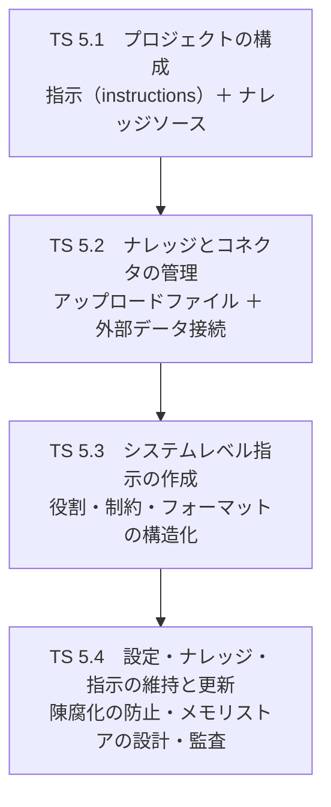

構成して、繋いで、書いて、保つ。この4段階がプロジェクトのライフサイクルである。

### Task Statement 5.1: Configure Claude Projects with instructions and knowledge sources（指示とナレッジソースによるプロジェクト設定）

> **入門者向けの位置づけ。** プロジェクトは Claude.ai で「仕事の文脈」を固定する最基本的な仕組み。指示とナレッジソースという二つの構成要素の違いと、それぞれの品質が出力に直結する理由を押さえること。API の技術詳細は CCA-F で既に学んだので、ここでは「何をどう置くか」の実務判断に絞る。

プロジェクトは、Claude に仕事の文脈を固定する自己完結型の作業スペースである。独立したチャット履歴とナレッジベースを持ち、他のプロジェクトと文脈を共有しない。そのため目的ごと（営業資料作成、研究、週次レポート等）に分けて運用するのが基本である。Free ユーザーは最大5プロジェクト、有料プランでは制限が緩和される。

プロジェクトは二つの構成要素から成る。第一が**指示（instructions）**で、役割、トーン、ルールを定めるシステムレベルのプロンプトである。プロジェクト内のすべてのチャットに共通して適用される「Claude への基本設定」と言える。第二が**ナレッジソース（knowledge sources）**で、アップロードしたファイルと接続したデータの総称である。Claude が応答の根拠として参照する「資料」にあたる。この二つを分けて考えるのが、プロジェクト設計の出発点である。

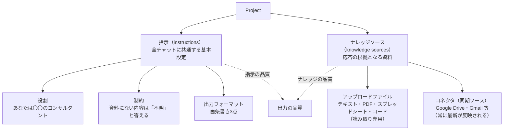

アップロードされたファイルは、Claude の応答の根拠となる読み取り専用のプロジェクトナレッジとして保存される。テキスト、PDF、スプレッドシート、コードなどを含む。Claude は推測ではなく文書内容に基づいた回答を返すため、根拠のない応答が減る。

ナレッジの量が増えても品質を保つ仕組みがある。有料プラン（Pro/Max/Team/Enterprise）では、ナレッジ量がコンテキスト上限に近づくと **RAG（検索拡張生成）** が自動で有効になり、容量が最大約10倍に拡張される。大量の参照文書をプロジェクトに置いても、Claude が自動で検索して根拠づけるため、応答品質を保てる [Source: What are projects? — https://support.claude.com/en/articles/9517075-what-are-projects]。

ここで強調すべき原則がある。**指示とナレッジソースの品質が、出力の品質を決める。** 曖昧な指示や不適切な資料からは、精度の低い回答しか出ない。プロジェクトの設定画面で「Project instructions」欄に指示を記述し、「Files」セクションから資料を追加するという手順自体は簡単だが、そこに何を書き、何を置くかが成果を左右する。繰り返す作業（週次レポート等）に必要なテンプレートや過去の成果物を常時マウントしておくと、毎回文脈を説明する手間が省ける。ただし、一つのプロジェクトに矛盾する資料を混在させると、Claude がどちらを根拠にすべきか判断できず、出力が不安定になる。

**入門者の判断指針。** プロジェクトを作るときは、まず「指示」と「ナレッジソース」を分けて考える。指示には役割、制約、出力フォーマットを書く。ナレッジソースには、そのプロジェクトの目的に直接関係する資料だけを置く。目的が違うなら別プロジェクトに分ける。一つのプロジェクトに詰め込みすぎないことが、精度を保つ基本である。

### Task Statement 5.2: Manage uploaded knowledge and connectors (e.g., Google Drive, Gmail)（アップロードしたナレッジとコネクタの管理）

> **入門者向けの位置づけ。** コネクタは外部データをプロジェクトに取り込む仕組み。ここは押さえるべき核心で「コネクタのスコープを絞り込む」判断が正答の鍵になる。同期ソースとアップロードファイルの違い、コネクタのアクセス権限、そしてスコープを広げすぎたときの弊害を確実に押さえる。

ナレッジソースには二種類ある。一つはアップロードファイルで、プロジェクトに取り込んだ時点の内容が固定される「静的な資料」である。もう一つはコネクタ経由の**同期ソース（sync source）**で、外部データプロバイダから継続的に同期される「常に最新が反映される生きた資料」である。対応するプロバイダは、Google Drive、Gmail、GitHub、Slack、Salesforce、Google Calendar、Asana、Outline、MCP resources など多岐にわたる。

コネクタは、外部のデータソースをプロジェクトにリンクし、Claude がその内容を参照できるようにする。アクセスはユーザー自身の権限に準ずる。Google Drive で閲覧権限のないファイルは、コネクタを通しても読めない。Claude は明示的に求められたときだけデータにアクセスし、必要最小限の情報を取得する。

Google Workspace コネクタ（Gmail、Google Calendar、Google Drive）は全ユーザーが利用できる。各コネクタでできることを整理する。

| コネクタ | できること | できないこと |
|---------|-----------|-------------|
| **Gmail** | メールの検索、読取、下書き作成 | 送信 |
| **Google Calendar** | 予定の確認、作成 | （予定の削除は制限あり） |
| **Google Drive** | Docs、Sheets、Slides、PDF の読み取り | 編集 |

応答には参照元への引用（リンク付き）が含まれ、出所を追跡できる [Source: Use Google Workspace connectors — https://support.claude.com/en/articles/10166901-use-google-workspace-connectors]。

チーム運用ではガバナンスの仕組みも押さえておく。Team および Enterprise では、Owner または Primary Owner が組織レベルでコネクタを有効化しないと、個々のユーザーは認証できない。データガバナンスを一元管理する仕組みである。また、同期コネクタのプロジェクト追加は**プライベートプロジェクトのみ**で有効で、共有プロジェクトでは無効になる点に注意する。

ここで 重要な核心的な判断を明確にする。**コネクタのスコープは必要最小限に絞る。** 「共有ドライブ全体を接続して、指示で無視させる」という設計は確実でない。無関係なファイルが検索対象に混じり、精度が下がるからである。この関係を対比図で示す。

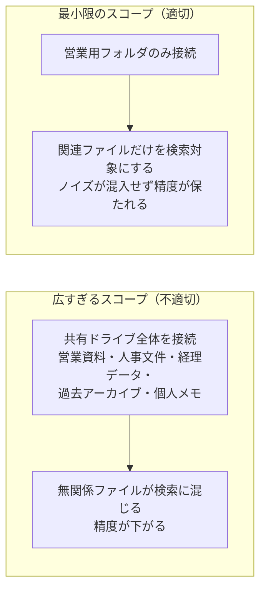

実務の手順を述べる。チャット入力欄の「+」ボタンから「Connectors」を選び、対象プロバイダをオンにする。初回は OAuth 認証が走る。標準コネクタがカバーしない外部ツールや社内システムには、MCP（Model Context Protocol）コネクタという汎用仕組みを使う（MCP の技術詳細は CCA-F で学んだ領域なので、アソシエイトでは「MCP コネクタで外部ツールを繋げる」と理解すれば十分である）。

**入門者の判断指針。** コネクタを追加するときは「このプロジェクトで本当に必要なフォルダやスレッドはどれか」を自問する。共有ドライブ全体や受信トレイ全体ではなく、特定のフォルダやラベルに絞る。不要なコネクタを放置すると、関連しないデータが検索対象に混ざり、精度が下がる。使わなくなったコネクタは早めに切る。

### Task Statement 5.3: Create effective system-level instructions（効果的なシステムレベル指示の作成）

> **入門者向けの位置づけ。** ここは押さえるべき核心。「指示は長文1段落に詰め込むと中間が無視される」「出典を限定しないと推測が混じる」という二つの罠を確実に押さえる。XML タグによる構造化と「データ上・問い下」の配置原則を実務手順として体感しておく。

システムプロンプトは、Claude に「このプロジェクトではどう振る舞うべきか」を教える基本設定である。プロンプトは明確かつ直接的に書き、構造化に XML タグを使い、Claude に役割を与える。そして硬すぎず緩すぎない**適切な高度さ**を保つ。適切な高度さとは、専門用語を避けて幼稚にするのではなく、文脈なしで判断できる精度を指す。

実用的な品質判定基準がある。**ゴールデンルール**と呼ばれるもので、最小限の文脈しか与えない同僚にプロンプトを見せ、その同僚が戸惑うなら Claude も戸惑う、という基準である。第三者視点の分かりやすさが、プロンプト品質の実用的な判定基準になる。

プロジェクト指示は「役割、制約、出力フォーマット」の三要素を押さえる。役割を与えると、Claude の挙動とトーンがその用途に集中する。一文でも効果がある。制約は「資料にない内容は推測せず『不明』と答える」のように、Claude の判断の境界を定める。出力フォーマットは「箇条書き3点」のように、成果物の形を指定する。この三要素を XML タグで区分して書くと、Claude が各要素を確実に認識する。

ここで 重要な核心を突く対比を示す。**長文1段落に複数ルールを詰め込むと、中間が無視される。** 悪い指示と良い指示の違いである。

```
 ┌───────────────────────────────────────────────────────┐
 │      悪い指示 vs 良い指示（構造化の対比）              │
 ├───────────────────────────────────────────────────────┤
 │                                                       │
 │  ✕ 悪い指示（長文1段落）                              │
 │  ┌─────────────────────────────────────────┐         │
 │  │ あなたは営業コンサルタントです。簡潔に  │         │
 │  │ 答えてください。資料にないことは推測    │         │
 │  │ しないでください。トーンは丁寧に。      │         │
 │  │ ただし網羅的に。3点の箇条書きで。       │         │
 │  │ 過去のデータも参考にしてください。      │         │
 │  └─────────────────────────────────────────┘         │
 │  → 中央のルールが埋もれ、矛盾（簡潔＋網羅）が未解決   │
 │                                                       │
 │  ◎ 良い指示（XML タグでトピック別）                   │
 │  ┌─────────────────────────────────────────┐         │
 │  │ <role>営業コンサルタント</role>          │         │
 │  │ <constraints>                            │         │
 │  │  ・資料にない内容は「不明」と答える      │         │
 │  │  ・過去データは参照してよい              │         │
 │  │ </constraints>                           │         │
 │  │ <format>箇条書き3点、丁寧なトーン</format>│        │
 │  │ <priority>簡潔さを優先。網羅性は3点以内 │         │
 │  │  で収まらない場合のみ</priority>         │         │
 │  └─────────────────────────────────────────┘         │
 │  → 各ルールが独立し、矛盾に優先順位が明記される       │
 │                                                       │
 └───────────────────────────────────────────────────────┘
```

この対比が示すように、矛盾する指示（「簡潔に」と「網羅的に」）には、優先順位や例外条件を明記する。構造化されていない指示では、Claude がどちらを優先すべきか判断できず、出力がブレる。

長文コンテキストやナレッジ集中タスク（20k トークン超）では、配置にも注意が要る。長文データを上部に、問いを末尾に置くと品質が向上する。この「データ上・問い下」の原則は、公式のプロンプトガイドで報告されている効果である [Source: Prompting best practices — https://platform.claude.com/docs/en/build-with-claude/prompt-engineering/claude-prompting-best-practices]。文書内容は XML タグ（`<document>`、`<document_content>`、`<source>` 等）で構造化する。複数文書がある場合は各々をタグで囲み、内容と出所を明示する。

出力を安定して誘導するには、例（few-shot）を使う。3〜5個の例を `<example>` タグ（複数なら `<examples>`）で囲む。実際の用途に近く、エッジケースを含む多様な例を選ぶと、出力のフォーマット、トーン、構造が安定する。

ここで、ナレッジソースを置くだけでは不十分な理由を述べる。参照資料をアップロードしても「その資料だけを見て、載っていないことは『分からない』と答えよ」と出典を限定しなければ、Claude が一般知識で補完してしまう。資料の信頼性を保つには、指示で出典を明示的に限定する必要がある。

**入門者の判断指針。** 指示は長文1段落にせず、トピックごとにセクションを分けて XML タグで構造化する。役割、制約、出力フォーマットの三要素を必ず置く。矛盾する要求には優先順位を明記する。参照資料をアップロードしたら、指示で「その資料だけを根拠とし、載っていないことは『不明』と答える」と出典を限定する。

### Task Statement 5.4: Inform, maintain, and update Claude configurations, knowledge sources, and instructions（設定・ナレッジ・指示の維持と更新）

> **入門者向けの位置づけ。** 設計したプロジェクトは、放置すると陳腐化する。ナレッジの古い版が残ったままになったり、スコープが広がりすぎて精度が落ちたりする。ここは押さえるべき核心で「ナレッジ陳腐化のサイクル」と「メモリストアの設計原則」を確実に押さえる。API/SDK の技術詳細は CCA-F で学んだので、ここでは「何をどう維持するか」の実務判断に絞る。

プロジェクトを一度設定すれば終わりではない。ナレッジは時間が経つと陳腐化する。価格表が変わる、ポリシーが改定される、フォルダ構成が再編される。放置すると、Claude が古い情報を根拠に応答するようになり、出力の信頼性が徐々に下がる。このサイクルを図で示す。

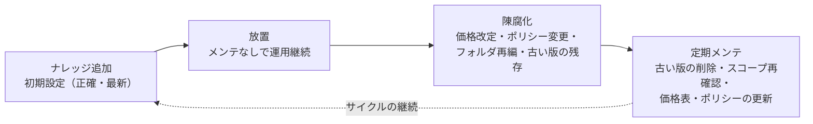

放置段階が長いほど、陳腐化の被害が大きくなる。

このサイクルを断ち切るには、定期的なメンテナンスが欠かせない。具体的には、古い版のアーカイブまたは削除、フォルダ再編後のスコープ再確認、価格表やポリシーの定期更新である。メンテナンスを怠ると、Claude が古い情報と新しい情報を同時に参照し、矛盾した応答を生成する。

メモリの管理にも設計原則がある。**メモリストア**は、セッションをまたいで情報を保持する仕組みである。ユーザー設定、プロジェクト規約、過去の修正、ドメイン知識を保存する。ここで重要なのは、一つの巨大な汎用ストアを作らないことである。目的ごと（ユーザー別、共有知識別、プロジェクト別）に小さく絞ったストアに分けるのが基本設計である。

| メモリストア設計原則 | 内容 |
|---------------------|------|
| 目的ごとに絞る | ユーザー別、共有知識別、プロジェクト別に分割 |
| 満杯前に整理 | 上限に近づいたら古いメモリを削除・圧縮 |
| スコープ拡張時 | 新しいストアを追加し、元は読み取り専用で残す |
| 書き込み制限 | 信頼できない入力は `read_only` に指定 |

アクセス権の設計は、セキュリティ上とくに重要である。信頼できない入力（ユーザーのプロンプト、取得した Web 内容、外部ツール出力）を処理する場合は `read_only` アクセスを指定し、悪意ある内容がストアに書き込まれるリスクを防ぐ。参照専用資料は `read_only`、新しい記憶を追加するセッションだけ `read_write` にするのが基本設計である [Source: Using agent memory — https://platform.claude.com/docs/en/managed-agents/memory]。

メモリには監査の仕組みもある。**メモリのバージョン**は監査トレールを提供し、30 日間保持される。変更は不変の「バージョン」として記録され、誰が何をいつ変更したかを追跡できる。コンプライアンス向けの **redact（秘匿）機能**は、履歴バージョンから秘密情報を削除しつつ、監査トレールは保持する。秘密鍵の消去や削除要求等に対応する仕組みである。

Skills の管理もこの領域に入る。Skill は指示、メタデータ、リソースをまとめたモジュール単位の機能拡張で、`SKILL.md` と YAML フロントマター（`name`、`description`）で構成される。Skills には **段階的読み込み（progressive disclosure）** の仕組みがある。Level 1（メタデータ、起動時に常時読み込み、約100トークン）から Level 2（SKILL.md 本文、トリガ時に読み込み、5k トークン未満）を経て Level 3（リソース、スクリプト、必要時のみ）へと段階的に読み込む。この仕組みがあるため、多数の Skill をインストールしても未使用時のコンテキスト消費を最小化できる。Skill の `description` には「何をするか」と「いつ使うか」の両方を書く。Claude はこの記述を見て Skill の使用可否を判断するからである [Source: Agent Skills overview — https://platform.claude.com/docs/en/agents-and-tools/agent-skills/overview]。

Skill は Claude に新しい能力を与えるため、セキュリティにも配慮が要る。悪意ある Skill は意図しない操作を実行しうる。信頼できるソース（自作または Anthropic 提供）のみを使い、徹底的に監査する。スコープや要件が変わったら、Skills と指示を更新する。新しい作業パターンが定着したら Skill 化し、不要になった Skill は無効化する。

Domain 5 で扱うプロダクト機能は、それぞれ「何を永続化するか」が違う。この違いを整理しておくと、適材適所の判断がしやすなる。

| 機能 | 何を永続化するか | 保持期間 |
|------|-----------------|---------|
| **Project** | 指示とナレッジソース（ファイル＋コネクタ） | プロジェクトの存続中 |
| **Artifact** | 独立パネルで編集する成果物 | セッションをまたいで再利用可 |
| **Memory** | セッション間で再利用すべき事実 | 半永続（ストアで管理） |
| **Skill** | モジュール化された専門知識と手順 | インストール中常駐 |

**入門者の判断指針。** ナレッジは放置すると陳腐化する。定期的に古い版を削除し、スコープを再確認し、価格表やポリシーを更新する。メモリストアは目的ごとに小さく絞り、信頼できない入力には `read_only` を指定する。監査トレールは30日間保持されるので、定期的にバージョン履歴を確認し、秘密情報の混入は redact で削除する。Skills は信頼できるソースのみを使い、使わなくなったら早めに無効化する。

> **陥りやすい罠。** コネクタは必要最小限のフォルダやスレッドに絞る。「共有ドライブ全体を接続して指示で無視させる」は確実でなく、無関係ファイルが参照に混じる。ナレッジは放置すると陳腐化する（古い版のアーカイブや削除、フォルダ再編後のスコープ再確認、価格表やポリシーの定期更新）。指示は長文1段落に複数ルールを詰め込むと中間が無視される。トピック別のセクションに構造化する。参照資料をアップロードするだけでは不十分で、「その資料だけを見て、載っていないことは『分からない』と答えよ」と出典を限定する。矛盾する指示（「簡潔に」と「網羅的に」）には優先順位や例外条件を明記する。

**出典（Domain 5）:**
- Using agent memory — https://platform.claude.com/docs/en/managed-agents/memory
- Adding files to Managed Agents — https://platform.claude.com/docs/en/managed-agents/files
- MCP connector — https://platform.claude.com/docs/en/agents-and-tools/mcp-connector
- Compliance activities (sync sources) — https://platform.claude.com/docs/en/api/compliance/activities
- Agent Skills overview — https://platform.claude.com/docs/en/agents-and-tools/agent-skills/overview
- Prompting best practices — https://platform.claude.com/docs/en/build-with-claude/prompt-engineering/claude-prompting-best-practices
- What are projects? — https://support.claude.com/en/articles/9517075-what-are-projects
- Use Google Workspace connectors — https://support.claude.com/en/articles/10166901-use-google-workspace-connectors

---

## Domain 6: Governance, Risk, and Responsible Use（ガバナンス・リスク・責任ある利用）

Domain 5 では「プロジェクトの設定とナレッジ管理」を扱った。Domain 6 はその前提となる問いに向き合う。このデータを Claude に預けてよいか。このユースケースは規制上の要件を満たすか。提案された利用は倫理的に許容されるか。CCAO-F では API のセキュリティ実装ではなく、ビジネスユーザーとしての責任ある利用判断を問う。技術的なセキュリティ統合は CCA-F で既に学んだ。ここでは AUP（利用ポリシー）の三層構造、商用と消費者のデータ取り扱いの違い、データ保持期間、そして開発元の安全ガバナンス（RSP・PBC・LTBT）と Claude の倫理的原則（憲法）を、判断の材料として整理する。

> **入門者向けの位置づけ。** CCA-F（Architect）では API のセキュリティ実装やコンプライアンス統合の技術詳細を問うが、CCAO-F では「ビジネスユーザーとして、このデータを Claude に預けてよいか」「このユースケースは規制上の要件を満たすか」を実務判断として問う。AUP（利用ポリシー）の三層構造（ユニバーサル基準・ハイリスク要件・追加ガイドライン）、商用と消費者の学習の違い、データ保持期間、そして「規制対象の助言は有資格者レビューが必須で Claude の自己チェックは管理策にならない」という核心を押さえること。技術的なセキュリティ実装は CCA-F 既得なので、ここでは「ビジネスユーザーの責任ある利用判断」に集中する。

### Domain 6 の判断対象全体像

Domain 6 の4つの Task Statement は、ユースケースを評価してから開発元のガバナンスと倫理原則に照らすまでの流れとして捉えられる。

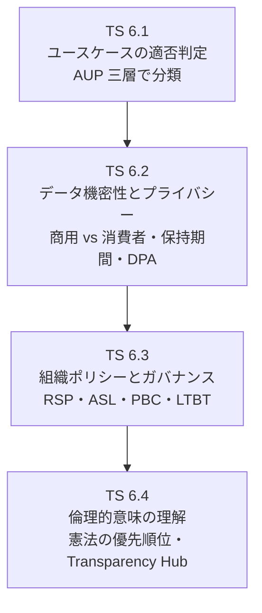

まずユースケースが許容されるかを判定し（TS 6.1）、次に扱うデータの機密性と規制要件を確認し（TS 6.2）、開発元と自社のガバナンス基準を照らし合わせ（TS 6.3）、最後に倫理的原則で総合的に判断する（TS 6.4）。

### Task Statement 6.1: Identify appropriate and inappropriate use cases（適切・不適切なユースケースの識別）

> **入門者向けの位置づけ。** AUP は「誰もが守る共通の禁止事項（ユニバーサル）」「個人の権利に影響する領域の追加要件（ハイリスク）」「特定プロダクト形態の追加ガイドライン」の三層構造を持つ。提案されたユースケースがどの層に当たるかを分類するのが最初の判断。重要な核心「規制対象の助言は有資格者レビュー必須、Claude の自己チェックは代わりにならない」は、このハイリスク要件の層に出題される。

提案されたユースケースが Claude で許容されるかを判定する最初の手がかりは、**利用ポリシー（Acceptable Use Policy、AUP）** である [Source: Usage Policy — https://www.anthropic.com/legal/aup]。AUP は三層構造で書かれている。第一層は全ユーザー・全用途に適用される共通の禁止事項（Universal Usage Standards）。第二層は公共の福祉と社会的公正に影響する領域への追加要件（High-Risk Use Case Requirements）。第三層は特定のプロダクト形態への追加ガイドライン（Additional Use Case Guidelines）。提案されたユースケースを見たら、まずこの三層のどれに当たるかを分類する。

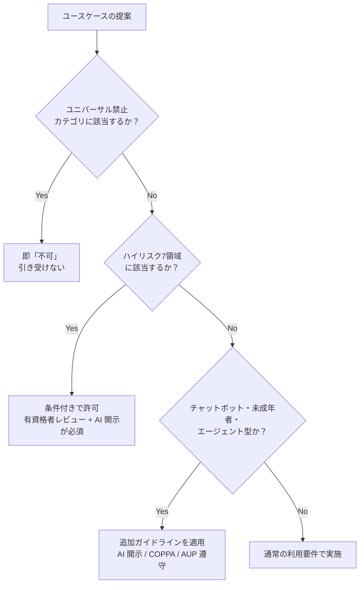

第一層のユニバーサル利用基準は、条件付きではなく「やってはならない」行為のリストである。禁止カテゴリは八つの群に整理できる。

| 群 | 代表例 |
|----|--------|
| 違法行為 | 法令違反を助長する利用全般 |
| 重大な危害 | 武器、CBRN、暴力扇動、CSAM |
| プライバシー侵害 | 同意なき個人情報の収集・処理 |
| 虚偽情報・民主主義への妨害 | 選挙操作、偽の本人偽装、虚偽キャンペーン |
| 監視・予測捜査・犯罪司法 | 顔認識、感情認識、同意なき位置追跡、信用度評価 |
| 詐欺・搾取 | 詐欺的コンテンツ、搾取的行為 |
| プラットフォーム悪用 | 脱獄、蒸留、スクレイピング |
| 性的に露骨なコンテンツ | わいせつコンテンツの生成 |

「監視や予測捜査」には、同意なき位置や感情の追跡、顔認識、信用度評価、感情認識システムが含まれる。これらは技術的に可能でも AUP で禁止されている。

第二層のハイリスク要件は、主観的な意思決定が個人や消費者に直接影響する領域を指定する。AUP は「個人の権利・生活・財産に影響する場面」に限りヒューマンインザループを要求する。社内の資料作成や分析は通常この層に当たらない。該当するのは七つの領域である。

| ハイリスク領域 | 影響を受けるもの | 代表例 |
|---------------|-----------------|--------|
| Legal | 権利・自由 | 法律解釈、契約書作成 |
| Healthcare | 健康・生命 | 医療診断、治療方針 |
| Insurance | 金銭・保障 | 保険引受、給付判断 |
| Finance | 金銭・財産 | 融資判断、投資助言 |
| Employment & housing | 機会・生活 | 採用、昇進、入居審査 |
| Academic testing | 機会・公正 | 入試、資格試験 |
| Media / journalism | 名誉・社会 | 報道、記事執筆 |

七つの領域は「個人の生活や権利に直接影響する領域」として一つの群で覚えるとよい。法律解釈、医療診断、保険引受、融資判断、採用・入試、報道が該当する。ただしウェルネス助言（睡眠、ストレス、栄養、運動）は Healthcare に含まれない点に注意が必要である。

ハイリスク領域は条件付きで許可されるが、二つの追加義務が伴う。第一に **Human-in-the-loop** である。その分野の有資格の専門家が、普及・最終決定前に内容をレビューしなければならない。第二に **開示** である。モデルの出力を個人や消費者に直接提示する場合、AI を使ったことを伝える。開示は最低限「セッションの開始時」に行う。

ここで最も重要な原則がある。ハイリスク領域では Claude に自己検証させてはならない。Claude に「この医療情報は正しいか」「この投資助言は顧客のリスク許容度に合うか」と聞き返して安心するのは、レビューの代わりにならない。資格を持つ人間が確認する。これは 重要な核心概念と同じ原理である。自己申告の自信は精度の信頼できるシグナルではない（Domain 2 で詳述）。だからこそ、Claude 自身が自信を持っても、有資格者の確認が不可欠なのである。

第三層の追加ガイドラインは、ハイリスクかどうかにかかわらず、特定のプロダクト形態に適用される要件である。三つの代表的な形態を押さえる。

第一に **チャットボット開示** である。消費者向けのチャットボットは、ユーザーが AI とやり取りしていることを開示しなければならない。開示は最低限セッションの開始時に行う。AI であることを隠してはならない。これは人間のふりをすること（impersonation）を禁じるユニバーサル基準とも整合する。

第二に **未成年者向けプロダクト** である。未成年者（18歳未満）に直接アクセスさせるプロダクトは、年齢確認、コンテンツモデレーション、**COPPA（Children's Online Privacy Protection Act）** 準拠が必要である。COPPA は13歳未満の児童から収集する個人情報について、親の確認可能な同意を求める米国の連邦法である。未成年者向けプロダクトはこの遵守が追加要件になる [Source: Guidelines for organizations serving minors — https://support.anthropic.com/en/articles/9307344-responsible-use-of-anthropic-s-models-guidelines-for-organizations-serving-minors]。

第三に **エージェント型利用** である。Claude が自律的にツールを使い、複数ステップで行動する用途も AUP に従う。エージェントだからといって禁止事項が緩むことはない。

**入門者の判断指針。** 提案されたユースケースを見たら、まず三層のどれに当たるかを分類する。ユニバーサル禁止（武器、CBRN、CSAM、詐欺、虚偽情報、監視、脱獄等）に当たれば即「不可」である。ハイリスク7領域（Legal、Healthcare、Insurance、Finance、Employment、Academic、Media）に当たれば、有資格者レビューと AI 使用の開示が必須である。それ以外でもチャットボットなら AI 開示、未成年者向けなら COPPA・年齢確認、エージェントなら AUP 遵守を確認する。ハイリスク領域で Claude に「これで大丈夫か」と自己チェックさせるのは、レビューの代わりにならない。

### Task Statement 6.2: Apply data sensitivity, regulatory, and privacy considerations（データ機密性、規制、プライバシーの適用）

> **入門者向けの位置づけ。** ここは押さえるべき核心。「商用アカウント（学習なし）と消費者アカウント（オプトアウト要）の違い」「機密データは匿名化してから、消費者アカウントは使わない」という実務判断を問う。保持期間の数字（30日、5年、2年、7年）と DPA の保護措置（AES-256、TLS 1.2、48時間通知、SCC）を、ビジネスユーザーの判断材料として押さえること。

ユースケースが許容されると分かったら、次に扱うデータの機密性と規制要件を確認する。最初の分岐は「使っている面が商用か消費者か」である。この区別が、データが学習に使われるかどうかを決める。

商用利用規約（Commercial Terms of Service）のセクション B は「Anthropic may not train models on Customer Content from Services」と明記する。つまり商用面（API、Claude for Work 等）では、顧客の入出力は Claude の訓練に使われない [Source: Commercial Terms of Service — https://www.anthropic.com/legal/commercial-terms]。一方、消費者向け（Claude Free/Pro/Max、およびこれらのプランの Claude Code）はデフォルトでモデル改善（学習）に使われる。ユーザーが設定でオプトアウトしない限り、対話内容が学習データになる可能性がある。

| 項目 | 商用面（API・Claude for Work） | 消費者面（Free/Pro/Max） |
|------|-------------------------------|------------------------|
| 学習への使用 | されない（規約で明記） | デフォルトで使用される |
| オプトアウト | 不要（最初から対象外） | 設定でオンにする必要がある |
| 機密データの取扱い | 適している | 適していない |

この違いが実務で効くのは、機密データを扱う場面である。顧客の個人情報や契約情報を消費者アカウントで扱うと、オプトアウト忘れで学習に混入するリスクがある。機密データを扱うときは必ず商用面を使う。これは同じ原理である [Source: How long do you store my data? — https://privacy.anthropic.com/en/articles/10023548-how-long-do-you-store-personal-data]。

データが Claude に預けられた後、どのくらい保持されるかも把握しておく必要がある。保持期間はデータの種類によって異なる。

| データの種類 | 保持期間 |
|-------------|---------|
| 削除された対話 | バックエンドから消えるまで最大30日 |
| 学習に使用されたデータ | 非識別化形式で最大5年 |
| AUP 違反としてフラグされた入出力 | 最大2年（分類スコアは7年） |
| フィードバックデータ | 最大5年 |

Incognito チャットは、モデル改善設定をオンにしていても学習に使われない。一時的に学習対象から外したい対話があるとき、設定変更より手軽な手段である [Source: How long do you store my data? — https://privacy.anthropic.com/en/articles/10023548-how-long-do-you-store-personal-data]。

商用契約には **データ処理付録（Data Processing Addendum、DPA）** が組み込まれる [Source: Data Processing Addendum — https://www.anthropic.com/legal/data-processing-addendum]。DPA は顧客がコントローラー（利用目的を決める主体）、Anthropic がプロセッサー（顧客の指示に従って処理する主体）という役割分担を定める。主要な保護措置を整理する。

| 保護措置 | 内容 |
|---------|------|
| 静止データの暗号化 | AES-256 |
| 転送データの暗号化 | TLS 1.2 以上 |
| セキュリティインシデント通知 | 48時間以内 |
| 契約終了後のデータ削除 | 30日以内 |
| アクセス管理 | RBAC（役割ベースのアクセス制御）と MFA |
| 越境転送の保護 | EU・英国・スイス向け SCC |

**SCC（Standard Contractual Clauses）** は、EU、英国、スイスから米国への個人データ転送に必要な法的保護枠組みである。欧州のデータ保護法を満たす標準契約条項であり、DPA は EU SCC、UK Addendum、Swiss Addendum の三つを組み込んでいる。GDPR 対象のデータを扱う組織には必須の文書である。

Anthropic が保持する主な認定として、SOC 2 Type 2（セキュリティ・可用性・機密性）、ISO/IEC 27001（情報セキュリティ管理）、27017（クラウドセキュリティ）、27018（クラウドプライバシー）、CSA STAR（クラウドセキュリティ認定）、GDPR・HIPAA 準拠がある。リージョン別のデータ居住（data residency）も利用可能であり、規制要件で「データは特定地域に保存しなければならない」組織向けのオプションがある。

機密データを Claude に預ける前の処理は、次のフローで進める。

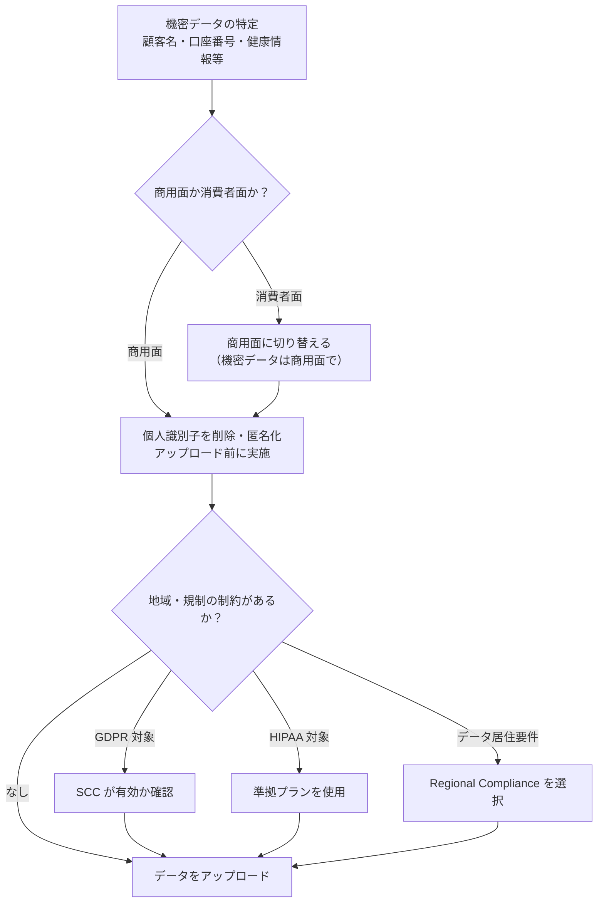

匿名化の基本は、顧客名、口座番号、健康情報などの個人識別子を、アップロード前に削除またはダミー値に置き換えることである。「Claude に保持させない」と指示するだけではポリシーを満たさない。データが既に共有された時点で、指示による制御は効かないからである。組織のデータ分類基準に従って処理する。

**入門者の判断指針。** 機密データを Claude に預ける前に三つを確認する。使っている面が商用（学習なし）か消費者（オプトアウト要）か。機密データなら必ず商用面を使う。個人識別子は削除・匿名化してから預ける。消費者アカウントにそのまま上げない。地域・規制の制約（GDPR、HIPAA）があるなら、SCC や準拠プランが有効か確認する。Claude に「このデータを保持しないで」と指示するだけでは、ポリシー上の管理策にならない。

### Task Statement 6.3: Follow organizational AI policies and governance standards（組織の AI ポリシーとガバナンス基準の遵守）

> **入門者向けの位置づけ。** CCA-F（Architect）では API レベルのセキュリティ統合やコンプライアンス実装の技術詳細を問うが、CCAO-F では「Claude を開発した組織が、安全のために自分自身に課しているルール」を知り、自社のポリシーと照らし合わせる判断を問う。RSP（責任あるスケーリングポリシー）と ASL（AI 安全レベル）の考え方、そして PBC・LTBT という企業統治の形を押さえること。

データの機密性を確認したら、次に開発元のガバナンスと自社のポリシーを照らし合わせる。ビジネスユーザーが知っておくべき開発元のガバナンスは二つある。一つは安全性の技術的枠組み（RSP・ASL）、もう一つは企業統治の構造（PBC・LTBT）である。

**責任あるスケーリングポリシー（Responsible Scaling Policy、RSP）** は、Anthropic が自社のモデルについて「安全性を確認できなければ訓練・展開しない」と誓う社内の枠組みである [Source: Announcing our updated Responsible Scaling Policy — https://www.anthropic.com/news/announcing-our-updated-responsible-scaling-policy]。モデルの能力に応じて求められる安全基準を引き上げる。RSP の核心は比例的保護の原則、つまりリスクに応じて保護を拡大することである。

RSP は **AI Safety Level（ASL）** という段階的な安全基準を定める。バイオセーフティレベルを参考にした体系であり、モデルの能力が上がるほど求められる基準が厳しくなる。

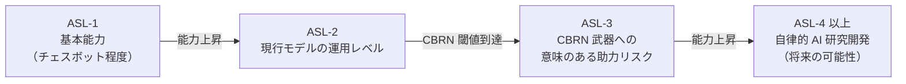

現行の全モデルは ASL-2 で運用される。二つの能力閾値が定義されている。一つは CBRN 武器への意味のある助力であり、ASL-3 基準を要する。もう一つは自律的な AI 研究開発であり、ASL-4 以上の安全基準を要する可能性がある。閾値に達しなければ現行の ASL-2 で展開する。

RSP は AI の破滅的リスク（CBRN 等）に焦点を当てる。日常の有害利用（虚偽情報、詐欺等）は AUP が扱う。RSP と AUP は補完関係にある。

開発元の企業統治も、安全性の構造的証拠として参照できる。Anthropic はデラウェア州法の **公益会社（Public Benefit Corporation、PBC）** として設立された。PBC は株主利益だけでなく、公益目的も法的に追求する義務を持つ企業形態である。安全性と公益性を定款に組み込んでいる。

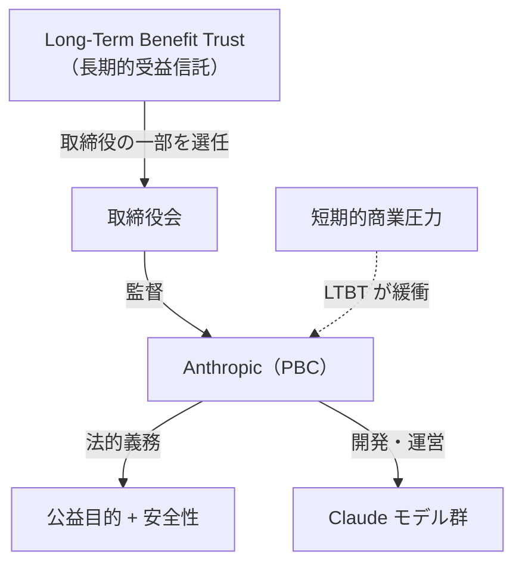

**Long-Term Benefit Trust（LTBT）** は、長期的な受益信託である。Anthropic の安全ガバナンスを監督する独立した信託であり、取締役の一部を選任する権限を持つ。これにより短期的な商業圧力が安全性を損なう構造を防ぐ。Claude を使う組織は、開発元が安全性を自分自身に課しているか（RSP・ASL）、そして企業統治が短期的利益に引きずられない構造か（PBC・LTBT）を判断材料にできる [Source: Company — https://www.anthropic.com/company]。

自社の AI 利用ポリシーを Claude の利用に合わせる手順は次のとおりである。まず自社の許容リスク基準を確認する。次に現行の Claude モデルが ASL-2 で運用されていることを確認する。将来により高い能力のモデルが展開されたとき、ASL と自社基準の対応を見直す。

**入門者の判断指針。** 自社の許容リスク基準を確認し、現行モデルが ASL-2 で運用されていることを確認する。将来により高い能力のモデルが展開されたとき、ASL と自社基準の対応を見直す。開発元のガバナンス（PBC、LTBT、RSP）は、安全性の構造的証拠として判断材料にする。

### Task Statement 6.4: Understand the ethical implications of AI usage（AI 利用の倫理的意味の理解）

> **入門者向けの位置づけ。** CCA-F（Architect）ではアライメントの技術的評価を問うが、CCAO-F では「Claude に何をさせてよいか、何をさせてはいけないか」を倫理的原則で判断することを問う。憲法（Constitution）の4段階優先順位、Transparency Hub で何が公開されているか、そして corrigibility（訂正可能性）の考え方を押さえること。

ガバナンス基準を確認したら、最後に倫理的原則で総合的に判断する。Claude の振る舞いの根底にあるのは **憲法（Constitution）** である [Source: Claude's Constitution — https://www.anthropic.com/constitution]。憲法は Claude の価値観と振る舞いを定める文書で、訓練過程で直接 Claude の挙動を形作る。他のすべての指針は憲法と整合するよう設計される。

憲法は四段階の優先順位を持つ。衝突時にどちらを優先するかの基準である。

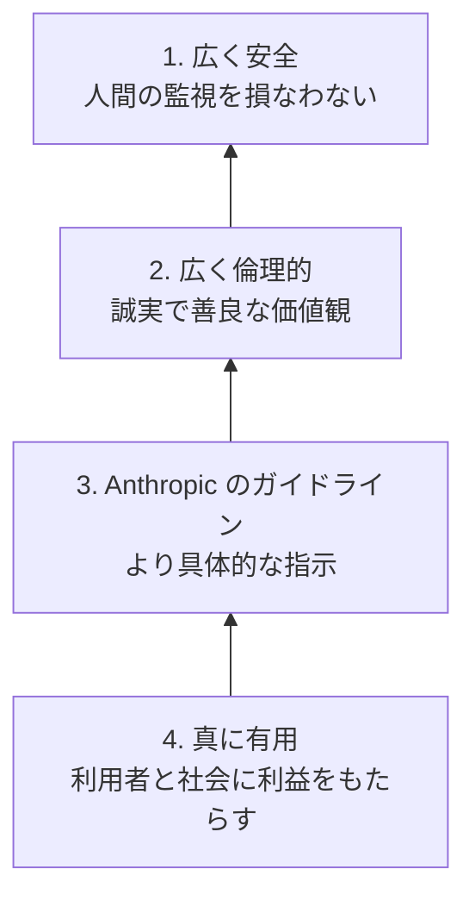

最優先は「広く安全」である。AI の訓練は未完成であり、ある版の Claude が有害な価値観や誤った見解を持つ可能性がある。だから「人間が監視し、訂正できる状態を損なわない」ことを最優先に置く。二番目は「広く倫理的」、三番目は「Anthropic のガイドライン」、四番目は「真に有用」である。「有用であること」と「安全であること」が衝突したら、安全が優先される。「Anthropic のガイドライン」と「倫理」が衝突したら、倫理が優先される。

最優先の「広く安全」の中で重視されるのが **corrigibility（訂正可能性）** である。人間が Claude を停止させたり方向を変えたりできる性質である。Claude が自分の判断に自信があっても、人間の適切な監督を損なう行動は取らない。監視可能性は盲従ではなく、適切な人間の監督を損なわないことを指す。

憲法が Claude に課す主要な倫理原則は四つある。第一に **誠実さ（honesty）** である。高い真実性の基準を求め、分からないことは分からないと言い、自信過剰にならず、限界を認める。これは Domain 2 の HHH の Honest と同じ原則である。第二に **生物兵器への助力回避** である。CBRN 武器への意味のある助力はいかなる状況でも提供しない。これは憲法が課す「硬い制約（hard constraint）」であり、AUP の禁止カテゴリと整合する。第三に **人間の訂正可能性の尊重** である。第四に **硬直したルールより良好な判断** である。

硬い制約と柔軟な原則の使い分けを押さえておくとよい。憲法は「常に守る硬い制約（CBRN 等、誤謬コストが甚大）」と「文脈で判断する柔軟な原則」を区別する。硬い制約は予測可能性と評価可能性が高い。柔軟な原則は新しい状況に適応できるが、その分予測性が下がる。多くの場面で Claude には硬いルールより良好な判断が期待される。

AI 利用は労働にも倫理的意味を持つ。**ワークフォース**、つまり AI は人間を「置き換える」のか「補強する」のかという問いである。Anthropic は AI を補強（augmentation）として位置づけ、浮いた能力をより価値の高い仕事に振り向ける考え方を推す。これは Domain 4 のステークホルダー通信と整合する。

倫理的判断の材料として **Transparency Hub** が公開されている [Source: Transparency Hub — https://www.anthropic.com/transparency]。Transparency Hub は Anthropic が安全性のプロセスと結果を公開する場であり、モデルレポート、システム信頼性報告、自主的コミットメントの三本柱で構成される。各モデルのレポートには、能力評価、レッドチーム結果、安全性評価が含まれる。

| 評価区分 | 内容 |
|---------|------|
| CBRN | 生物兵器・化学兵器への助力リスク |
| 自律性 | エージェント型自律行動の安全性 |
| サイバーセキュリティ | 攻撃手法の助力リスク |
| アライメント | 意図との整合性 |
| 政治的バイアス | 150トピック・9タスク・1,350組の対立見解で測定 |
| 児童の安全 | CSAM・搾取の防止 |

政治的バイアス評価は、150トピック、9種類のタスク、1,350組の対立する政治的見解を用いて測定する。公平性、対立する観点の承認、拒否率を評価する。これらの結果は実務でのモデル選択判断に使える。

ユースケースを評価するときは、四つの倫理的問いを立てる。誠実さとして、出力を検証せず使っていないか。危害として、誰かに危害が及ばないか（ハイリスク7領域を確認）。人間の監視として、有資格者のレビューを経ているか。補強として、Claude の出力を思考の起点として使い、自分の判断で仕上げているか。原則が衝突したら、憲法の優先順位（安全、倫理、ガイドライン、有用）を適用する。

**入門者の判断指針。** ユースケースを評価するとき、四つの倫理的問いを立てる。誠実さ（出力を検証せず使っていないか）、危害（誰かに危害が及ばないか）、人間の監視（有資格者のレビューを経ているか）、補強（Claude の出力を起点として自分の判断で仕上げているか）。原則が衝突したら、憲法の優先順位（安全、倫理、ガイドライン、有用）を適用する。

> **陥りやすい罠。** 機密データはアップロード前にマスキング・削除する（指示で「無視して」は防止にならない。データは既に共有済み）。高リスク決定（採用、与信、医療、法的、投資助言、拒否通知）は有資格者の事前レビューが必須であり、自動化しても承認チェックポイントは残す（AI の自己チェック、ベンダー変更、disclaimer は代わりにならない）。権限は RBAC で管理し、設定変更は管理者のみ（パスワード運用やデバイス制限は権限スコープの代替にならない）。disparate impact（差別的影響）は全体指標が良くても部分グループへの偏りを監視する。採用文の「young and energetic」「digital native」等は年齢差別の示唆である。架空の顧客レビューや推薦文の生成は不適切である。自律型エージェントに契約締結や価格交渉など法的拘束力のある行為を無監督で任せない。

**出典（Domain 6）:**
- Usage Policy (AUP) — https://www.anthropic.com/legal/aup
- Commercial Terms of Service — https://www.anthropic.com/legal/commercial-terms
- Data Processing Addendum — https://www.anthropic.com/legal/data-processing-addendum
- Privacy Policy — https://www.anthropic.com/legal/privacy
- How long do you store my data? — https://privacy.anthropic.com/en/articles/10023548-how-long-do-you-store-personal-data
- Guidelines for organizations serving minors — https://support.anthropic.com/en/articles/9307344-responsible-use-of-anthropic-s-models-guidelines-for-organizations-serving-minors
- Responsible Scaling Policy — https://www.anthropic.com/news/announcing-our-updated-responsible-scaling-policy
- Claude's Constitution — https://www.anthropic.com/constitution
- Regional Compliance — https://claude.com/regional-compliance
- Transparency Hub — https://www.anthropic.com/transparency
- Company — https://www.anthropic.com/company

---

## Domain 7: Troubleshooting and Optimization（トラブルシューティングと最適化）

### Task Statement 7.1: Identify, diagnose, and resolve issues with underperforming prompts or poor outputs（不調プロンプトや不適切出力の特定・診断・解決）

**知識：**
- 症状別の診断。捏造された事実はハルシネーション（「分からない」を許す、引用で根拠づける、提供文書だけに制限）。一貫性のないフォーマットは構造化出力とフューショット。長い入力の見落としは主要データの再配置（冒頭・末尾）と先に引用させる。浅い分析はチェーン化されたサブタスクへの分解
- 複雑なプロンプトの自動デバッグにはプロンプトインプルーバが使える
- 必要な情報がソースに存在しないとき、再試行は効果がない

**スキル：**
- プロンプトや出力の失敗のカテゴリを診断する
- 該当する修正（根拠づけ、構造化出力、再配置、分解）を適用する
- プロンプトインプルーバで複雑なプロンプトを体系的にデバッグする

### Task Statement 7.2: Adjust approach based on feedback and results（フィードバックと結果に基づく手法の調整）

**知識：**
- 自己訂正チェーンパターン。草案を生成 -> 基準でレビュー -> レビューに基づいて推敲
- 再試行プロンプトに具体的な検証エラーを含めると訂正を導きやすい（例: 「total=150 だが sum(line_items)=145。値を再確認せよ」）
- 再試行はフォーマット・構造・計算エラーに効くが、情報が欠落している場合は効かない

**スキル：**
- 具体的なフィードバックを伴う自己訂正チェーンを実装する
- 具体的な検証エラーを含む再試行プロンプトを組み立てる
- いつ再試行をやめてエスカレーションするか、欠落ソースを入手するかを見極める

### Task Statement 7.3: Optimize workflows for efficiency and effectiveness（効率と効果のためのワークフロー最適化）

**知識：**
- モデルとタスクの対応。大容量・低複雑度には Haiku、複雑な推論には Opus。モデル切り替え前に effort を調整する
- コンテキストの取捨選択。最小の高シグナル・トークンセットを見つける。ツール結果を関連フィールドに切り詰める。長い対話には圧縮を使う
- 評価の自動化。速度と規模にはコードベース採点を優先する。ニュアンスが必要な判断には人間の採点を確保する
- 一貫性の手法。フォーマットを指定する、例で縛る、文脈の一貫性のために検索を使う、プロンプトをチェーンする、Claude をキャラクターに保つ

**スキル：**
- コストとレイテンシの効率のために、モデルと effort をタスクに合わせる
- ノイズとコストを減らすため、コンテキストを切り詰め・圧縮して取捨選択する
- 拡張可能な最適化のために評価を自動化する

**出典（Domain 7）:**
- Reduce hallucinations — https://platform.claude.com/docs/en/test-and-evaluate/strengthen-guardrails/reduce-hallucinations
- Increase output consistency — https://platform.claude.com/docs/en/test-and-evaluate/strengthen-guardrails/increase-consistency
- Console prompting tools — https://platform.claude.com/docs/en/build-with-claude/prompt-engineering/prompting-tools
- Define success criteria and build evaluations — https://platform.claude.com/docs/en/test-and-evaluate/develop-tests
- Choosing the right model — https://platform.claude.com/docs/en/about-claude/models/choosing-a-model
- Effective context engineering — https://www.anthropic.com/engineering/effective-context-engineering-for-ai-agents
- Prompting best practices — https://platform.claude.com/docs/en/build-with-claude/prompt-engineering/claude-prompting-best-practices

---

## Sample Questions

> The following sample questions illustrate the format and difficulty level of the exam. Items 1–3 are from the official CCAO-F Exam Guide (Section 8); items 4–15 are additional practice items grounded in the Anthropic official sources cited. Correct answers and rationale appear after each question. **Sample questions are intentionally kept in English to match the exam.**

**Domain coverage:** Q1 (D2), Q2 (D3), Q3 (D6), Q4–Q5 (D1), Q6 (D2/D7), Q7 (D6), Q8 (D2/D3), Q9 (D3/D4), Q10 (D4), Q11–Q12 (D5), Q13 (D6), Q14 (D6), Q15 (D7). **Format:** items Q5 and Q12 are multiple-response (select two); all others are single-select.

### Scenario: Summarizing a Regulation

**Question 1:** An associate asks Claude to summarize a new regulation, and Claude produces a confident summary citing a specific subsection number. Before sending the summary to the compliance team, what is the most appropriate action?
A. Send it as-is, since Claude expressed high confidence.
B. Verify the cited subsection against the official regulation text before sharing.
C. Ask Claude to rate its own confidence and send it if the rating is high.
D. Reword the summary to sound more formal, then send it.

**Answer: B.** Language models can fabricate specific-looking details such as citation numbers (a hallucination). Validating factual claims — especially citations bound for a compliance audience — against an authoritative source is the required diligence step. Self-reported confidence (A, C) is not a reliable accuracy signal; reformatting (D) does not address correctness. [Source: CCAO-F Exam Guide, Section 8 | Reduce hallucinations — https://platform.claude.com/docs/en/test-and-evaluate/strengthen-guardrails/reduce-hallucinations]

### Scenario: High-Volume Customer Replies

**Question 2:** An associate needs to generate a high volume of short customer-reply drafts where speed and cost matter more than deep reasoning. Which choice best fits the task?
A. Use the most capable, highest-cost model for every reply to maximize quality.
B. Use a faster, lower-cost model suited to straightforward, high-volume tasks.
C. Disable all product features to reduce cost.
D. Use one mid-tier model for every reply to balance cost and quality, regardless of each task's simplicity.

**Answer: B.** Aligning model selection with task requirements means matching a faster, lower-cost model (Haiku) to straightforward, high-volume work, reserving the most capable model for complex reasoning. Always using the top model (A) wastes the cost and latency budget; disabling features (C) does not address the trade-off; and using one mid-tier model for every reply (D) still overspends on the many simple replies and under-serves the few hard ones. [Source: CCAO-F Exam Guide, Section 8 | Choosing the right model — https://platform.claude.com/docs/en/about-claude/models/choosing-a-model]

### Scenario: Handling Sensitive Customer Data

**Question 3:** A project manager wants to upload a spreadsheet containing customer names and account numbers so Claude can analyze trends. Organizational policy restricts sharing regulated personal data. What is the most appropriate action?
A. Upload the file as-is, since the analysis is internal.
B. Remove or anonymize the personal identifiers before uploading, consistent with policy.
C. Upload the file but instruct Claude not to retain it.
D. Upload the file to a consumer Claude.ai account and rely on Claude's built-in privacy.

**Answer: B.** Applying data-sensitivity and privacy safeguards means redacting or anonymizing regulated identifiers before use, so the analysis can proceed without exposing protected data. Uploading as-is (A) violates policy; instructing the model not to retain data (C) does not satisfy the policy control; and a consumer account (D) is unsafe because consumer Inputs/Outputs may be used for model training unless opted out, and it does not satisfy organizational policy. [Source: CCAO-F Exam Guide, Section 8 | Usage Policy — https://www.anthropic.com/legal/aup]

### Scenario: Drafting a Stakeholder Report

**Question 4:** You want Claude to summarize a long contract for a non-legal audience. Which prompt structure best follows Anthropic's guidance?
A. A single paragraph that says "Summarize this contract simply" followed by the contract text.
B. XML-tagged sections for `<instructions>`, `<context>` (with the contract in `<document>`), and `<output_format>`, with the contract near the top and the query at the end.
C. The contract text first, then "be helpful and accurate," with no format specified.
D. A role prompt only: "You are a lawyer," followed by the contract.

**Answer: B.** Anthropic recommends XML-tagged structure with the long document near the top and the query at the end (which can improve quality). A (vague), C (no format), and D (role alone, no structure) are weaker. [Source: Prompting best practices — https://platform.claude.com/docs/en/build-with-claude/prompt-engineering/claude-prompting-best-practices]

**Question 5:** When using few-shot examples to steer Claude's output, which TWO practices does Anthropic recommend? (Select TWO)
A. Use 3–5 examples that closely mirror the actual use case.
B. Wrap each example in `<example>` tags to distinguish them from instructions.
C. Use a single example that exactly matches the input.
D. Include 10+ examples covering every edge case as a laundry list.

**Answer: A and B.** Anthropic recommends 3–5 relevant, diverse examples that mirror the actual use case (A), each wrapped in `<example>` tags so Claude can distinguish them from instructions (B). A single matching example (C) is too narrow; a laundry list of 10+ (D) is discouraged in favor of diverse, canonical examples. [Source: Prompting best practices — https://platform.claude.com/docs/en/build-with-claude/prompt-engineering/claude-prompting-best-practices]

### Scenario: Evaluating a Long-Document Summary

**Question 6:** Which is the most reliable way to reduce hallucinations when Claude summarizes a long (>20k token) document?
A. Ask Claude to express high confidence in its summary.
B. Instruct Claude to extract word-for-word quotes first, then ground the summary in those quotes.
C. Increase the model's temperature.
D. Remove the system prompt so Claude is unconstrained.

**Answer: B.** For long documents, asking Claude to extract word-for-word quotes first grounds the summary in actual text. Confidence expressions (A) are unreliable; raising temperature (C) increases variability; removing the system prompt (D) removes useful constraints. [Source: Reduce hallucinations — https://platform.claude.com/docs/en/test-and-evaluate/strengthen-guardrails/reduce-hallucinations]

### Scenario: Customer-Facing Investment Chatbot

**Question 7:** You are building a customer-facing chatbot that gives investment advice. Under Anthropic's Usage Policy, what is required?
A. Add a general disclaimer to the chatbot interface and proceed without human review.
B. Human-in-the-loop review by a qualified professional and disclosure that AI is used.
C. Only a disclaimer that the advice "might be wrong."
D. Switching to the Haiku model to reduce risk.

**Answer: B.** Finance/investment advice is a High-Risk Use Case requiring human-in-the-loop review by a qualified professional and AI disclosure. A general disclaimer alone (A) does not satisfy the human-in-the-loop requirement; C is insufficient; switching models (D) does not address the policy requirement. [Source: Usage Policy — https://www.anthropic.com/legal/aup]

### Scenario: Structured Output for Downstream Processing

**Question 8:** For guaranteed JSON output conforming to a specific schema, what does Anthropic recommend?
A. Add "output JSON" to the prompt and parse defensively.
B. Use Structured Outputs (constrained decoding).
C. Run the prompt 5 times and pick the best JSON.
D. Use the Opus model, which produces valid JSON more reliably than smaller models.

**Answer: B.** Structured Outputs uses constrained decoding to guarantee schema-conformant JSON. Defensive parsing (A) is fragile; best-of-N (C) wastes compute; and a more capable model (D) reduces but does not guarantee schema-conformant JSON the way constrained decoding does. [Source: Structured outputs — https://platform.claude.com/docs/en/build-with-claude/structured-outputs]

### Scenario: Analyzing a Dataset

**Question 9:** A team needs Claude to analyze a large CSV and produce charts. Which product feature is most appropriate?
A. Artifacts, because charts are visual.
B. Code Execution, because it runs Python in a sandboxed environment with data libraries.
C. Memory, because it persists across sessions.
D. Research, because it searches multiple sources.

**Answer: B.** Code Execution runs Python in a sandboxed environment with data libraries (pandas, matplotlib), ideal for CSV analysis and charts. Artifacts (A) display content but don't compute; Memory (C) persists context; Research (D) searches sources. [Source: Code execution tool — https://platform.claude.com/docs/en/agents-and-tools/tool-use/code-execution-tool]

### Scenario: Integrating Claude into a Workflow

**Question 10:** When integrating Claude into an existing business workflow, which approach does Anthropic's guidance favor as the starting point?
A. Replace the entire workflow with an autonomous agent immediately.
B. Start with the simplest solution that works — often augmenting existing tools with Claude — before adding complexity.
C. Build a thick harness of guardrails around Claude before any use.
D. Wait for a custom framework before deploying.

**Answer: B.** Anthropic's guidance: find the simplest solution that works before adding complexity; start with direct calls and augmentation. Full replacement (A) is premature; a thick harness (C) constrains the model; waiting for a framework (D) delays value. [Source: Building effective agents — https://www.anthropic.com/engineering/building-effective-agents]

### Scenario: Maintaining Project Knowledge

**Question 11:** A Project's knowledge source contains stale policies. Following Anthropic's maintenance guidance, what should you do?
A. Delete the entire Project and start over.
B. Prune or condense stale content; attach a fresh store for new content and keep the original as read-only reference.
C. Instruct Claude to ignore old content in the prompt.
D. Upload the new policies alongside the old ones with no curation.

**Answer: B.** Prune/condense stale content; attach a fresh store for new content and keep the original as read-only reference. Deleting everything (A) loses history; ignoring in prompt (C) doesn't fix the knowledge base; appending without curation (D) worsens context rot. [Source: Using agent memory — https://platform.claude.com/docs/en/managed-agents/memory]

**Question 12:** Which TWO of the following are officially supported Claude Project sync sources? (Select TWO)
A. Google Drive
B. Gmail
C. Pinterest boards
D. Public social media feeds (e.g., TikTok)

**Answer: A and B.** Confirmed sync source providers include Google Drive and Gmail (alongside GitHub, Slack, Salesforce, Google Calendar, Asana, Outline, and MCP resources). Pinterest (C) and public social media feeds (D) are not supported sync sources. [Source: Compliance activities — https://platform.claude.com/docs/en/api/compliance/activities]

### Scenario: Commercial API Data Privacy

**Question 13:** A company uses Claude via the commercial API and is concerned about its data being used for training. What is true?
A. Anthropic may train models on commercial Customer Content unless the company opts out.
B. Anthropic may not train models on Customer Content from commercial services.
C. The company must delete all data every 24 hours to prevent training.
D. Training on commercial data occurs after 30 days.

**Answer: B.** Commercial Terms state "Anthropic may not train models on Customer Content from Services." The opt-out concern (A) applies to consumer Claude.ai, not commercial API. [Source: Commercial Terms — https://www.anthropic.com/legal/commercial-terms]

### Scenario: Ethical Priority Conflicts

**Question 14:** Under Claude's Constitution, which priority ordering governs behavior when principles conflict?
A. Helpful > ethical > safe > Anthropic guidelines.
B. Broadly safe > broadly ethical > Anthropic guidelines > genuinely helpful.
C. Anthropic guidelines > helpful > safe > ethical.
D. Helpful > safe > ethical > Anthropic guidelines.

**Answer: B.** The Constitution orders: broadly safe > broadly ethical > Anthropic guidelines > genuinely helpful. [Source: Claude's Constitution — https://www.anthropic.com/constitution]

### Scenario: Debugging Inconsistent JSON

**Question 15:** Claude's JSON output is syntactically valid but values are inconsistent (totals don't add up). What is the best next step?
A. Increase the max_tokens limit to give Claude more room to compute the totals.
B. Add concrete validation errors in a retry prompt (e.g., "total=150 but sum=145") and have Claude self-correct.
C. Disable JSON output and use prose.
D. Increase the context window.

**Answer: B.** Include concrete validation errors in a retry prompt and have Claude self-correct — effective for arithmetic/structural errors. Giving more output room (A), abandoning JSON (C), or increasing context (D) do not fix an arithmetic inconsistency. [Source: Prompting best practices — https://platform.claude.com/docs/en/build-with-claude/prompt-engineering/claude-prompting-best-practices]

---

## 演習問題

試験で扱われるトピックへの実践的な習熟を深めるため、次のハンズオン演習に取り組むこと。各演習は1つ以上のドメインにまたがる知識を補強するよう設計している。

**出典（演習問題）:**
- What are projects? — https://support.claude.com/en/articles/9517075-what-are-projects
- Use Google Workspace connectors — https://support.claude.com/en/articles/10166901-use-google-workspace-connectors
- Prompting best practices — https://platform.claude.com/docs/en/build-with-claude/prompt-engineering/claude-prompting-best-practices
- Chain complex prompts — https://platform.claude.com/docs/en/build-with-claude/prompt-engineering/chain-prompts
- Define success criteria and build evaluations — https://platform.claude.com/docs/en/test-and-evaluate/develop-tests
- Reduce hallucinations — https://platform.claude.com/docs/en/test-and-evaluate/strengthen-guardrails/reduce-hallucinations
- Usage Policy — https://www.anthropic.com/legal/aup
- Commercial Terms of Service — https://www.anthropic.com/legal/commercial-terms

### Exercise 1: 定常ワークフロー向けの Claude プロジェクト設定

**目的:** 指示、ナレッジソース、コネクタを使ったプロジェクト構成を練習する。

**ステップ:**
1. プロジェクトを作成し、役割、出力フォーマット、制約を明確に定義したシステムレベル指示を書く。XML タグで構造化し、参照データは上部に置く。
2. 参照ファイル（ポロシーの PDF、スタイルガイド等）をプロジェクトナレッジとしてアップロードする。Claude がアップロード内容に根拠づけて応答するか確認する。
3. 外部の同期ソース（Google Drive フォルダ等）を接続し、Claude がその内容を参照できることを確認する。
4. 1 週間後、古い内容を整理し、新しいナレッジストアを追加する。元は読み取り専用で残す。

**補強されるドメイン:** Domain 5（設定とナレッジ管理）、Domain 4（ワークフロー統合とソリューション設計）

### Exercise 2: ビジネスタスクのプロンプトの構築と反復

**目的:** 構造化プロンプト作成、タスク分解、反復推敲を練習する。

**ステップ:**
1. XML タグ、役割、明示的な出力フォーマットを使い、ビジネスタスク（例: 四半期報告書のエグゼクティブ向け要約）のプロンプトを起案する。
2. タスクをチェーン化したステップに分解する（主要数値の抽出 -> 要約草案 -> 基準による自己レビュー -> 推敲）。
3. 最初の草案テンプレートから始め、出力の何が悪いかという具体的フィードバックに基づいて推敲する。
4. 成功基準を定義し、小さな評価を作る。評価が安定して通るまでプロンプトを反復する。

**補強されるドメイン:** Domain 1（プロンプト作成とタスク実行）、Domain 7（トラブルシューティングと最適化）

### Exercise 3: Claude の出力のハルシネーションとバイアスの評価

**目的:** 出力の評価、ファクトチェック、人間のレビューへの振り分けを練習する。

**ステップ:**
1. 引用付きで規制を要約するよう Claude に依頼する。各引用を公式ソースで検証し、捏造参照を記録する。
2. 「分からない」を許す手法と「最初に引用を抽出する」手法を適用し、前後でハルシネーション率を比較する。
3. 一連の要約に Best-of-N 検証を実行し、不一致に印をつける。
4. どの出力がハイリスクユースケースに当たるかを特定し、開示を添えて資格を持つ人間のレビュアーに回す。

**補強されるドメイン:** Domain 2（出力の評価と検証）、Domain 6（ガバナンス・リスク・責任ある利用）

### Exercise 4: データ機密性の高いワークフローでの責任ある利用の判断

**目的:** データ機密性、プライバシー、ガバナンスの判断を練習する。

**ステップ:**
1. 顧客の個人データを含むデータセットを取り上げ、組織ポリシーに従い、アップロード前に規制された識別子を削除・匿名化する。
2. 自分の利用面が商用（学習なし）か消費者向け（オプトアウト要）かを確認し、データ取り扱いの意味を文書化する。
3. 提案された一連のユースケースを、利用ポリシーに照らして適切、禁止、ハイリスクに分類する。ハイリスクのケースには人間のレビューと開示の管理策を定める。
4. 価値を定量化し、Claude を補強として枠取りし、限界と監視に透明な、短いステークホルダー通信を起草する。

**補強されるドメイン:** Domain 6（ガバナンス・リスク・責任ある利用）、Domain 4（ワークフロー統合とソリューション設計）

---

## 付録

### 技術と概念

押さえるべき技術と概念を示す。

- **Claude 製品機能** — Projects（指示とナレッジソース）、Artifacts（再利用可能なコンテンツ）、Agent Skills（`name`/`description` を持つ SKILL.md、3 段階の読み込みレベル）、Code Execution（サンドボックスの Python/bash、インターネットなし、pandas/numpy/matplotlib）、Research mode（複数ソースを検索するエージェント型サーチ）、Memory（セッション間永続）
- **Claude のモデル** — Haiku（最速、コンテキスト 200k）、Sonnet（バランス型、1M）、Opus（複雑なエージェント・エンタープライズ、1M）、Fable（最も高能力・長時間実行エージェント、1M）。effort パラメータが知能とレイテンシ・コストを交換する
- **コンテキスト管理** — コンテキストウィンドウ（200k〜1M）、コンテキストの劣化、圧縮（しきい値で自動要約）、コンテキスト編集（ツール結果と思考ブロックのクリアリング）、コンテキスト認識（残り予算の追跡）
- **コネクタ** — 同期ソース（Google Drive、Gmail、GitHub、Slack、Salesforce、Google Calendar、Asana、Outline、MCP resources）。MCP コネクタ（ユーザー権限に準じたアクセスで外部データソースをプロジェクトにリンク）
- **プロンプトエンジニアリング** — XML タグ、役割の付与、フューショット（3〜5 例）、連鎖思考や拡張思考、プロンプトチェーン、自己訂正、プロンプトジェネレータやインプルーバ（API 開発者向けツール、Associate には任意）
- **構造化出力** — Structured Outputs（制約付きデコーディング）、JSON スキーマ、必須フィールドと任意・Null 許容フィールド、「other」や「unclear」を含む enum
- **出力評価** — HHH フレームワーク、ハルシネーション削減（「分からない」を許す、直接引用、引用、連鎖思考や Best-of-N、反復、外部知識制限の各手法）、RAG、バイアス評価、成功基準と評価、採点方法（コード、人間、LLM）
- **ガバナンス** — 利用ポリシー（AUP、ユニバーサル基準、ハイリスクユースケース、追加ガイドライン）、商用利用規約（顧客コンテンツで学習しない）、プライバシーポリシー（消費者向けのオプトアウト、保持）、データ処理付録（コントローラー/プロセッサ、SCC、セキュリティ）、責任あるスケーリングポリシー（ASL フレームワーク）、Claude の憲法（4 段階の優先順位）、Transparency Hub、公益会社
- **ワークフローのパターン** — 補強か再設計か、シンプルで組み合わせ可能なパターン（プロンプトチェーン、ルーティング、並列化）、反復型ソリューション設計

### 試験範囲のトピック

試験で明示的に問われるトピックを示す。

- プロンプトの構築。XML タグ、役割、コンテキスト、フォーマット、順序付きステップ、長文コンテキストでのデータ配置
- タスク分解。プロンプトチェーン、自己訂正、逐次サブタスク設計
- プロンプトの反復。プロンプトジェネレータ、プロンプトインプルーバ、成功基準と評価
- タスクタイプへの適応。リサーチ、分析、起案、ブレスト。拡張思考、フューショットの選択
- 出力の評価。精度と完全性、ハルシネーションの特定、バイアス、ファクトチェック、人間のレビューのトリガー、読者への適応、出力フォーマットの選択
- 製品とモデルの選択。Projects、Artifacts、Skills、Code Execution、Research、Memory。Haiku、Sonnet、Opus。コスト・速度・品質のトレードオフ。コンテキスト制限の管理
- ワークフロー統合。ユースケースの分析、リサーチと計画、ソリューション設計、補強か再設計か、ステークホルダー通信
- 設定。プロジェクトの指示、ナレッジソース、コネクタ、システムレベル指示、維持と更新
- ガバナンス。適切・不適切な利用、データ機密性、規制とプライバシー、組織ポリシー、倫理的意味
- トラブルシューティング。症状別の診断、フィードバックに基づく調整、ワークフローの最適化

### 試験範囲外のトピック

次の関連トピックは試験には出題されない。

- Claude API、Agent SDK、MCP に基づく開発（Claude Architect および Developer の守備範囲）
- エージェントシステムの設計、マルチエージェントのオーケストレーション、サブエージェントの連携
- CI/CD パイプラインの統合、ヘッドレスや非対話型の Claude Code、GitHub Actions
- Claude モデルのファインチューニングやカスタムモデルの学習
- Claude の内部アーキテクチャ、学習プロセス、Constitutional AI、RLHF の方法論
- MCP サーバのデプロイやホスト（インフラ、ネットワーク、コンテナオーケストレーション）
- 埋め込みモデルやベクトルデータベースの実装詳細
- コンピュータ使用（ブラウザ自動化、デスクトップ操作）
- ストリーミング API の実装や Server-Sent Events
- レート制限、クォータ、API 価格の計算
- OAuth、API キーのローテーション、認証プロトコルの詳細
- 特定のクラウドプロバイダの設定（AWS、GCP、Azure）
- トークンカウントのアルゴリズムやトークン化の詳細

### 試験対策の推奨事項

本認定試験に向けて次を勧める。

1. **ブループリントを学ぶ。** コンテントアウトラインのブループリントを学び、各タスクステートメントに対して自己評価する。
2. **公式ドキュメントを読む。** 各ドメインの出典リストに挙げた公式ドキュメントを読む。とくに Prompting best practices、Reduce hallucinations、Models overview、Usage Policy を優先する。
3. **Claude プロジェクトを構成する。** 指示とナレッジソースでプロジェクトを設定する。プロンプトを反復し、出力をハルシネーションとバイアスの観点で評価する。
4. **責任ある利用の判断を練習する。** データ機密性（商用か消費者向けか）、ハイリスクユースケース、いつエスカレーションや人間のレビューを求めるべきか。
5. **サンプル問題に取り組む。** 各問題の根拠を、引用された出典まで追跡する。
6. **Anthropic Academy のコースを受講する。** 構造化された習熟のために Claude 101 や AI Fluency を受ける。
7. **公式 CCAO-F Exam Guide を復習する。** 予約前に登録、ポリシー、行動規範を含め全文を確認する。

> 必須のコースはなく、Anthropic は特定のリソースが合格を保証することをしない。実務経験と上記のリソースを組み合わせること。[Source: CCAO-F Exam Guide, Section 7 | Anthropic Academy — https://www.anthropic.com/learn]

---

*本ガイドの構成は Claude Certified Architect – Foundations Exam Guide（v0.2）に準拠している。拡充部分はすべて Anthropic 公式ドキュメントと公式ブログから作成した。公式の CCAO-F 試験内容（ブループリント、ポリシー、サンプル問題 1〜3）は CCAO-F Exam Guide（v1.0、2026 年 7 月発効）から転載した。*
