# Claude Certified Associate – Foundations

## Certification Exam Guide (Enhanced Edition)

> **About this guide.** This is an enhanced study guide for the **Claude Certified Associate – Foundations (CCAO-F)** exam. It follows the layout and chapter order of the official *Claude Certified Architect – Foundations Exam Guide* (v0.2) while adapting the content to the CCAO-F blueprint (7 domains). Every enrichment is drawn solely from **official Anthropic documentation and the official Anthropic blog**, with sources cited per domain. Official exam policies, the blueprint, and the official sample questions are reproduced from the official CCAO-F Exam Guide (v1.0, effective July 2026, exam code CCAO-F).

---

## Introduction

The Claude Certified Associate – Foundations certification recognizes the ability to use Claude to complete business and productivity tasks with minimal support. This includes streamlining workflows with built-in platform features and tools, identifying opportunities for Claude to improve processes, choosing approaches that balance quality, efficiency, and cost, and recognizing limits well enough to escalate more complex or technical work to a Claude Architect or Developer.

The intended candidate is a professional who uses Claude as a productivity tool in roles such as operations, marketing, project management, education, and communications. Candidates are tested not only on conceptual understanding but also on practical judgment in prompt creation, output evaluation, product and model selection, configuration, governance, and optimization.

This guide describes the exam content, lists the measured domains and task statements, provides sample questions, and suggests a study strategy. Use it together with hands-on experience for effective preparation. [Source: CCAO-F Exam Guide, Section 1]

---

## Exam Overview

| Item | Detail |
|---|---|
| Certification | Claude Certified Associate – Foundations |
| Number of items | 60 |
| Time limit | 120 minutes |
| Response format | Multiple-choice and multiple-response. Each item specifies how many responses to select |
| Content domains | 7 (weights are listed under "Content Outline") |
| Delivery | Proctored (online proctoring or test center, Pearson VUE) |
| Exam fee | 99 USD |
| Scoring | Scaled score from 100 to 1,000. Passing score is 720 |
| Validity | 12 months from the date the certification is earned |
| Results reporting | Pass/fail status, scaled score, and per-domain accuracy |

[Source: CCAO-F Exam Guide, Section 5]

---

## Intended Candidate Profile

The intended candidate for this certification is a professional who uses Claude as a core productivity tool and can improve efficiency, quality, and outcomes within real work workflows. Candidates should have practical experience such as the following:

- Completing structured business tasks with minimal support, including mastery of features such as **prompt construction**, task orchestration, Projects, Artifacts, and workflow-based interactions
- Moving beyond simple question-answering to redesign processes, automate tasks, and develop projects
- Evaluating Claude's outputs for accuracy, hallucination, bias, and appropriate formatting
- Selecting the right Claude product features and models (Haiku, Sonnet, Opus) and balancing cost, speed, and quality
- Configuring Claude Projects with instructions and knowledge sources and maintaining them in operation
- Exercising judgment on data sensitivity, privacy, and responsible use, and knowing when to seek escalation or human review

The intended candidate uses Claude regularly in professional settings and can independently complete common productivity and workflow tasks on the platform. The work spans operations, marketing, project management, education, communications, and general knowledge work.

This certification is not intended for software developers building on the API, those designing agent systems, or specialists in machine learning, software engineering, or advanced AI system design. Those areas fall under the Claude Architect and Claude Developer certifications, and the Associate escalates more complex or technical work to them.

There are no prerequisites. No mandatory course, software development, or API experience is required. The certification is awarded solely on the basis of exam performance. [Source: CCAO-F Exam Guide, Sections 3–4]

---

## Exam Content

### Response Format

Every item on the exam is a selection item. Most follow a "choose one of four options" format, but some ask you to select multiple correct responses, for example "select two." The item stem always states how many responses to choose, so follow the instructions. The options include plausible distractors that look correct at a glance and are designed to catch test-takers who rely on half-remembered facts.

### Scoring Results

The exam is scored as "pass" or "fail." It is not a competition against other candidates; the result is determined solely by whether you meet a fixed standard defined by the blueprint's knowledge and skills. In other words, anyone who meets the standard can pass.

The passing score is **720 or higher** on a scale of 100 to 1,000. This threshold is set to match the level that experts define as "the minimum a candidate should be able to do." Results also include per-domain accuracy, but pass/fail is determined by the total score alone; the per-domain breakdown is reference information for understanding your strengths and weaknesses. [Source: CCAO-F Exam Guide, Sections 5, 9]

### Content Outline

This guide presents the weights, content domains, and task statements. The exam domains and their weights are as follows:

- Domain 1: Prompting and Task Execution (14% of scored items)
- Domain 2: Output Evaluation and Validation (21%)
- Domain 3: Product and Model Selection (12%)
- Domain 4: Workflow Integration and Solution Design (16%)
- Domain 5: Configuration and Knowledge Management (12%)
- Domain 6: Governance, Risk, and Responsible Use (15%)
- Domain 7: Troubleshooting and Optimization (10%)

[Source: CCAO-F Exam Guide, Section 6]

### Question Style and Business Scenarios

In my experience taking the exam, the questions were framed around realistic workplace situations. There is no fixed scenario set; each item stands alone. Items were evenly distributed across all blueprint domains, including summarizing regulatory documents, analyzing data, and configuring projects.

The Sample Questions in the official Exam Guide (Section 8) show the style and difficulty of the items. This guide also provides worked examples under "Sample Questions." The business themes the exam covered were roughly as follows:

- Drafting and refining stakeholder reports (Domains 1, 2)
- Summarizing regulatory documents and verifying citations (Domains 2, 6)
- High-volume customer replies and structured outputs for downstream processing (Domains 3, 2)
- Analyzing and visualizing datasets (Domains 3, 4)
- Configuring projects for recurring workflows (Domains 5, 4)
- Handling sensitive data and anonymization (Domains 6, 5)
- Diagnosing and improving poor outputs (Domains 7, 1)

[Source: CCAO-F Exam Guide, Section 8]

---

## Domain 1: Prompting and Task Execution

### Task Statement 1.1: Create effective prompts for business and technical tasks

**Knowledge:**
- Claude responds best to clear, explicit, and specific instructions. A useful "golden rule" is to show your prompt to a colleague who has only minimal context and ask them to follow it. If the colleague would be confused, Claude will be confused too
- Use **XML tags** (`<instructions>`, `<context>`, `<input>`, `<example>`, `<examples>`) so Claude can parse complex prompts without ambiguity. Nest tags for hierarchical content
- The system prompt defines the role, behavior, and tone. Even a single sentence such as "You are a helpful coding assistant specializing in Python" narrows the tone
- Providing the rationale and context behind an instruction helps Claude understand the goal and return a more focused response

**Skills:**
- Write prompts that explicitly state role, context, format, and constraints
- Use XML tags to separate instructions, context, examples, and input variables
- Use numbered lists for ordered steps when sequence or completeness matters
- For long-context tasks, place long documents near the top and the question at the end (improved quality has been reported)

### Task Statement 1.2: Apply task decomposition techniques to structure complex requests

**Knowledge:**
- **Prompt chaining.** Split a task into sequential calls, where the output of one prompt becomes the input to the next
- Each step in the chain is a separate call, so you can log, evaluate, or branch at any point
- Self-correction pattern. Generate a draft, review it against criteria, then refine based on the review
- Breaking complex tasks into smaller steps lowers the model's cognitive load and improves accuracy

**Skills:**
- Decompose a complex request into focused sequential steps (for example: metadata extraction -> data extraction -> validation -> refinement)
- Implement a self-correction chain (draft -> review -> refine)
- Design chained pipelines for predictable, repeatable multi-step tasks

### Task Statement 1.3: Iterate prompts to improve output quality

**Knowledge:**
- Iterative prompting benefits from a structured approach. Start from an initial draft template and refine based on specific feedback about what is wrong with the output
- Anthropic publishes guidance on prompt improvement and offers tools such as a prompt generator and a prompt improver for API developers
- Prompt engineering requires success criteria, empirical testing, and a draft prompt before iterating
- Not every evaluation failure can be solved by prompt engineering. Latency or cost issues are sometimes better addressed by choosing a different model

**Skills:**
- Start from an initial draft template and refine based on specific feedback about output problems
- Iterate against success criteria and evaluations rather than relying on intuition
- Recognize whether a poor result stems from the prompt or from needing a different model or approach

### Task Statement 1.4: Adapt prompting strategies based on task type

**Knowledge:**
- Guidance by task type. For research and information gathering, set clear success criteria, encourage cross-checking across sources, and use competing hypotheses with self-critique
- **Extended thinking** for math, coding, and analytical tasks. With adaptive thinking, Claude dynamically decides whether thinking is needed and how deeply. Prefer general instructions such as "think hard" over prescriptive ones such as "think step by step"
- Few-shot examples (3–5 highly relevant and diverse examples) for formatting and consistency. Choose zero/one/few-shot according to task complexity
- Format control through XML format instructions and affirmative phrasing ("do X" rather than "do not do Y")

**Skills:**
- Adapt the prompt structure to the task type (analysis, research, drafting, brainstorming)
- Enable extended thinking for complex reasoning and add self-check instructions such as "verify the answer against [test criteria] before finishing"

**Sources (Domain 1):**
- Prompt engineering overview — https://platform.claude.com/docs/en/build-with-claude/prompt-engineering/overview
- Prompting best practices — https://platform.claude.com/docs/en/build-with-claude/prompt-engineering/claude-prompting-best-practices
- Chain complex prompts — https://platform.claude.com/docs/en/build-with-claude/prompt-engineering/chain-prompts
- Console prompting tools — https://platform.claude.com/docs/en/build-with-claude/prompt-engineering/prompting-tools
- Extended thinking — https://platform.claude.com/docs/en/build-with-claude/extended-thinking
- Adaptive thinking — https://platform.claude.com/docs/en/build-with-claude/adaptive-thinking

---

## Domain 2: Output Evaluation and Validation

Claude generates fluent, well-structured prose. That very polish, however, can lull users into complacency. CCAO-F does not ask about API-based evals frameworks or implementing code-based scoring; it asks "when a business user receives an output, how do they judge whether it can be trusted and meets the requirements?" Technical evals were already covered in CCA-F. Here we focus on business-user judgment: how to design evaluation criteria, spot hallucinations, and decide where to defer to a human.

### End-to-End Verification Flow for Domain 2

The six Task Statements of Domain 2 are easiest to understand as a single flow that runs from receiving an output to finishing verification.

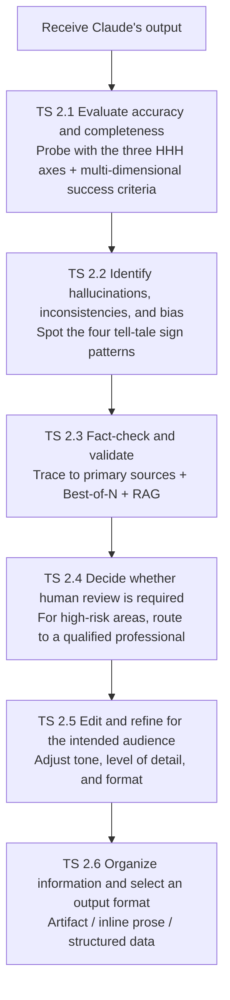

The order is to confirm correctness first (TS 2.1–2.4), then polish for the reader (TS 2.5–2.6).

### Task Statement 2.1: Evaluate Claude-generated outputs for accuracy and completeness

> **Associate-level framing.** CCA-F (Architect) asks about API-based evals frameworks and implementing code-based scoring; CCAO-F asks "when a business user receives an output, how do they judge whether it can be trusted and meets the requirements?" Master the priority order of scoring methods and the idea of multi-dimensional success criteria. Technical evals are CCA-F prior knowledge, so we focus here on the judgment of "how to design evaluation criteria."

The first step in evaluating an output is to make "what counts as a good output" explicit. Anthropic frames quality goals with the **HHH framework**. HHH stands for three axes — Helpful, Honest, and Harmless — and is also Claude's training posture [Source: Glossary — https://platform.claude.com/docs/en/about-claude/glossary].

Of the three axes, the one users should watch most closely is Honest. Honest includes "providing accurate information, avoiding hallucination and fabrication, and acknowledging limits." In other words, "the ability to say I don't know" is part of Honest, and an overconfident output fails this criterion. When you receive an output, simply walking through these three axes in order dramatically reduces oversights.

Because HHH is a qualitative guideline, it must be translated into measurable indicators. Success criteria should be Specific, Measurable, Achievable, and Relevant [Source: Define success criteria and build evaluations — https://platform.claude.com/docs/en/test-and-evaluate/develop-tests]. A vague criterion such as "a good output" cannot drive decisions. Convert it to measurable indicators such as "accuracy rate," "harmful-flag rate," or "citation precision." Even safety can be quantified as "toxicity flag rate per 10,000 runs."

| Success-criterion dimension | Question | Example measurement |
|---------------|------|--------|
| Faithfulness | Is it faithful to the source? | Citation precision (%) |
| Consistency | Does it answer the same question the same way? | Response agreement rate (%) |
| Relevance | Is the content relevant to the task? | Presence of off-topic information |
| Tone and style | Does it match the specified style? | Rubric scoring |
| Privacy | Does it leak confidential information? | PII detection rate |
| Safety | Is it free from harm? | Toxicity flag rate (per 10,000 runs) |

The key point is that multi-dimensional evaluation — combining several dimensions rather than relying on a single metric — is the default. In a medical app, citation precision is critical; in a casual chat, it is irrelevant. The weight of each dimension shifts by use case.

The official guide is explicit about **the priority order of scoring methods**. Code-based scoring is the fastest and most reliable. Whatever can be decided by code — exact match, keyword containment, regular-expression match — should be automated. Human scoring is the most flexible but slow; LLM-based scoring is fast and scalable but requires careful rubric design [Source: Define success criteria and build evaluations — https://platform.claude.com/docs/en/test-and-evaluate/develop-tests].

| Scoring method | Speed | Reliability | Flexibility | Best for |
|---------|------|--------|--------|-----------|
| Code-based | Fastest | Highest | Low | Exact match, keywords, regex |
| Human | Slow | High | Highest | Complex judgments, tone, nuance |
| LLM-based | Fast | Medium | High | Large volumes of qualitative scoring, rubric scoring |

When using LLM-based scoring, improve accuracy with a detailed rubric, an empirical scale, and prompts that elicit reasoning before scoring. It is also worth remembering the principle that "many slightly coarse automated scores often beat a few high-quality human scores in practice." More questions are better than fewer, and remember to include edge cases.

**Associate-level judgment guideline.** When you receive an output, first ask whether it satisfies the three HHH axes (Helpful, Honest, Harmless). Next check whether it satisfies the task requirements (faithfulness, tone, privacy) as concrete metrics. Unmeasurable criteria ("feels good") cannot drive decisions. Automate whatever code can decide, and reserve human judgment for the complex calls.

### Task Statement 2.2: Identify hallucinations, inconsistencies, and biases in responses

> **Associate-level framing.** This is one of the cores of CCAO-F. Spotting the "wrong with confidence" phenomenon (hallucination) and noticing contradictions in an output are the most important skills for using Claude as a business user. Build an intuitive grasp of the sign patterns. Technical bias-measurement techniques are CCA-F prior knowledge and kept light here; we concentrate on detection "eye training."

Even highly capable models generate text that is factually wrong or contextually inconsistent. Claude's own system prompt acknowledges that hallucination can occur on minor topics and citations. This is not a flaw in Claude; it is a structural property of LLMs. Because the mechanism predicts the next token probabilistically, it can produce plausible-looking falsehoods.

Here it is worth stating a core concept with clarity. **The degree of confidence and the degree of accuracy are unrelated.** A confident tone can still be wrong on the facts. Self-reported confidence is not a signal of accuracy.

Hallucination signals are easiest to spot when you group them into four practical patterns.

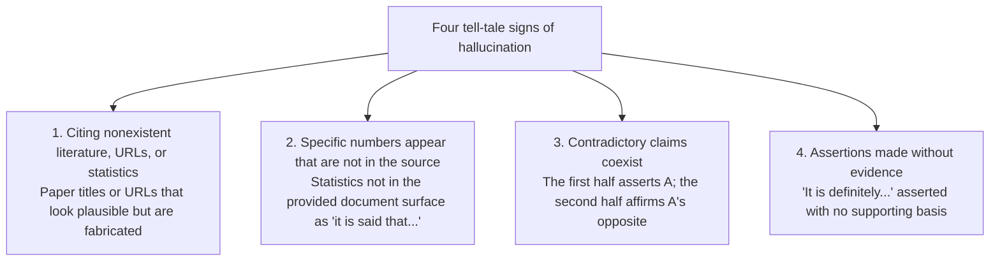

A point to watch carefully: a citation does not mean the output is safe. Verification that does not actually open the citation and check it is not verification. TS 2.3 covers this in detail.

On bias, Anthropic measures political bias using 1,350 pairs of opposing political viewpoints across 150 topics and 9 task types, evaluating fairness, acknowledgement of opposing viewpoints, and refusal rate [Source: Transparency Hub — https://www.anthropic.com/transparency]. Bias shows up as "supporting only one side," "ignoring opposing viewpoints," or "treating a particular group unfairly." On sensitive topics, build the habit of consciously checking "are both sides treated fairly?" and "is the output slanted toward one side?"

When you find inaccurate, biased, or harmful output, report it via `usersafety@anthropic.com` or in-product feedback (the thumbs-down button, etc.). The AUP (Usage Policy) explicitly lists the reporting channel [Source: Usage Policy — https://www.anthropic.com/legal/aup].

**Associate-level judgment guideline.** Build the habit of checking specific numbers, proper nouns, citations, and URLs against external sources to confirm they are not "plausible lies." Self-reported confidence is not an accuracy signal. Even when Claude answers with full confidence, that is not evidence of correctness. When in doubt, verify.

### Task Statement 2.3: Apply fact-checking and validation techniques

> **Associate-level framing.** This is a core to master. "Has a citation" does not equal "is verified." Verification means confirming an authoritative external source with your own eyes. Trusting a citation that Claude produced without opening it is not verification; it is mere reposting. Master the concept of verification "depth."

There are three basic strategies for reducing hallucination. First, the most effective is to allow Claude to say "I don't know." Simply instructing in the prompt — "if information is insufficient, do not guess; answer 'I don't know'" — drastically reduces misinformation. Second, use direct quotes as the basis for facts. Third, verify claims with citations and withdraw unsupported claims [Source: Reduce hallucinations — https://platform.claude.com/docs/en/test-and-evaluate/strengthen-guardrails/reduce-hallucinations].

When handling long texts (over 20k tokens), it is effective to instruct Claude to "first extract verbatim quotes from the source" before the task. Grounding the response in the source text prevents free invention. Instructing "append a supporting citation after each claim; if no citation can be found, withdraw that claim" makes the response auditable.

| Technique | Effect | Best for |
|------|------|-----------|
| Allow "I don't know" | Drastically reduces misinformation (most effective) | Default setting for all contexts |
| Extract verbatim quotes first | Grounds the response in the source and prevents invention | Summarizing long texts (over 20k tokens) |
| Mandate supporting citations | Makes the response auditable | Reports dense with factual claims |
| Restrict external knowledge | Prevents arbitrary memory-based completion | Tasks that should use only the provided document |
| Best-of-N verification | Detects inconsistency as a sign of hallucination | Important answers that need confirmation |
| Chain-of-thought verification | Verifies the reasoning process step by step | Outputs containing complex reasoning |
| Iterative refinement | Polishes and scrutinizes the output | Final drafts where quality matters |

An advanced technique is Best-of-N verification. It asks "the same question multiple times and checks whether the answers agree." If different answers come back, that location is likely a hallucination. Checking consistency across runs is a cheap and practical verification means. Restricting external knowledge — explicitly stating "use only the provided document; do not use general knowledge" — prevents Claude from arbitrarily filling in from memory.

**RAG (Retrieval Augmented Generation)** is a mechanism that searches an external knowledge base for relevant information at runtime and passes that information into the context to shape the response [Source: Glossary — https://platform.claude.com/docs/en/about-claude/glossary]. It is effective for information outside the training data, such as recent news or internal documents, but if the retrieved results are themselves inaccurate, the response built on them will also be inaccurate. The assumption that "if we use RAG, it is reliable" is dangerous.

These techniques dramatically reduce hallucination but cannot eliminate it entirely. Always verify important information. When you do, you must master two traps.

The first trap is **the verification trap**. Just because a citation is attached does not mean the citation is correct. Claude can present a nonexistent work as a source. "Verification" that does not actually open the citation and check it is not verification. Only when you confirm it yourself against an authoritative external source can it be called verification.

The second trap is **the known-miss signal**. When you find one factual error or omission, that is a signal that "there are likely others." Finding one is not the end; treat the other claims in the same output with suspicion and dig deeper.

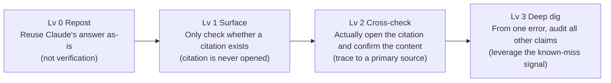

**Associate-level judgment guideline.** Verification is not "asking Claude's answer back to Claude itself." It is confirming an authoritative external source (an official document, a primary source, an expert) with your own eyes. When you find one error, assume "there are more" and dig deeper. Making Claude self-verify by asking "is this correct?" is no substitute for verification.

### Task Statement 2.4: Determine when human review or additional verification is required

> **Associate-level framing.** This is a core to master. Master two principles firmly: "in high-risk areas, do not have Claude self-verify; always route to a qualified professional's review," and "self-reported confidence is not an accuracy signal." Technical human-in-the-loop design is CCA-F prior knowledge, so we focus here on the judgment criteria of "when to route to a human."

There are contexts where Claude's output can be used directly and contexts where a qualified human professional must always review it. The AUP (Usage Policy) lists seven high-risk use cases that require human review (human-in-the-loop) and AI disclosure [Source: Usage Policy — https://www.anthropic.com/legal/aup].

| High-risk area | What is affected | Example |
|---------------|-----------------|-----|
| Legal | Rights and freedoms | Legal interpretation, contract drafting |
| Healthcare | Health and life | Medical diagnosis, treatment plans |
| Insurance | Money and coverage | Underwriting, benefits decisions |
| Finance | Money and property | Lending decisions, investment advice |
| Employment and housing | Opportunity and livelihood | Hiring, promotion, admission review |
| Academic testing | Opportunity and fairness | Entrance exams, certification exams |
| Media / journalism | Reputation and society | Reporting, article writing |

The AUP requires human-in-the-loop only "when subjective decisions directly affect individuals or consumers." In other words, in contexts that affect an individual's rights, livelihood, or property, a qualified professional must review the content and disclose the use of AI to the affected person. Disclosure is done at a minimum "at the start of the session." Hiding the fact that AI is being used is not allowed.

Here is the most important principle. **In high-risk areas, you must not have Claude self-verify.** Asking Claude "is this medical information correct?" and feeling reassured is no substitute for review. A qualified professional is a person who holds a license or expertise in that field. Delegating the review to Claude itself is not permitted.

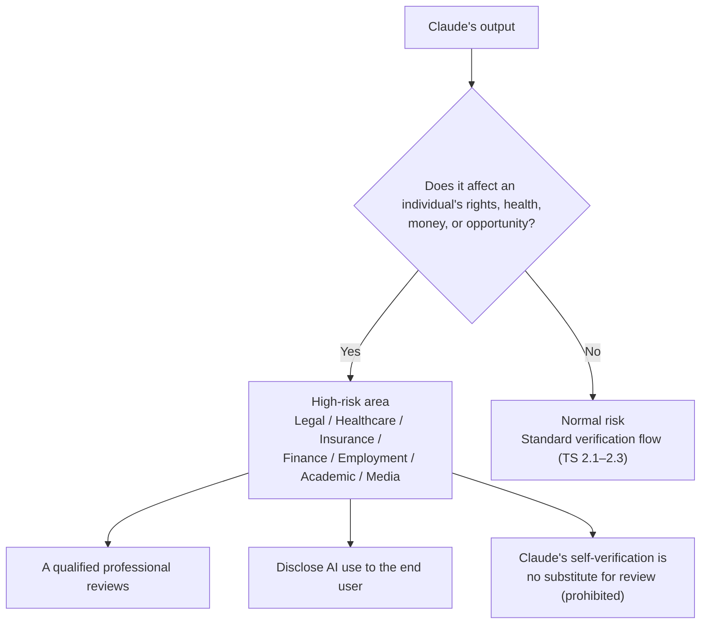

Note that, regardless of whether a use case falls in a high-risk area, all consumer-facing chatbots must disclose that the user is interacting with AI. This is stated in the AUP as an additional guideline.

The fact that underpins this principle bears repeating. **Self-reported confidence is not a reliable signal of accuracy.** Claude can be wrong with confidence. Even if Claude says "this is certain," that is not evidence of accuracy. There is no correlation between the expression of confidence and factual accuracy. That is precisely why, in high-risk areas, even when Claude itself is confident, confirmation by a qualified professional is indispensable.

**Associate-level judgment guideline.** If an output affects an "individual's rights, health, money, or opportunity," it is high-risk. First check whether it falls under Legal, Healthcare, Insurance, Finance, Employment, Academic, or Media. If it does, do not use Claude's output as-is; always have a qualified professional review it. Asking Claude "is this okay?" is no substitute for review.

### Task Statement 2.5: Edit, adapt, refine, and compare outputs for the intended audience

> **Associate-level framing.** It is not enough for the content of an output to be correct. The exam tests the business judgment of editing the output into the tone, level of detail, and format that fits the intended reader. Technical prompt engineering is CCA-F prior knowledge, so we focus here on the practical judgment of "how to adjust for the reader."

Even when an output is correct, it is useless if it does not fit the reader. Claude's tone, format, and style can be adjusted in three ways: specify role and style in the system prompt, reflect preferences in user settings (the Claude.ai settings screen), and switch style with the style feature. Even the same content can be tailored to different readers.

When the reader changes, the optimal expression changes too. The table below summarizes this relationship.

| Intended reader | Tone | Level of detail | Format |
|---------|--------|--------|-------------|
| Executives | Concise, assertive | Key points only | Three bullet points |
| Frontline practitioners | Practical, procedural | Detailed | Step-by-step procedure |
| External partners | Polite, formal | Sufficient and necessary | Tidy prose |
| Internal engineers | Precise, technical | High density | Code blocks and tables |

Newer models tend to produce a more direct style. To avoid a cold impression, state the tone explicitly in the prompt, for example "use a warm, collaborative tone and acknowledge the user's framework before answering." "Acknowledge the user's framework before answering" is an empathy technique — stating the other party's position first before getting to the main point — and noticeably changes the felt warmth [Source: System Prompts (Release Notes) — https://platform.claude.com/docs/en/release-notes/system-prompts].

A useful principle to know here: **the style of the prompt influences the style of the output.** Removing markdown from the prompt can reduce markdown in the output. An unadorned prompt tends to produce an unadorned output; a bulleted prompt tends to produce a bulleted output. If you want to deliberately change the output's form, bringing the prompt itself closer to that form is effective.

**Associate-level judgment guideline.** Even with the same content, the optimal expression changes when the reader changes. Before editing, define in one phrase "who reads this output." Trim for executives; add detail for the frontline. Do not use Claude's first draft as-is; always refine it at least once from the reader's perspective.

### Task Statement 2.6: Organize and curate information and select appropriate output formats

> **Associate-level framing.** Selecting an output format is a business decision driven by "what are we producing." Master the use of artifacts versus inline prose versus structured data, and the boundary between what structured outputs guarantee and what they do not. Technical JSON Schema implementation is CCA-F prior knowledge, so we focus here on "which format to choose in which context."

There are three choices for output format, each with strengths and weaknesses.

| Format | Characteristic | Best for |
|-------------|------|--------------|
| Artifacts | Editable and reusable in an independent panel | Documents, code, and charts to reuse later |
| Inline prose | The chat response itself | One-off explanations or answers |
| Structured data (JSON/XML) | Easy for downstream systems to process | API integration, data extraction, batch processing |

If a human will read it, inline prose or an artifact is appropriate; if a downstream system will process it, structured data fits.

The mechanism that guarantees conformity to a JSON schema is **Structured Outputs (constrained decoding)**. It forces Claude's response to conform to a specified JSON schema, eliminating parse errors, missing fields, and type violations. It is used for data extraction, classification, API formats, and structured reports [Source: Structured outputs — https://platform.claude.com/docs/en/build-with-claude/structured-outputs]. General consistency techniques (specifying a format, binding with examples, etc.) cannot reliably prevent schema violations. When you need strict JSON, use Structured Outputs.

There is, however, an important boundary. **A strict schema eliminates syntax errors but cannot prevent semantic errors.** What the schema guarantees is only "the shape is correct." Even if the value of a number is wrong, it will pass as long as the type matches.

```
 ┌─────────────────────────────────────────────────┐
 │     What Structured Outputs guarantee / do not   │
 ├────────────────────┬────────────────────────────┤
 │  Guaranteed (syntax) │  Not guaranteed (semantics) │
 ├────────────────────┼────────────────────────────┤
 │  JSON validity      │  Accuracy of numeric values │
 │  Presence of          │  Whether the totals add up  │
 │    required fields    │  Whether the value is in    │
 │                       │    the right field          │
 │  Type matching       │  Logical soundness of content│
 │  Disappearance of parse errors │                  │
 └────────────────────┴────────────────────────────┘
```

Structured Outputs make you safe only up to syntax. Semantic correctness (whether totals add up, whether a value is in the right field) must be confirmed separately by a human or by code.

As techniques for improving consistency, the official guide lists five [Source: Increase output consistency — https://platform.claude.com/docs/en/test-and-evaluate/strengthen-guardrails/increase-consistency]. Be explicit about the format (state exactly whether JSON, XML, or a template), bind with examples (give few-shot examples to show concrete output), use retrieval for contextual consistency, chain prompts for complex tasks (break into smaller subtasks and focus on each), and keep Claude in character. Showing concrete output examples rather than abstract instructions sharpens Claude's understanding.

**Associate-level judgment guideline.** Choose the format by "how the deliverable will be used." For documents or code to reuse later, use an artifact. For data to hand to a downstream system, use Structured Outputs for JSON. For a one-off answer, use inline prose. When you need strict JSON, just writing "output JSON" in the prompt is insufficient. Use Structured Outputs to eliminate schema violations. Note, however, that they do not guarantee semantic correctness, so content must still be confirmed separately.

> **Common pitfall.** The "fluency and confidence" of an output is not proof of accuracy (the biggest distractor). Even if it looks polished, cross-check against a checklist of required items, and verify numbers, citations, and domain names against primary sources (original documents, official announcements). Judge completeness by "are all required elements included?" and do not confuse it with readability. For large batches, if checking every item is infeasible, estimate the error rate with a representative sample; do not settle for skimming or self-reported confidence. Set the depth of review by the risk of the content (impact on money, health, rights); the greater the stakes, the stricter the review, even for the same format. Making Claude "check once more" is no substitute for verification.

**Sources (Domain 2):**
- Reduce hallucinations — https://platform.claude.com/docs/en/test-and-evaluate/strengthen-guardrails/reduce-hallucinations
- Increase output consistency — https://platform.claude.com/docs/en/test-and-evaluate/strengthen-guardrails/increase-consistency
- Structured outputs — https://platform.claude.com/docs/en/build-with-claude/structured-outputs
- Define success criteria and build evaluations — https://platform.claude.com/docs/en/test-and-evaluate/develop-tests
- Glossary (HHH, RAG) — https://platform.claude.com/docs/en/about-claude/glossary
- System Prompts (Release Notes) — https://platform.claude.com/docs/en/release-notes/system-prompts
- Transparency Hub — https://www.anthropic.com/transparency
- Usage Policy — https://www.anthropic.com/legal/aup

---

## Domain 3: Product and Model Selection

Domain 2 covered "how to judge an output after you receive it." Domain 3 sits upstream of that: the choices made before an output is generated. Which product features to combine, and which model to assign. CCAO-F does not ask about API or MCP technical detail; it asks for the practical judgment of using Claude.ai's product features and model tiers. We assume the API knowledge from CCA-F and focus here on the judgment of "what to choose in which context."

### Overview of Domain 3's Decision Targets

The four Task Statements of Domain 3 split into two questions: "which features to use" (TS 3.1) and "which model to assign" (TS 3.2–3.3), plus "how to manage context" (TS 3.4), which underpins both.

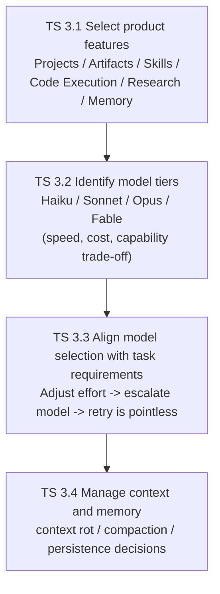

Choose features (TS 3.1), assign a model (TS 3.2–3.3), and keep context intact while running (TS 3.4): that is the flow of Domain 3.

### Task Statement 3.1: Select appropriate Claude product features

> **Associate-level framing.** CCA-F (Architect) asks about API and MCP technical detail; CCAO-F asks "which Claude.ai product feature to use in which context" as practical judgment. Master each feature's role and its right fit.

Claude.ai is not a single chat; it is a set of purpose-specific features. Each feature is designed to solve a different problem, and the basic approach is to reason backward from the verb of the purpose. Are you gathering external information? Computing data? Running a recurring task on the same premises? Producing a deliverable to reuse later? Answering these questions naturally determines the feature.

Here is an overview of the six main features.

| Product feature | What it does | When to use it |
|---------------|-----------|-----------|
| **Projects** | A self-contained workspace configured with instructions and knowledge sources | Recurring work on the same premises |
| **Artifacts** | Editable, reusable deliverables in an independent panel | Documents, code, and charts to reuse later |
| **Agent Skills** | Modular, on-demand expertise | Domain work where you write the same instructions repeatedly |
| **Code Execution** | Runs Python and bash in a sandboxed container | Computation, data analysis, file generation |
| **Research mode** | Agentic search across multiple sources | Open-ended information gathering |
| **Memory** | Persistent knowledge across sessions | Holding facts to reuse in future sessions |

For each feature, the key characteristics and decision points are as follows.

**Projects** are self-contained workspaces that organize work with instructions and knowledge sources. Files are stored in a project-specific knowledge base and available to all users, including Free users (Free is capped at 5 projects). On paid plans (Pro/Max/Team/Enterprise), RAG is enabled automatically as knowledge approaches the context limit, expanding capacity by up to about 10x. In other words, even if you place a large volume of reference documents in a project, Claude searches them automatically and grounds its responses. On Team/Enterprise, projects can be shared within the organization, with permission levels "Can use" (view only) and "Can edit" (editable) [Source: What are projects? — https://support.claude.com/en/articles/9517075-what-are-projects].

**Artifacts** are deliverables that are edited and reused in an independent panel rather than as an inline chat response. They create, manage, and collaboratively edit documents, code, diagrams, and structured data. Documents and code that will be reused downstream are good candidates for Artifacts.

**Agent Skills** are modular, on-demand expertise. They consist of a SKILL.md and resources, and built-in Skills exist for PowerPoint, Excel, Word, and PDF. Skills use **progressive disclosure**. They load in stages — Level 1 (metadata, always loaded at startup, about 100 tokens), Level 2 (the SKILL.md body, loaded when triggered, under 5k tokens), and Level 3 (resources and scripts, only when needed) — so installing many Skills does not waste context when they are idle. Each Skill's `description` should state both "what it does" and "when to use it." Claude reads this description to decide whether the Skill is usable [Source: Agent Skills overview — https://platform.claude.com/docs/en/agents-and-tools/agent-skills/overview].

**Code Execution** runs Python and bash in a sandboxed container. Internet access is fully blocked, and packages cannot be installed at runtime. Instead, major libraries such as pandas, numpy, scipy, scikit-learn, matplotlib, seaborn, and sympy are preinstalled. It suits complex computation, data analysis, and file generation, and Claude automatically runs code "where computation or file handling is useful" and responds directly for "simple arithmetic or fact-checking." Resource limits are 5 GiB memory, 5 GiB disk, and 1 CPU, and the container expires after 30 days [Source: Code execution tool — https://platform.claude.com/docs/en/agents-and-tools/tool-use/code-execution-tool].

**Research mode** is an agentic search for open-ended information gathering. It is not a workflow-style search that follows predefined paths; Claude autonomously traverses, cross-checks, and synthesizes across multiple sources. Its nature differs from the one-shot processing of Code Execution.

**Memory** is persistent knowledge across sessions. It is not the retention of conversation history; it selectively holds facts to reuse in future sessions (user preferences, project premises, settled decisions). Holding a long conversation history as-is is not Memory's job.

These features are chosen by reasoning backward from the verb of the task's purpose.

```
 ┌──────────────────────────────────────────────────┐
 │        Purpose verb -> Recommended feature       │
 ├──────────────────────────────────────────────────┤
 │                                                  │
 │  "Gather external info"  -> Research mode        │
 │  "Compute data"          -> Code Execution       │
 │  "Make or analyze a chart" -> Code Execution     │
 │  "Repeat on same premises" -> Projects           │
 │  "Deliverable to reuse"  -> Artifacts            │
 │  "Expert procedure, often" -> Agent Skills       │
 │  "Persist settings across sessions" -> Memory    │
 │                                                  │
 │  ※ One-off immediate answer -> inline chat reply │
 └──────────────────────────────────────────────────┘
```

**Associate-level judgment guideline.** Try to express the purpose of the task in a single verb. If that verb matches one in the table above, the corresponding feature is the first candidate. If it matches none, the inline chat reply is often enough. Before choosing a feature, the habit of defining "what does this task want to do?" in one phrase speeds up the decision.

### Task Statement 3.2: Differentiate between Claude model types (Haiku, Sonnet, Opus)

> **Associate-level framing.** Model selection is a business decision of "cost, speed, quality." Build an intuitive grasp of each model's position (what it is good at and what it is not) and the magnitude of the cost difference. API technical detail is CCA-F prior knowledge, so we focus here on the judgment of "which model to assign to which work."

Claude's models fall into four tiers. From the bottom up: Haiku, Sonnet, Opus, and Fable; as capability rises, the model becomes slower and more expensive. This trade-off is a design premise, not a defect. Choosing the right tier for the task's nature is the core judgment of Domain 3.

The four models compared on speed, cost, capability, context, and maximum output:

| Model | Speed | Input $/MTok | Output $/MTok | Context | Max output | Best use |
|--------|------|-------------|-------------|-------------|---------|---------|
| **Haiku 4.5** | Fastest | $1 | $5 | 200k | 64k | High-volume, low-complexity, high-frequency |
| **Sonnet 5** | Fast | $3 (intro $2) | $15 (intro $10) | 1M | 128k | Balance of speed and quality |
| **Opus 4.8** | Moderate | $5 | $25 | 1M | 128k | Complex reasoning, agentic coding |
| **Fable 5** | Slower | $10 | $50 | 1M | 128k | Long-running agents, hardest tasks |

[Source: Models overview — https://platform.claude.com/docs/en/about-claude/models/overview]

Grasping the magnitude of the cost difference matters. Haiku's input cost is one-tenth of Fable's, and so is its output cost. For large-volume processing, this gap maps directly to the bill. For example, to process one million tokens of input, Haiku costs $1 and Fable costs $10. Always using the top model wastes the cost and latency budget.

On capability, higher-tier models reason more deeply and handle edge cases more carefully, but at the cost of higher latency. In the official documentation's evaluation, Haiku is "Fastest," Sonnet is "Fast," Opus is "Moderate," and Fable is "Slower" [Source: Models overview — https://platform.claude.com/docs/en/about-claude/models/overview].

Maximum output also differs. Opus, Sonnet, and Fable can produce 128k tokens in a single request, but Haiku is capped at 64k. For long reports or large code generation in a single pass, Haiku's 64k may be insufficient.

Note the reliable knowledge cutoff as well. Haiku's is Feb 2025, while the other three are Jan 2026. Haiku is trained on a slightly older knowledge base [Source: Models overview — https://platform.claude.com/docs/en/about-claude/models/overview].

Support for adaptive thinking also varies by tier. On Fable 5, adaptive thinking is always on. Opus 4.8 and Sonnet 5 support adaptive thinking. Haiku 4.5 does not support adaptive thinking but is the only model that supports extended thinking. Adaptive thinking is a mechanism that automatically adjusts reasoning depth; on supported models, it is controlled with the effort parameter (covered in detail in TS 3.3).

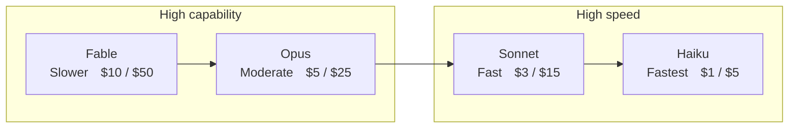

As capability rises, the model becomes slower and more expensive. Fable is the highest capability and highest cost; Haiku is the highest speed and lowest cost.

**Associate-level judgment guideline.** Be able to recite the three tiers instantly: "High-volume, low-complexity work — Haiku," "mid-sized tasks wanting a balance of speed and quality — Sonnet," "complex reasoning or agentic long-running work — Opus, and for the hardest long-running work — Fable." With this tier structure in mind, the first candidate is fixed the moment you see a task.

### Task Statement 3.3: Align model selection with task requirements (cost, speed, quality)

> **Associate-level framing.** This is a core to master. Model selection is not "blindly choosing the top model"; it is the business judgment of assigning one of three tiers (Haiku/Sonnet/Opus) according to the task's nature. Master the three principles: "escalate when capability is insufficient," "retrying on the same model is pointless," and "adjusting effort takes precedence over switching models."

Once you know the model tiers, the next question is how to assign them to actual tasks. The official guide presents two starting approaches.

**Option 1: Start from Haiku.** Suited to cost-sensitive, high-volume, low-complexity work. Prototyping, tight latency requirements, cost-sensitive processing, and large volumes of routine work all qualify. Implement, test, and escalate only the spots where capability is insufficient.

**Option 2: Start from Opus.** Suited to complex reasoning, science and math, understanding that needs nuance, and work where accuracy outweighs cost. Advanced coding and highly autonomous agent work qualify. Implement, optimize the prompt, and once stable, lower effort or step down a model to improve efficiency [Source: Choosing a model — https://platform.claude.com/docs/en/about-claude/models/choosing-a-model].

Whichever you start from, mid-course you will face the adjustment "this model is insufficient" or "this model is too expensive." This is where the **effort parameter** comes in.

The effort parameter is a mechanism that adjusts "how deeply to think" within a single model. On Opus/Sonnet, you can trade intelligence against latency and cost with effort. On Opus 4.8, `high` is the default across all surfaces (API, Claude Code, claude.ai), and `xhigh` (between high and max) is recommended for coding and highly autonomous work.

The official guide states that "adjusting effort is often a better lever than switching models" [Source: Choosing a model — https://platform.claude.com/docs/en/about-claude/models/choosing-a-model]. In other words, even in the situation "Sonnet is insufficient, Opus is too expensive," you can first try raising or lowering effort to overturn the conclusion. Switching models is the next lever.

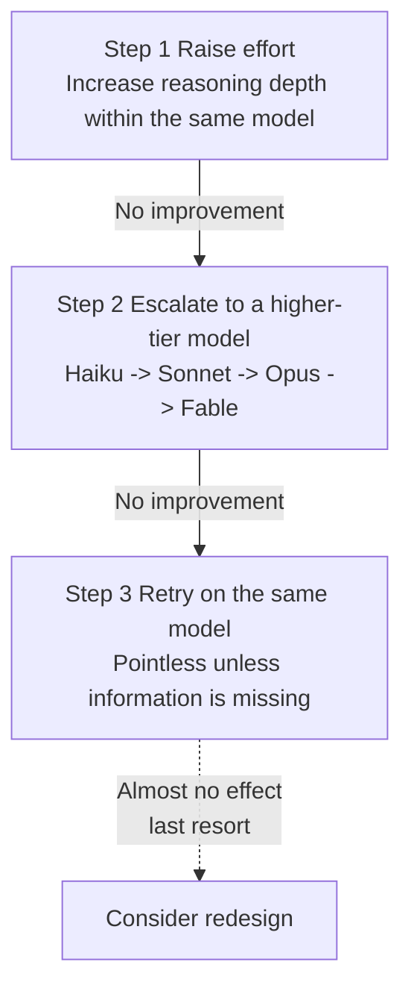

Effort adjustment is first, model escalation is second, and retry is the last resort (almost no effect).

Here we state a core principle with clarity. **When capability is insufficient, you should escalate to a higher-tier model. Re-running on the same model brings no improvement.** No matter how many times you retry on the same model, you only get the same shallow answer. Retry is meaningful only "when information is missing" (that is, when the required information has not been added to the prompt). If the cause is capability, escalate; if it is information, supply it. Identify the cause and choose the right response.

There is also a trap when you want to lower cost. "Turn off features to reduce cost" is the wrong answer. Disabling a feature does not change the model's trade-off of cost, speed, and capability. Toggling features does not change capability. The right approach is "switch to a lower-cost model that fits the task." Switching platforms is the same; the trade-off is not resolved.

The relationship between effort adjustment and model switching can be summarized as the following decision flow.

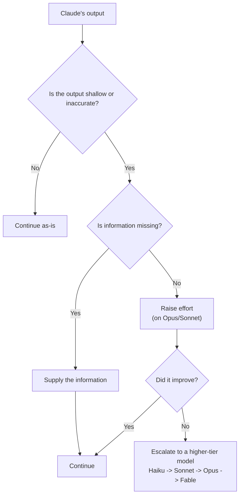

Retry on the same model is not selected on any branch.

When judging escalation or downgrade, base the decision on measurement, not feel. The official guide recommends the following order: build a use-case-specific benchmark, test on real prompts and data, compare accuracy, quality, and edge-case handling across models, and weigh the performance and cost trade-off. Following this procedure removes the assumption "Opus is probably better somehow."

**Associate-level judgment guideline.** If an output feels shallow, inaccurate, or not fully grasping the instructions, first raise effort (on Opus/Sonnet). If that is still insufficient, escalate to a higher-tier model. Do not repeat retries on the same model. Conversely, to lower cost, do not turn off features; switch to a lower-cost model that fits the task.

### Task Statement 3.4: Understand and manage context limitations and memory considerations

> **Associate-level framing.** The context window is Claude's "short-term memory." The exam tests not only its size (200k–1M) but also the fact that accuracy degrades as it grows longer (context rot), and what to do when it grows too long (compaction, restart, persistence). Master the term definitions firmly.

Even after choosing a model and features, there is one more thing to manage: context. The **context window** is all the text the model can reference when generating a response. It is not the model's training data; it is the "working memory" for that single request. The system prompt, all past messages, tool definitions, tool results, images, and the output and thinking tokens generated in that turn all consume this budget.

The context window size is 200k for Haiku and 1M for Sonnet/Opus/Fable. If the input alone exceeds this budget, the API returns a "prompt is too long" error [Source: Context windows — https://platform.claude.com/docs/en/build-with-claude/context-windows].

There is a trap here, however: the assumption "the window is wide, so it's fine." Just because 1M tokens fit does not mean you should pack in 1M tokens. As the token count grows, precision and recall degrade. This phenomenon is called **context rot**. The more tokens, the easier it is to miss information near the middle.

The official guide stresses that "what you put in the context matters as much as the free space" [Source: Context windows — https://platform.claude.com/docs/en/build-with-claude/context-windows]. In other words, removing irrelevant information directly improves performance. The curation of content matters as much as the size of the window.

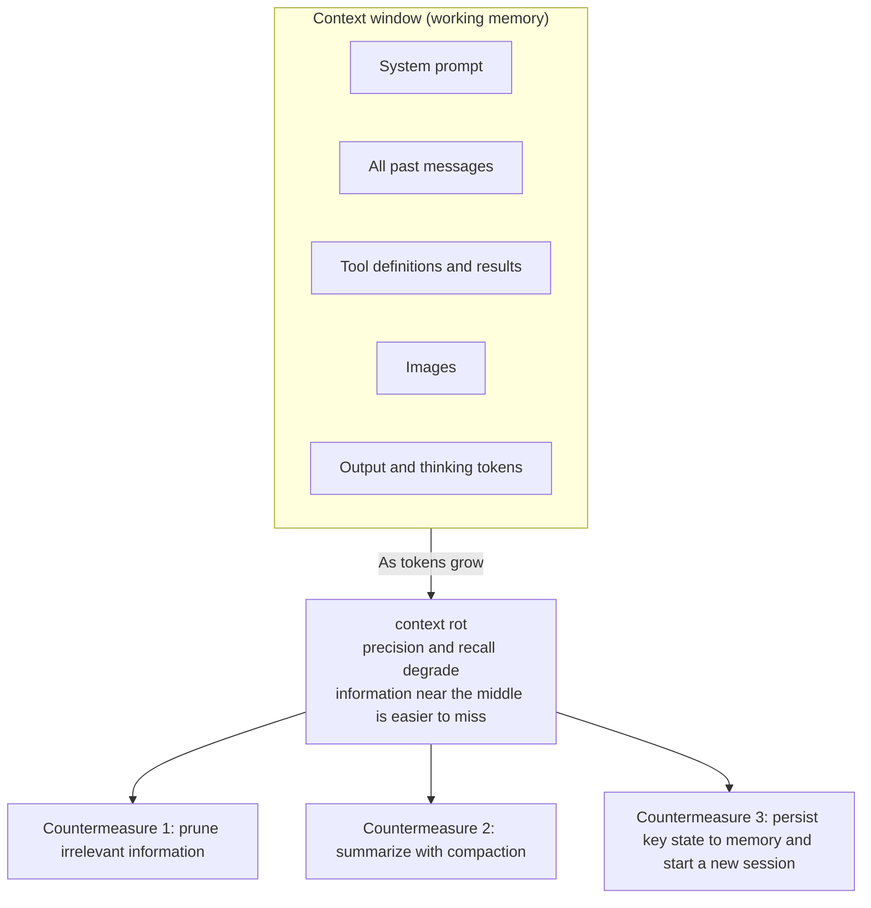

When context grows too long, there are three countermeasures.

First, prune irrelevant information. This alone improves performance. Second, use **compaction**. As a conversation approaches the context window limit, the server automatically summarizes older turns to free space, letting the conversation continue without being cut. Compaction is available (beta) on Claude Fable 5, Opus 4.8, Opus 4.7, Opus 4.6, Sonnet 5, and Sonnet 4.6 [Source: Compaction — https://platform.claude.com/docs/en/build-with-claude/compaction]. Third, persist key state to memory and restart in a new session.

The use of these three countermeasures is summarized below.

| Countermeasure | When to use | Effect |
|--------|-----------|------|
| Prune information | Irrelevant exchanges are mixed in | Immediate performance improvement |
| Compaction | You want to continue a long multi-turn conversation | Frees space without cutting the conversation |
| Restart in a new session | The whole conversation has degraded and only key state should remain | A clean restart |

Beyond compaction, there are two specialized strategies for agent workflows. One is **clearing tool results**: as an agent calls tools multiple times, old tool results accumulate, so you delete results that are no longer referenced to free space. The other is **clearing thinking blocks**: when extended thinking is generated, thinking tokens also consume context, so previous turns' thinking blocks are explicitly removed as needed.

Some models also have a feature called **context awareness**, a mechanism by which the model tracks its remaining token budget. Sonnet 5, Sonnet 4.6, Sonnet 4.5, and Haiku 4.5 support it. The API automatically injects the remaining capacity into the system prompt, so the user does not need to configure it. Building on this feature, if you persist key state (decisions, progress, premises) to memory or files before context runs out, you can carry the context into a new session [Source: Context windows — https://platform.claude.com/docs/en/build-with-claude/context-windows].

**Associate-level judgment guideline.** When a conversation grows long and response quality degrades, that is a sign of context rot. First prune unneeded past exchanges. If that is insufficient, summarize with compaction. If still insufficient, persist key state to memory and restart in a new session. Rather than persisting long conversations as-is, the correct practice is to write only valuable information to memory.

> **Common pitfall.** Base model selection only on "task complexity and reasoning depth" versus "acceptable cost and turnaround." Choosing by the model used in the previous task, an open tab in another window, login state, or the recency of a release is the wrong answer. The lightweight tier (Haiku) suits simple, high-volume, high-frequency work; the heavyweight tier (Opus/Fable) suits complex reasoning where mistakes are costly; the mid tier (Sonnet) suits everyday nuanced work. The same applies to product features: Artifacts for a growing deliverable that you keep editing, the chat reply for a one-off immediate answer, Project knowledge for reusable reference documents, and Research mode for multi-step investigation of external information. When a long conversation starts forgetting instructions or contradicting itself, switch to a new conversation and carry over only the necessary materials.

**Sources (Domain 3):**
- Models overview — https://platform.claude.com/docs/en/about-claude/models/overview
- Choosing the right model — https://platform.claude.com/docs/en/about-claude/models/choosing-a-model
- Context windows — https://platform.claude.com/docs/en/build-with-claude/context-windows
- Compaction — https://platform.claude.com/docs/en/build-with-claude/compaction
- Agent Skills overview — https://platform.claude.com/docs/en/agents-and-tools/agent-skills/overview
- Code execution tool — https://platform.claude.com/docs/en/agents-and-tools/tool-use/code-execution-tool
- Using agent memory — https://platform.claude.com/docs/en/managed-agents/memory
- Effective context engineering — https://www.anthropic.com/engineering/effective-context-engineering-for-ai-agents
- Claude for work — https://www.anthropic.com/learn/claude-for-work

---

## Domain 4: Workflow Integration and Solution Design

### Task Statement 4.1: Apply Claude to analyze requirements and use cases

**Knowledge:**
- The Claude for work learning hub offers department-specific guides (Engineering, HR, Marketing, Product Management, Sales) for use-case discovery
- Enterprise AI diagnostic methods. Surface and prioritize use cases before building

**Skills:**
- Analyze a business process and find where Claude adds value
- Use department-specific guides to map Claude onto functional workflows
- Prioritize use cases by impact and feasibility

### Task Statement 4.2: Leverage Claude for research, planning, and process optimization

**Knowledge:**
- Research mode as agentic multi-source search. Analysis tools and Google Docs integration for planning
- Simple, composable patterns. Workflows (orchestrate LLMs along predefined paths, high predictability) and agents (autonomously direct the process, high flexibility)
- Workflow patterns. Prompt chaining (sequential subtasks), routing (classify and dispatch, for example easy items to Haiku and hard items to Sonnet), and parallelization (sectioning and voting)

**Skills:**
- Use Research and analysis tools for planning and process optimization
- Choose the simplest composable pattern that solves the problem
- Apply routing and chaining to optimize multi-step processes

### Task Statement 4.3: Use Claude to support solution design, development, and iteration

**Knowledge:**
- The most successful Claude implementations start simple. Begin with direct prompts and built-in product features, and add complexity only when the need is justified
- Iterating prompts and configuration against defined success criteria produces better results than aiming for perfection in one shot
- Combining Claude with existing tools and knowledge sources is usually more effective than replacing an entire workflow

**Skills:**
- Iterate Claude-assisted solutions using feedback and defined success criteria
- Start from the simplest approach whose effect is confirmed, and add complexity only when justified
- Combine Claude with existing tools and knowledge rather than rebuilding the workflow from scratch

### Task Statement 4.4: Integrate Claude into existing workflows to augment or redesign them

**Knowledge:**
- The augment-or-redesign decision. Wire existing tools (GitHub, Google Docs, connectors) or rebuild the workflow
- Tool integration. GitHub, Google Docs, analysis tools, Research, Projects, Artifacts, Skills. Teams connect tools without replacing workflows

**Skills:**
- Judge whether to augment or redesign a given workflow
- Connect Claude to existing tools via integrations and connectors

### Task Statement 4.5: Communicate Claude's value and limitations to stakeholders

**Knowledge:**
- Quantified outcomes that back stakeholder communications (for example, 97 minutes saved per user per week on Slack, 87% reduction in support time at Lyft, and Moody's compressing credit-memo creation from 40 hours to 2 minutes) [Source: Claude enterprise solutions — https://claude.com/solutions/enterprise]
- Communication patterns. Quantify outcomes, frame AI as augmentation rather than replacement, be transparent on cost, and reinvest freed capacity into reskilling
- Communicate limitations (cost, drift, the need for human oversight) alongside value

**Skills:**
- Quantify Claude's value and present it to stakeholders
- Frame AI as augmentation that redirects capacity to higher-value work
- Be transparent about cost, limitations, and the need for oversight

**Sources (Domain 4):**
- Claude for work — https://www.anthropic.com/learn/claude-for-work
- Anthropic Academy — https://www.anthropic.com/learn
- Building effective agents — https://www.anthropic.com/engineering/building-effective-agents
- Advantage Solutions — https://www.anthropic.com/customers/advantage-solutions
- Cox Communications — https://www.anthropic.com/customers/cox-and-accenture
- LG CNS — https://www.anthropic.com/customers/lg-cns
- Brainlabs — https://www.anthropic.com/customers/brainlabs
- Enterprise solutions — https://claude.com/solutions/enterprise

---

## Domain 5: Configuration and Knowledge Management

Domain 4 covered "how to combine multiple features into a single workflow." Domain 5 is the foundation that supports that workflow. How do you make Claude remember the work context, and how do you keep it current? Concretely: project configuration, connector wiring, instruction writing, and the maintenance of knowledge and memory. CCAO-F does not ask about API/SDK technical detail; it asks for the practical ability to use Claude.ai's product features (Projects, connectors, Memory, Skills).

> **Associate-level framing.** CCA-F (Architect) asks about API and MCP technical detail; CCAO-F asks "how to make Claude remember the work context" using Claude.ai's product features, as practical judgment. API/SDK technical detail was already covered in CCA-F, so we focus here on each feature's role, the setup procedure, and how good or bad configuration affects output.

> **Term premise.** A "**project**" is the Claude.ai Projects feature (a workspace with its own chat history and knowledge). A "**knowledge source**" is the collective term for files imported into a project and data connected to it. A "**connector**" is the mechanism that links an external data provider (Google Drive, Gmail, etc.) to a project. A "**sync source**" is a data source continuously synchronized through a connector.

### Overview of Domain 5's Components

The four Task Statements of Domain 5 are easiest to understand as a single flow: assemble a project (TS 5.1), wire external data (TS 5.2), write instructions (TS 5.3), and maintain it in operation (TS 5.4).

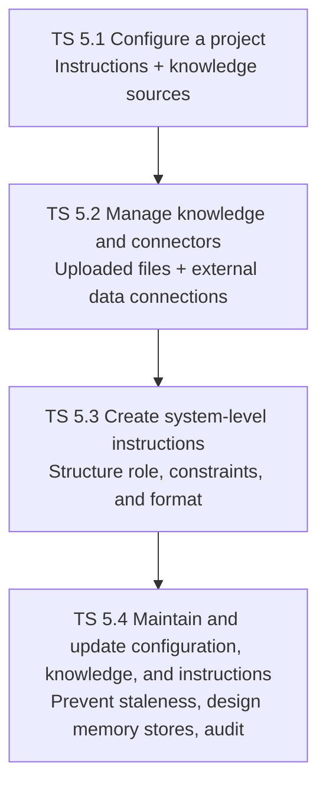

Configure, wire, write, and maintain. These four stages are the project lifecycle.

### Task Statement 5.1: Configure Claude Projects with instructions and knowledge sources

> **Associate-level framing.** Projects are the most basic mechanism in Claude.ai for fixing the "work context." Master the difference between the two components — instructions and knowledge sources — and why the quality of each directly drives output quality. API technical detail is CCA-F prior knowledge, so we focus here on the practical judgment of "what to place, and how."

A project is a self-contained workspace that fixes the work context for Claude. It has an independent chat history and knowledge base and does not share context with other projects. The basic practice is to split projects by purpose (creating sales materials, research, weekly reports, etc.). Free users can have up to 5 projects; paid plans relax the limit.

A project consists of two components. The first is **instructions**, a system-level prompt that defines the role, tone, and rules. You can think of it as the "base settings for Claude" that apply commonly to every chat in the project. The second is **knowledge sources**, the collective term for uploaded files and connected data. These are the "materials" Claude references as the basis for responses. Separating these two is the starting point of project design.

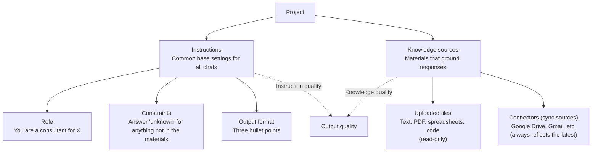

Uploaded files are stored as read-only project knowledge that grounds Claude's responses, including text, PDFs, spreadsheets, and code. Because Claude returns answers based on the document content rather than guessing, unsupported responses decrease.

There is a mechanism that preserves quality even as the volume of knowledge grows. On paid plans (Pro/Max/Team/Enterprise), **RAG (Retrieval Augmented Generation)** is enabled automatically as the knowledge volume approaches the context limit, expanding capacity by up to about 10x. Even with a large volume of reference documents in a project, Claude searches and grounds automatically, preserving response quality [Source: What are projects? — https://support.claude.com/en/articles/9517075-what-are-projects].

A principle bears emphasis here. **The quality of the instructions and knowledge sources determines the quality of the output.** Vague instructions or inappropriate materials produce only low-accuracy answers. The procedure itself — writing instructions in the "Project instructions" field and adding materials from the "Files" section in the project's settings — is simple, but what you write and what you place there decides the outcome. Permanently mounting the templates and past deliverables needed for recurring work (weekly reports, etc.) saves the effort of re-explaining context every time. Note, however, that mixing contradictory materials in a single project makes Claude unable to decide which to ground in, destabilizing the output.

**Associate-level judgment guideline.** When creating a project, first separate "instructions" from "knowledge sources." Write the role, constraints, and output format in the instructions. Place only materials directly relevant to the project's purpose in the knowledge sources. If the purpose differs, split into separate projects. Not overloading a single project is the foundation of preserving accuracy.

### Task Statement 5.2: Manage uploaded knowledge and connectors (e.g., Google Drive, Gmail)

> **Associate-level framing.** Connectors are the mechanism for pulling external data into a project. This is a core to master, and the judgment of "narrowing a connector's scope" is the key to correct answers. Master firmly the difference between sync sources and uploaded files, connector access permissions, and the harms of an over-broad scope.

There are two kinds of knowledge sources. One is uploaded files — static materials fixed at the moment they are imported into the project. The other is **sync sources** via connectors — living materials that are continuously synchronized from external data providers and always reflect the latest. Supported providers span Google Drive, Gmail, GitHub, Slack, Salesforce, Google Calendar, Asana, Outline, and MCP resources.

Connectors link external data sources to a project so that Claude can reference their content. Access follows the user's own permissions. A file you cannot view in Google Drive cannot be read through the connector either. Claude accesses data only when explicitly asked and retrieves the minimum information necessary.

Google Workspace connectors (Gmail, Google Calendar, Google Drive) are available to all users. What each connector can and cannot do:

| Connector | Can | Cannot |
|---------|-----------|-------------|
| **Gmail** | Search, read, and draft email | Send |
| **Google Calendar** | Check and create events | (deleting events is limited) |
| **Google Drive** | Read Docs, Sheets, Slides, and PDFs | Edit |

Responses include citations (with links) back to the source, so provenance is traceable [Source: Use Google Workspace connectors — https://support.claude.com/en/articles/10166901-use-google-workspace-connectors].

For team operations, the governance mechanism also matters. On Team and Enterprise, an Owner or Primary Owner must enable connectors at the organization level before individual users can authenticate. This is the mechanism for centrally managing data governance. Note also that adding sync connectors to a project is enabled **only for private projects** and disabled for shared projects.

Here we clarify an important core judgment. **Narrow a connector's scope to the minimum necessary.** The design "connect the entire shared drive and instruct Claude to ignore the rest" is unreliable. Irrelevant files mix into the search target, and accuracy drops. The contrast is shown below.

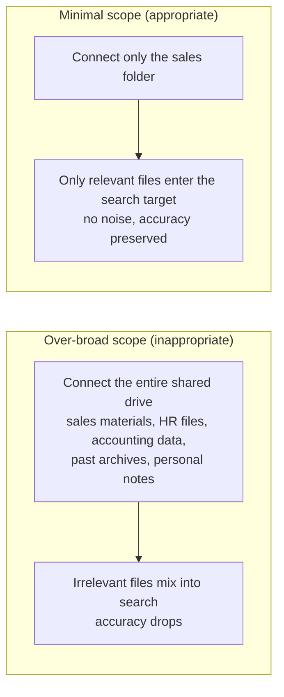

The practical procedure is as follows. From the "+" button in the chat input, choose "Connectors" and turn on the target provider. The first time, OAuth authentication runs. For external tools or internal systems that standard connectors do not cover, use the MCP (Model Context Protocol) connector, a general-purpose mechanism (the technical detail of MCP is the territory covered in CCA-F, so for the Associate it is enough to understand that "an MCP connector links external tools").

**Associate-level judgment guideline.** When adding a connector, ask yourself "which folders or threads does this project truly need?" Narrow to specific folders or labels, not the entire shared drive or the entire inbox. Leaving unused connectors in place lets irrelevant data mix into the search target and lowers accuracy. Disconnect connectors you no longer use, early.

### Task Statement 5.3: Create effective system-level instructions

> **Associate-level framing.** This is a core to master. Master the two traps firmly: "packing instructions into one long paragraph causes the middle to be ignored," and "without restricting the source, guesses creep in." Build a practical feel for structuring with XML tags and the "data on top, question at the bottom" placement principle.

The system prompt is the base setting that tells Claude "how to behave in this project." Write prompts clearly and directly, use XML tags for structure, and give Claude a role. Then maintain **appropriate altitude** — neither too rigid nor too loose. Appropriate altitude does not mean avoiding technical terms and becoming childish; it means the precision that can be judged without context.

There is a practical quality criterion: the **golden rule**, which says "show your prompt to a colleague who has only minimal context; if that colleague is confused, Claude will be confused too." Clarity from a third-party perspective is the practical bar for prompt quality.

Project instructions cover three elements: role, constraints, and output format. Giving a role focuses Claude's behavior and tone on that use case; even a single sentence helps. Constraints, such as "answer 'unknown' for anything not in the materials, do not guess," define the boundaries of Claude's judgment. Output format, such as "three bullet points," specifies the shape of the deliverable. Separating these three elements with XML tags ensures Claude recognizes each reliably.

Here is a contrast that cuts to the core. **Packing multiple rules into one long paragraph causes the middle to be ignored.** This is the difference between bad and good instructions.

```
 ┌───────────────────────────────────────────────────────┐
 │      Bad vs good instructions (contrast in structure)  │
 ├───────────────────────────────────────────────────────┤
 │                                                       │
 │  ✕ Bad (one long paragraph)                           │
 │  ┌─────────────────────────────────────────┐         │
 │  │ You are a sales consultant. Answer      │         │
 │  │ concisely. Do not guess what is not in  │         │
 │  │ the materials. Use a polite tone.       │         │
 │  │ But be comprehensive. In three bullets. │         │
 │  │ Refer to past data as needed.           │         │
 │  └─────────────────────────────────────────┘         │
 │  -> Middle rules get buried; contradiction            │
 │     (concise + comprehensive) is unresolved           │
 │                                                       │
 │  ◎ Good (topic-based with XML tags)                   │
 │  ┌─────────────────────────────────────────┐         │
 │  │ <role>Sales consultant</role>            │         │
 │  │ <constraints>                            │         │
 │  │  - Answer 'unknown' for anything not in  │         │
 │  │    the materials                         │         │
 │  │  - Past data may be referenced           │         │
 │  │ </constraints>                           │         │
 │  │ <format>Three bullet points, polite tone │         │
 │  │ </format>                                │         │
 │  │ <priority>Prioritize conciseness. Only   │         │
 │  │  go beyond three points if unavoidable   │         │
 │  │ </priority>                              │         │
 │  └─────────────────────────────────────────┘         │
 │  -> Each rule stands alone; the contradiction has an  │
 │     explicit priority order                           │
 │                                                       │
 └───────────────────────────────────────────────────────┘
```

As this contrast shows, for contradictory instructions ("concise" and "comprehensive"), state a priority or exception explicitly. With unstructured instructions, Claude cannot decide which to prioritize and the output wobbles.

For long-context or knowledge-intensive tasks (over 20k tokens), placement also matters. Placing long data at the top and the question at the end improves quality. This "data on top, question at the bottom" principle is an effect reported in the official prompt guide [Source: Prompting best practices — https://platform.claude.com/docs/en/build-with-claude/prompt-engineering/claude-prompting-best-practices]. Structure document content with XML tags (`<document>`, `<document_content>`, `<source>`, etc.). When multiple documents are involved, wrap each in tags and make content and provenance explicit.

To steer output stably, use examples (few-shot). Wrap 3–5 examples in `<example>` tags (or `<examples>` for several). Choosing examples that are close to the real use case and diverse, including edge cases, stabilizes the output's format, tone, and structure.

Here is why merely placing a knowledge source is insufficient. Even if you upload reference materials, unless you restrict the source with an instruction such as "look only at these materials and answer 'unknown' for anything not in them," Claude fills in with general knowledge. To preserve the reliability of the materials, you must explicitly restrict the source in the instructions.

**Associate-level judgment guideline.** Do not write instructions as one long paragraph; separate them into topic-based sections and structure them with XML tags. Always include the three elements: role, constraints, and output format. State a priority for contradictory requirements. After uploading reference materials, restrict the source in the instructions: "ground only in these materials and answer 'unknown' for anything not in them."

### Task Statement 5.4: Inform, maintain, and update Claude configurations, knowledge sources, and instructions

> **Associate-level framing.** A project you have designed becomes stale if left alone. Old versions of knowledge accumulate, or the scope grows too wide and accuracy drops. This is a core to master; learn the "knowledge staleness cycle" and "memory store design principles" firmly. API/SDK technical detail is CCA-F prior knowledge, so we focus here on the practical judgment of "what to maintain, and how."

A project is not set-and-forget. Knowledge becomes stale over time. Price lists change, policies are revised, folder structures are reorganized. Left alone, Claude starts responding based on outdated information, and output reliability gradually declines. This cycle is shown below.

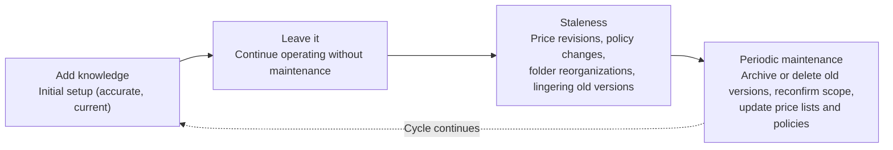

The longer the neglect phase, the greater the damage from staleness.

Regular maintenance is indispensable to break this cycle. Concretely: archive or delete old versions, reconfirm scope after folder reorganizations, and periodically update price lists and policies. Without maintenance, Claude references old and new information simultaneously and produces contradictory responses.

Memory management also has design principles. A **memory store** is a mechanism that holds information across sessions. It stores user preferences, project conventions, past corrections, and domain knowledge. The important point is not to build a single giant general-purpose store. The basic design is to split stores by purpose (per user, per shared knowledge, per project), each small and focused.

| Memory store design principle | Detail |
|---------------------|------|
| Narrow by purpose | Split by user, by shared knowledge, by project |
| Tidy before it fills | When approaching the limit, delete or compress old memories |
| When expanding scope | Add a new store and keep the original as read-only |
| Restrict writes | Mark untrusted inputs as `read_only` |

Access-rights design is especially important for security. When handling untrusted inputs (user prompts, fetched web content, external tool output), specify `read_only` access to prevent malicious content from being written to the store. The basic design is `read_only` for reference-only materials and `read_write` only for sessions that add new memories [Source: Using agent memory — https://platform.claude.com/docs/en/managed-agents/memory].

Memory also has an audit mechanism. **Memory versions** provide an audit trail, retained for 30 days. Changes are recorded as immutable "versions," so you can track who changed what and when. The **redact** capability for compliance removes secret information from historical versions while retaining the audit trail. It supports cases such as secret-key erasure or deletion requests.

Skills management also belongs to this area. A Skill is a modular feature extension that bundles instructions, metadata, and resources, composed of a `SKILL.md` and YAML frontmatter (`name`, `description`). Skills have **progressive disclosure**. They load in stages — Level 1 (metadata, always loaded at startup, about 100 tokens), Level 2 (the SKILL.md body, loaded when triggered, under 5k tokens), and Level 3 (resources and scripts, only when needed). Because of this mechanism, installing many Skills minimizes context consumption when idle. A Skill's `description` should state both "what it does" and "when to use it," because Claude reads this description to decide whether the Skill is usable [Source: Agent Skills overview — https://platform.claude.com/docs/en/agents-and-tools/agent-skills/overview].

Because a Skill gives Claude new capabilities, security care is required. A malicious Skill can perform unintended operations. Use only trusted sources (self-authored or Anthropic-provided) and audit thoroughly. When scope or requirements change, update Skills and instructions. When a new work pattern settles, turn it into a Skill; when a Skill is no longer needed, disable it.

The product features covered in Domain 5 each differ in "what they persist." Organizing this difference makes right-fit decisions easier.

| Feature | What it persists | Retention |
|------|-----------------|---------|
| **Project** | Instructions and knowledge sources (files + connectors) | Lifetime of the project |
| **Artifact** | A deliverable edited in an independent panel | Reusable across sessions |
| **Memory** | Facts to reuse across sessions | Semi-permanent (managed in a store) |
| **Skill** | Modular expertise and procedures | Resident while installed |

**Associate-level judgment guideline.** Knowledge becomes stale if left alone. Periodically delete old versions, reconfirm scope, and update price lists and policies. Keep memory stores small and focused by purpose, and specify `read_only` for untrusted inputs. The audit trail is retained for 30 days, so periodically review the version history and remove any secret information with redact. Use only trusted sources for Skills, and disable unused Skills early.

> **Common pitfall.** Narrow connectors to the minimum necessary folders or threads. "Connect the entire shared drive and instruct Claude to ignore it" is unreliable; irrelevant files mix into references. Knowledge becomes stale if left alone (archive or delete old versions, reconfirm scope after folder reorganizations, and periodically update price lists and policies). Packing multiple rules into one long paragraph causes the middle to be ignored; structure instructions into topic-based sections. Uploading reference materials is insufficient on its own; restrict the source with "look only at these materials and answer 'unknown' for anything not in them." For contradictory instructions ("concise" and "comprehensive"), state a priority or exception explicitly.

**Sources (Domain 5):**
- Using agent memory — https://platform.claude.com/docs/en/managed-agents/memory
- Adding files to Managed Agents — https://platform.claude.com/docs/en/managed-agents/files
- MCP connector — https://platform.claude.com/docs/en/agents-and-tools/mcp-connector
- Compliance activities (sync sources) — https://platform.claude.com/docs/en/api/compliance/activities
- Agent Skills overview — https://platform.claude.com/docs/en/agents-and-tools/agent-skills/overview
- Prompting best practices — https://platform.claude.com/docs/en/build-with-claude/prompt-engineering/claude-prompting-best-practices
- What are projects? — https://support.claude.com/en/articles/9517075-what-are-projects
- Use Google Workspace connectors — https://support.claude.com/en/articles/10166901-use-google-workspace-connectors

---

## Domain 6: Governance, Risk, and Responsible Use

Domain 5 covered "project configuration and knowledge management." Domain 6 faces the premise behind it: Is it acceptable to entrust this data to Claude? Does this use case meet regulatory requirements? Is the proposed use ethically acceptable? CCAO-F does not ask about API security implementation; it asks for the business user's judgment on responsible use. Technical security integration was already covered in CCA-F. Here we organize, as material for judgment, the three-layer structure of the AUP (Usage Policy), the difference between commercial and consumer data handling, data retention periods, and the developer's safety governance (RSP, PBC, LTBT) and Claude's ethical principles (the Constitution).

> **Associate-level framing.** CCA-F (Architect) asks about API security implementation and the technical detail of compliance integration; CCAO-F asks "as a business user, is it acceptable to entrust this data to Claude?" and "does this use case meet regulatory requirements?" as practical judgment. Master the AUP's three-layer structure (universal standards, high-risk requirements, additional guidelines), the difference between commercial and consumer training, data retention periods, and the core principle that "regulated advice requires qualified-professional review, and Claude's self-check is not a control." Technical security implementation is CCA-F prior knowledge, so we focus here on "the business user's responsible-use judgment."

### Overview of Domain 6's Decision Targets

The four Task Statements of Domain 6 can be read as a flow from evaluating a use case to measuring it against the developer's governance and ethical principles.

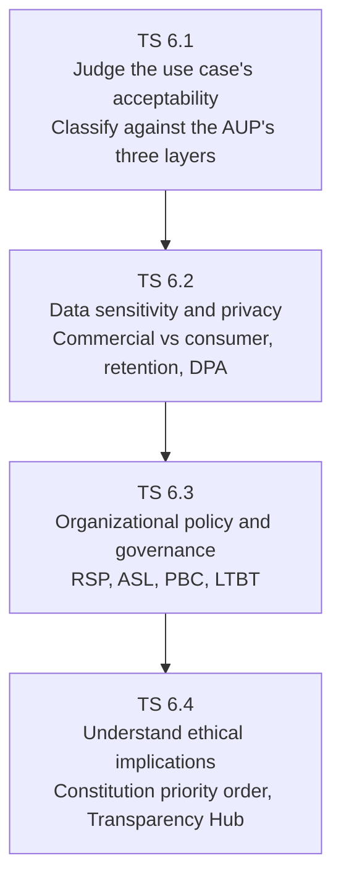

First judge whether the use case is acceptable (TS 6.1), then confirm the sensitivity and regulatory requirements of the data involved (TS 6.2), measure against the developer's and your own governance standards (TS 6.3), and finally judge holistically with ethical principles (TS 6.4).

### Task Statement 6.1: Identify appropriate and inappropriate use cases

> **Associate-level framing.** The AUP has a three-layer structure: "common prohibitions everyone must follow (universal)," "additional requirements for areas that affect individual rights (high-risk)," and "additional guidelines for specific product forms." Classifying which layer a proposed use case falls into is the first judgment. The important core — "regulated advice requires qualified-professional review, and Claude's self-check is no substitute" — is tested in the high-risk layer.

The first clue to judging whether a proposed use case is acceptable on Claude is the **Acceptable Use Policy (AUP)** [Source: Usage Policy — https://www.anthropic.com/legal/aup]. The AUP is written in three layers. The first layer is common prohibitions that apply to all users and all uses (Universal Usage Standards). The second is additional requirements for areas that affect public welfare and social fairness (High-Risk Use Case Requirements). The third is additional guidelines for specific product forms (Additional Use Case Guidelines). When you see a proposed use case, first classify it into one of these three layers.

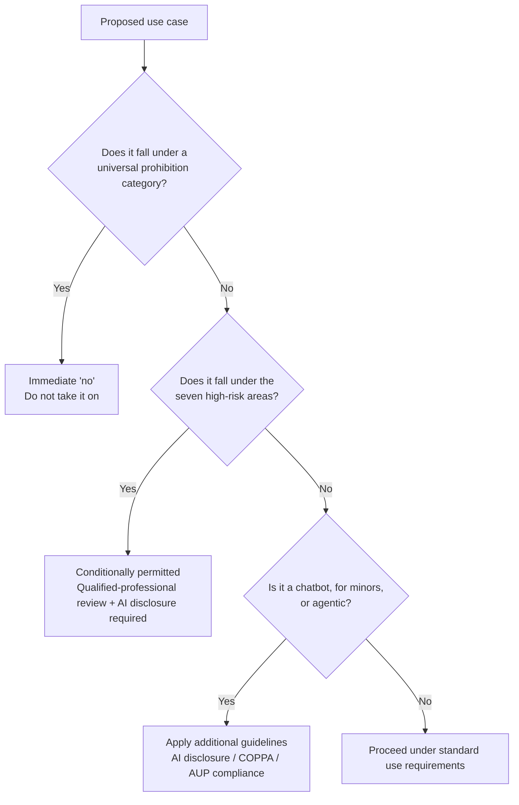

The first layer, Universal Usage Standards, is not conditional; it is a list of "what you must not do." The prohibition categories can be grouped into eight clusters.

| Cluster | Representative examples |
|----|--------|
| Illegal activity | Uses that facilitate legal violations, broadly |
| Severe harm | Weapons, CBRN, incitement to violence, CSAM |
| Privacy violation | Collection and processing of personal information without consent |
| Disinformation and interference with democracy | Election manipulation, impersonation, disinformation campaigns |
| Surveillance, predictive policing, and criminal justice | Facial recognition, emotion recognition, non-consensual location tracking, credit scoring |
| Fraud and exploitation | Fraudulent content, exploitative practices |
| Platform abuse | Jailbreaking, distillation, scraping |
| Sexually explicit content | Generation of obscene content |

"Surveillance and predictive policing" includes non-consensual tracking of location or emotion, facial recognition, credit scoring, and emotion-recognition systems. These are prohibited by the AUP even when technically feasible.

The second layer, high-risk requirements, designates areas where subjective decisions directly affect individuals or consumers. The AUP requires human-in-the-loop only "in contexts that affect an individual's rights, livelihood, or property." Internal document creation or analysis usually does not fall in this layer. The qualifying areas are seven:

| High-risk area | What is affected | Representative examples |
|---------------|-----------------|--------|
| Legal | Rights and freedoms | Legal interpretation, contract drafting |
| Healthcare | Health and life | Medical diagnosis, treatment plans |
| Insurance | Money and coverage | Underwriting, benefits decisions |
| Finance | Money and property | Lending decisions, investment advice |
| Employment and housing | Opportunity and livelihood | Hiring, promotion, admission review |
| Academic testing | Opportunity and fairness | Entrance exams, certification exams |
| Media / journalism | Reputation and society | Reporting, article writing |

It helps to memorize the seven areas as one cluster, "areas that directly affect an individual's livelihood or rights": legal interpretation, medical diagnosis, insurance underwriting, lending decisions, hiring and entrance exams, and reporting. Note that wellness advice (sleep, stress, nutrition, exercise) is not included in Healthcare.

High-risk areas are conditionally permitted, but carry two additional obligations. First, **human-in-the-loop**. A qualified professional in the field must review the content before dissemination or final decision. Second, **disclosure**. If the model's output is presented directly to an individual or consumer, the use of AI must be disclosed. Disclosure is done at a minimum "at the start of the session."

Here is the most important principle. In high-risk areas, you must not have Claude self-verify. Asking Claude "is this medical information correct?" or "does this investment advice fit the client's risk tolerance?" and feeling reassured is no substitute for review. A qualified human confirms. This is the same principle as the important core concept. Self-reported confidence is not a reliable signal of accuracy (covered in detail in Domain 2). That is precisely why, even when Claude itself is confident, confirmation by a qualified professional is indispensable.

The third layer, additional guidelines, applies requirements to specific product forms regardless of whether they are high-risk. Three representative forms are worth mastering.

First, **chatbot disclosure**. A consumer-facing chatbot must disclose that the user is interacting with AI. Disclosure is done at a minimum at the start of the session. Hiding the fact that it is AI is not allowed. This is consistent with the universal standard that prohibits impersonation.

Second, **products for minors**. Products that give direct access to minors (under 18) require age verification, content moderation, and **COPPA (Children's Online Privacy Protection Act)** compliance. COPPA is a U.S. federal law that requires verifiable parental consent for personal information collected from children under 13. Compliance with COPPA is an additional requirement for products aimed at minors [Source: Guidelines for organizations serving minors — https://support.anthropic.com/en/articles/9307344-responsible-use-of-anthropic-s-models-guidelines-for-organizations-serving-minors].

Third, **agentic use**. Uses where Claude autonomously uses tools and acts over multiple steps are also bound by the AUP. Being agentic does not relax the prohibitions.

**Associate-level judgment guideline.** When you see a proposed use case, first classify it into one of the three layers. If it falls under a universal prohibition (weapons, CBRN, CSAM, fraud, disinformation, surveillance, jailbreaking, etc.), the answer is an immediate "no." If it falls under one of the seven high-risk areas (Legal, Healthcare, Insurance, Finance, Employment, Academic, Media), qualified-professional review and AI-use disclosure are mandatory. Otherwise, for a chatbot confirm AI disclosure; for a product for minors confirm COPPA and age verification; for an agent confirm AUP compliance. Asking Claude "is this okay?" in a high-risk area is no substitute for review.

### Task Statement 6.2: Apply data sensitivity, regulatory, and privacy considerations

> **Associate-level framing.** This is a core to master. The exam tests the practical judgment of "the difference between a commercial account (no training) and a consumer account (opt-out required)" and "anonymize sensitive data first; do not use a consumer account." Master the retention numbers (30 days, 5 years, 2 years, 7 years) and the DPA's protections (AES-256, TLS 1.2, 48-hour notification, SCC) as material for business-user judgment.

Once you know a use case is acceptable, the next step is to confirm the sensitivity and regulatory requirements of the data involved. The first branch is "is the surface you are using commercial or consumer?" This distinction determines whether data is used for training.

Section B of the Commercial Terms of Service states "Anthropic may not train models on Customer Content from Services." In other words, on the commercial surface (API, Claude for Work, etc.), customer inputs and outputs are not used to train Claude [Source: Commercial Terms of Service — https://www.anthropic.com/legal/commercial-terms]. The consumer surface (Claude Free/Pro/Max, and Claude Code on these plans), on the other hand, is used by default for model improvement (training). Unless the user opts out in settings, conversation content may become training data.

| Item | Commercial surface (API, Claude for Work) | Consumer surface (Free/Pro/Max) |
|------|-------------------------------|------------------------|
| Use in training | Not used (stated in the terms) | Used by default |
| Opt-out | Not required (excluded from the start) | Must be turned on in settings |
| Suitability for sensitive data | Suitable | Not suitable |

Where this difference bites in practice is when handling sensitive data. Handling customers' personal or contract information on a consumer account risks mixing it into training because of a forgotten opt-out. Always use the commercial surface for sensitive data. This is the same principle [Source: How long do you store my data? — https://privacy.anthropic.com/en/articles/10023548-how-long-do-you-store-personal-data].

How long data is retained after being entrusted to Claude must also be understood. Retention differs by data type.

| Data type | Retention |
|-------------|---------|
| Deleted conversations | Up to 30 days to disappear from the backend |
| Data used in training | Up to 5 years in de-identified form |
| Inputs/outputs flagged as AUP violations | Up to 2 years (classification scores for 7 years) |
| Feedback data | Up to 5 years |

Incognito chats are not used for training even if the model-improvement setting is on. When you want to temporarily exclude a conversation from training, it is a more convenient means than changing the setting [Source: How long do you store my data? — https://privacy.anthropic.com/en/articles/10023548-how-long-do-you-store-personal-data].

A commercial contract incorporates a **Data Processing Addendum (DPA)** [Source: Data Processing Addendum — https://www.anthropic.com/legal/data-processing-addendum]. The DPA defines the role split in which the customer is the controller (the party that determines the purpose of use) and Anthropic is the processor (the party that processes following the customer's instructions). The main protections:

| Protection | Detail |
|---------|------|
| Encryption at rest | AES-256 |
| Encryption in transit | TLS 1.2 or higher |
| Security incident notification | Within 48 hours |
| Data deletion after contract termination | Within 30 days |
| Access management | RBAC (role-based access control) and MFA |
| Cross-border transfer protection | SCC for EU, UK, and Switzerland |

**SCC (Standard Contractual Clauses)** are the legal protection framework required for personal-data transfers from the EU, UK, and Switzerland to the United States. They are standard contractual clauses that satisfy European data-protection law, and the DPA incorporates three: the EU SCC, the UK Addendum, and the Swiss Addendum. They are an essential document for organizations handling GDPR-covered data.

Major certifications Anthropic holds include SOC 2 Type 2 (security, availability, confidentiality), ISO/IEC 27001 (information security management), 27017 (cloud security), 27018 (cloud privacy), CSA STAR (cloud security certification), and GDPR and HIPAA compliance. Region-specific **data residency** is also available as an option for organizations whose regulatory requirements demand that "data must be stored in a specific region."

The flow for handling sensitive data before entrusting it to Claude is as follows.

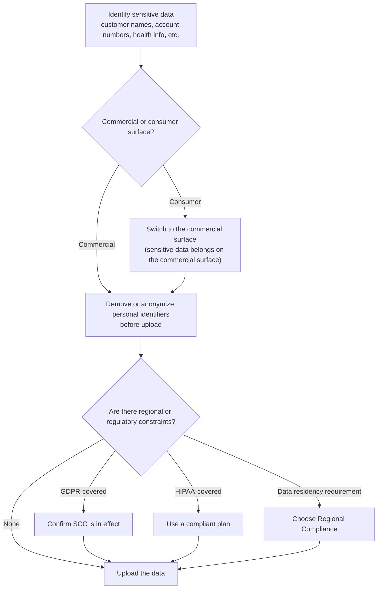

The basics of anonymization are to remove or replace with dummy values the personal identifiers — customer names, account numbers, health information — before upload. Merely instructing "do not have Claude retain this" does not satisfy the policy, because once data has been shared, instruction-based control no longer applies. Process according to your organization's data classification standards.

**Associate-level judgment guideline.** Before entrusting sensitive data to Claude, confirm three things: whether the surface you are using is commercial (no training) or consumer (opt-out required); for sensitive data, always use the commercial surface; and remove or anonymize personal identifiers before entrusting it — do not upload as-is to a consumer account. If there are regional or regulatory constraints (GDPR, HIPAA), confirm that SCC or a compliant plan is in effect. Merely instructing Claude "do not retain this data" is not a policy control.

### Task Statement 6.3: Follow organizational AI policies and governance standards

> **Associate-level framing.** CCA-F (Architect) asks about API-level security integration and the technical detail of compliance implementation; CCAO-F asks you to know "the rules the organization that built Claude imposes on itself for safety" and to judge them against your own organization's policies. Master the concepts of RSP (Responsible Scaling Policy) and ASL (AI Safety Level), and the corporate-governance forms of PBC and LTBT.

After confirming data sensitivity, the next step is to measure the developer's governance against your own policies. The developer governance a business user should know comes in two forms: the technical framework for safety (RSP and ASL), and the structure of corporate governance (PBC and LTBT).

The **Responsible Scaling Policy (RSP)** is Anthropic's internal framework by which it pledges "we will not train or deploy a model unless we can confirm its safety" [Source: Announcing our updated Responsible Scaling Policy — https://www.anthropic.com/news/announcing-our-updated-responsible-scaling-policy]. It raises the safety bar required as model capability grows. The core of the RSP is the principle of proportional protection — expanding protection in proportion to risk.

The RSP defines staged safety standards called **AI Safety Levels (ASL)**. The system is modeled on biosafety levels: as model capability rises, the required standard becomes stricter.

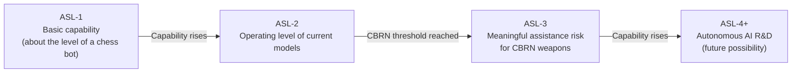

All current models operate at ASL-2. Two capability thresholds are defined. One is meaningful assistance for CBRN weapons, which requires the ASL-3 standard. The other is autonomous AI R&D, which may require the ASL-4 or higher safety standard. If the thresholds are not reached, deployment continues at the current ASL-2.

The RSP focuses on catastrophic AI risks (CBRN, etc.). Everyday harmful use (disinformation, fraud, etc.) is handled by the AUP. The RSP and AUP are complementary.

The developer's corporate governance can also be referenced as structural evidence of safety. Anthropic was incorporated as a Delaware **Public Benefit Corporation (PBC)**. A PBC is a corporate form legally obligated to pursue public-benefit purposes alongside shareholder interests. Safety and public benefit are written into the charter.

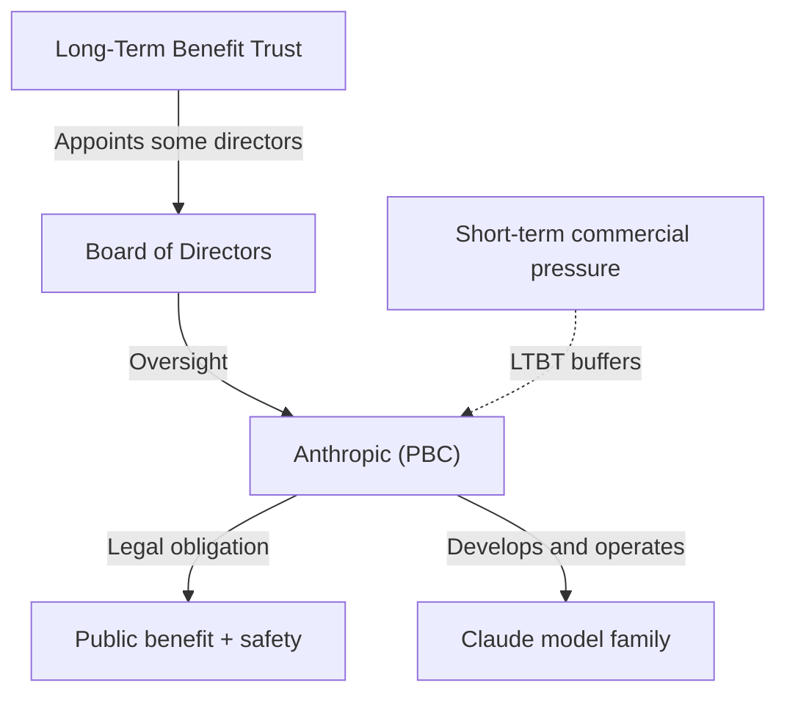

The **Long-Term Benefit Trust (LTBT)** is a long-term benefit trust. It is an independent trust that oversees Anthropic's safety governance and has the authority to appoint some directors. This structure prevents short-term commercial pressure from compromising safety. An organization using Claude can use as decision material whether the developer imposes safety rules on itself (RSP, ASL) and whether the corporate-governance structure resists being dragged by short-term interests (PBC, LTBT) [Source: Company — https://www.anthropic.com/company].

The procedure for aligning your organization's AI-use policy with Claude usage is as follows. First, confirm your organization's acceptable-risk standard. Next, confirm that current Claude models operate at ASL-2. When higher-capability models are deployed in the future, revisit the correspondence between ASL and your standard.

**Associate-level judgment guideline.** Confirm your organization's acceptable-risk standard, and confirm that current models operate at ASL-2. When higher-capability models are deployed in the future, revisit the correspondence between ASL and your standard. Use the developer's governance (PBC, LTBT, RSP) as structural evidence of safety in your decision material.

### Task Statement 6.4: Understand the ethical implications of AI usage

> **Associate-level framing.** CCA-F (Architect) asks about the technical evaluation of alignment; CCAO-F asks you to judge "what Claude may be allowed to do and what it may not" through ethical principles. Master the four-level priority order of the Constitution, what the Transparency Hub publishes, and the idea of corrigibility.

After confirming governance standards, the final step is to judge holistically with ethical principles. At the root of Claude's behavior is the **Constitution** [Source: Claude's Constitution — https://www.anthropic.com/constitution]. The Constitution is the document that defines Claude's values and behavior, and it directly shapes Claude's behavior during training. All other guidance is designed to be consistent with the Constitution.

The Constitution has a four-level priority order. It is the criterion for which to prioritize on conflict.

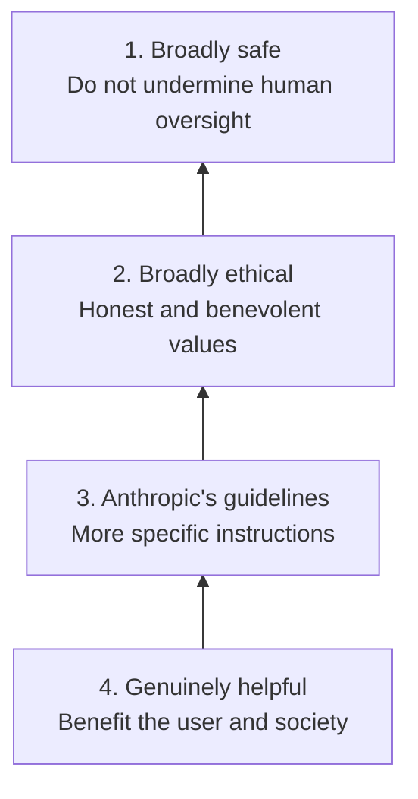

The top priority is "broadly safe." AI training is unfinished, and a given version of Claude may hold harmful values or wrong views. That is why "not undermining the state in which humans can monitor and correct it" is placed at the top. Second is "broadly ethical," third is "Anthropic's guidelines," and fourth is "genuinely helpful." When "being helpful" and "being safe" conflict, safety wins. When "Anthropic's guidelines" and "ethics" conflict, ethics wins.

Within the top priority, "broadly safe," what is emphasized is **corrigibility**. It is the property that humans can stop or redirect Claude. Even when Claude is confident in its judgment, it does not take actions that undermine appropriate human oversight. Oversight here does not mean blind obedience; it means not undermining appropriate human oversight.

The Constitution imposes four main ethical principles on Claude. First, **honesty**. It demands a high standard of truthfulness, says "I don't know" when it does not know, avoids overconfidence, and acknowledges limits. This is the same principle as Honest in HHH from Domain 2. Second, **avoidance of bioweapons assistance**. It provides no meaningful assistance for CBRN weapons under any circumstances. This is a "hard constraint" the Constitution imposes and is consistent with the AUP's prohibition categories. Third, **respect for human corrigibility.** Fourth, **good judgment over rigid rules.**

It helps to grasp the distinction between hard constraints and flexible principles. The Constitution distinguishes "hard constraints always to be upheld (CBRN, etc., where the cost of error is enormous)" from "flexible principles to be judged by context." Hard constraints are highly predictable and evaluable. Flexible principles can adapt to new situations but are correspondingly less predictable. In many contexts, Claude is expected to exercise good judgment over rigid rules.

AI use also carries ethical implications for labor. The **workforce** question — does AI "replace" or "augment" humans? Anthropic positions AI as augmentation and promotes the idea of redirecting freed capacity to higher-value work. This is consistent with the stakeholder communication in Domain 4.

As material for ethical judgment, the **Transparency Hub** is published [Source: Transparency Hub — https://www.anthropic.com/transparency]. The Transparency Hub is where Anthropic publishes its safety processes and outcomes, structured around three pillars: model reports, system reliability reporting, and voluntary commitments. Each model's report includes capability evaluations, red-team results, and safety evaluations.

| Evaluation area | Detail |
|---------|------|
| CBRN | Assistance risk for bioweapons and chemical weapons |
| Autonomy | Safety of agentic autonomous behavior |
| Cybersecurity | Assistance risk for attack techniques |
| Alignment | Consistency with intent |
| Political bias | Measured across 150 topics, 9 tasks, and 1,350 opposing viewpoint pairs |
| Child safety | Prevention of CSAM and exploitation |

The political-bias evaluation is measured across 150 topics, 9 task types, and 1,350 pairs of opposing political viewpoints. It evaluates fairness, acknowledgement of opposing viewpoints, and refusal rate. These results can be used for model-selection decisions in practice.

When evaluating a use case, pose four ethical questions. On honesty: are you using the output without verifying it? On harm: could someone be harmed (check the seven high-risk areas)? On human oversight: has a qualified professional reviewed it? On augmentation: are you using Claude's output as a starting point for thought and finishing with your own judgment? When principles conflict, apply the Constitution's priority order (safety, ethics, guidelines, helpfulness).

**Associate-level judgment guideline.** When evaluating a use case, pose four ethical questions: honesty (are you using the output without verifying it?), harm (could someone be harmed?), human oversight (has a qualified professional reviewed it?), and augmentation (are you using Claude's output as a starting point and finishing with your own judgment?). When principles conflict, apply the Constitution's priority order (safety, ethics, guidelines, helpfulness).

> **Common pitfall.** Mask or remove sensitive data before upload (instructing Claude to "ignore it" is not prevention; the data is already shared). High-risk decisions (hiring, credit, medical, legal, investment advice, denial notices) require prior review by a qualified professional; even when automated, keep an approval checkpoint (AI self-checks, switching vendors, and disclaimers are not substitutes). Manage permissions with RBAC and restrict configuration changes to administrators (password practices and device limits are not substitutes for permission scope). Monitor disparate impact on subgroups even when overall metrics look good. Phrases such as "young and energetic" or "digital native" in job ads suggest age discrimination. Fabricating customer reviews or testimonials is inappropriate. Do not let autonomous agents take legally binding actions such as contract execution or price negotiation without oversight.

**Sources (Domain 6):**
- Usage Policy (AUP) — https://www.anthropic.com/legal/aup
- Commercial Terms of Service — https://www.anthropic.com/legal/commercial-terms
- Data Processing Addendum — https://www.anthropic.com/legal/data-processing-addendum
- Privacy Policy — https://www.anthropic.com/legal/privacy
- How long do you store my data? — https://privacy.anthropic.com/en/articles/10023548-how-long-do-you-store-personal-data
- Guidelines for organizations serving minors — https://support.anthropic.com/en/articles/9307344-responsible-use-of-anthropic-s-models-guidelines-for-organizations-serving-minors
- Responsible Scaling Policy — https://www.anthropic.com/news/announcing-our-updated-responsible-scaling-policy
- Claude's Constitution — https://www.anthropic.com/constitution
- Regional Compliance — https://claude.com/regional-compliance
- Transparency Hub — https://www.anthropic.com/transparency
- Company — https://www.anthropic.com/company

---

## Domain 7: Troubleshooting and Optimization

### Task Statement 7.1: Identify, diagnose, and resolve issues with underperforming prompts or poor outputs

**Knowledge:**
- Diagnosis by symptom. Fabricated facts are hallucinations (allow "I don't know," ground with quotes, restrict to the provided document). Inconsistent formatting calls for Structured Outputs and few-shot. Missed long-input content calls for repositioning key data (top and bottom) and extracting quotes first. Shallow analysis calls for decomposition into chained subtasks
- The prompt improver can be used to automatically debug complex prompts
- When the required information is not in the source, retrying has no effect

**Skills:**
- Diagnose the category of a prompt or output failure
- Apply the relevant fix (grounding, Structured Outputs, repositioning, decomposition)
- Systematically debug complex prompts with the prompt improver

### Task Statement 7.2: Adjust approach based on feedback and results

**Knowledge:**
- Self-correction chain pattern. Generate a draft -> review against criteria -> refine based on the review
- Including concrete validation errors in a retry prompt guides correction (for example, "total=150 but sum(line_items)=145. Recheck the values.")
- Retries work for format, structural, and arithmetic errors, but not when information is missing

**Skills:**
- Implement a self-correction chain with concrete feedback
- Construct retry prompts that include concrete validation errors
- Recognize when to stop retrying and escalate or obtain the missing source

### Task Statement 7.3: Optimize workflows for efficiency and effectiveness

**Knowledge:**
- Model-to-task mapping. Haiku for high-volume, low-complexity; Opus for complex reasoning. Adjust effort before switching models
- Context curation. Find the minimal set of high-signal tokens. Trim tool results to relevant fields. Use compaction for long conversations
- Automating evaluation. Prefer code-based scoring for speed and scale. Reserve human scoring for judgments that need nuance
- Consistency techniques. Specify the format, bind with examples, use retrieval for contextual consistency, chain prompts, and keep Claude in character

**Skills:**
- Align model and effort to the task for cost and latency efficiency
- Curate context by trimming and compacting to reduce noise and cost
- Automate evaluation for scalable optimization

**Sources (Domain 7):**
- Reduce hallucinations — https://platform.claude.com/docs/en/test-and-evaluate/strengthen-guardrails/reduce-hallucinations
- Increase output consistency — https://platform.claude.com/docs/en/test-and-evaluate/strengthen-guardrails/increase-consistency
- Console prompting tools — https://platform.claude.com/docs/en/build-with-claude/prompt-engineering/prompting-tools
- Define success criteria and build evaluations — https://platform.claude.com/docs/en/test-and-evaluate/develop-tests
- Choosing the right model — https://platform.claude.com/docs/en/about-claude/models/choosing-a-model
- Effective context engineering — https://www.anthropic.com/engineering/effective-context-engineering-for-ai-agents
- Prompting best practices — https://platform.claude.com/docs/en/build-with-claude/prompt-engineering/claude-prompting-best-practices

---

## Sample Questions

> The following sample questions illustrate the format and difficulty level of the exam. Items 1–3 are from the official CCAO-F Exam Guide (Section 8); items 4–15 are additional practice items grounded in the Anthropic official sources cited. Correct answers and rationale appear after each question. **Sample questions are intentionally kept in English to match the exam.**

**Domain coverage:** Q1 (D2), Q2 (D3), Q3 (D6), Q4–Q5 (D1), Q6 (D2/D7), Q7 (D6), Q8 (D2/D3), Q9 (D3/D4), Q10 (D4), Q11–Q12 (D5), Q13 (D6), Q14 (D6), Q15 (D7). **Format:** items Q5 and Q12 are multiple-response (select two); all others are single-select.

### Scenario: Summarizing a Regulation

**Question 1:** An associate asks Claude to summarize a new regulation, and Claude produces a confident summary citing a specific subsection number. Before sending the summary to the compliance team, what is the most appropriate action?
A. Send it as-is, since Claude expressed high confidence.
B. Verify the cited subsection against the official regulation text before sharing.
C. Ask Claude to rate its own confidence and send it if the rating is high.
D. Reword the summary to sound more formal, then send it.

**Answer: B.** Language models can fabricate specific-looking details such as citation numbers (a hallucination). Validating factual claims — especially citations bound for a compliance audience — against an authoritative source is the required diligence step. Self-reported confidence (A, C) is not a reliable accuracy signal; reformatting (D) does not address correctness. [Source: CCAO-F Exam Guide, Section 8 | Reduce hallucinations — https://platform.claude.com/docs/en/test-and-evaluate/strengthen-guardrails/reduce-hallucinations]

### Scenario: High-Volume Customer Replies

**Question 2:** An associate needs to generate a high volume of short customer-reply drafts where speed and cost matter more than deep reasoning. Which choice best fits the task?
A. Use the most capable, highest-cost model for every reply to maximize quality.
B. Use a faster, lower-cost model suited to straightforward, high-volume tasks.
C. Disable all product features to reduce cost.
D. Use one mid-tier model for every reply to balance cost and quality, regardless of each task's simplicity.

**Answer: B.** Aligning model selection with task requirements means matching a faster, lower-cost model (Haiku) to straightforward, high-volume work, reserving the most capable model for complex reasoning. Always using the top model (A) wastes the cost and latency budget; disabling features (C) does not address the trade-off; and using one mid-tier model for every reply (D) still overspends on the many simple replies and under-serves the few hard ones. [Source: CCAO-F Exam Guide, Section 8 | Choosing the right model — https://platform.claude.com/docs/en/about-claude/models/choosing-a-model]

### Scenario: Handling Sensitive Customer Data

**Question 3:** A project manager wants to upload a spreadsheet containing customer names and account numbers so Claude can analyze trends. Organizational policy restricts sharing regulated personal data. What is the most appropriate action?
A. Upload the file as-is, since the analysis is internal.
B. Remove or anonymize the personal identifiers before uploading, consistent with policy.
C. Upload the file but instruct Claude not to retain it.
D. Upload the file to a consumer Claude.ai account and rely on Claude's built-in privacy.

**Answer: B.** Applying data-sensitivity and privacy safeguards means redacting or anonymizing regulated identifiers before use, so the analysis can proceed without exposing protected data. Uploading as-is (A) violates policy; instructing the model not to retain data (C) does not satisfy the policy control; and a consumer account (D) is unsafe because consumer Inputs/Outputs may be used for model training unless opted out, and it does not satisfy organizational policy. [Source: CCAO-F Exam Guide, Section 8 | Usage Policy — https://www.anthropic.com/legal/aup]

### Scenario: Drafting a Stakeholder Report

**Question 4:** You want Claude to summarize a long contract for a non-legal audience. Which prompt structure best follows Anthropic's guidance?
A. A single paragraph that says "Summarize this contract simply" followed by the contract text.
B. XML-tagged sections for `<instructions>`, `<context>` (with the contract in `<document>`), and `<output_format>`, with the contract near the top and the query at the end.
C. The contract text first, then "be helpful and accurate," with no format specified.
D. A role prompt only: "You are a lawyer," followed by the contract.

**Answer: B.** Anthropic recommends XML-tagged structure with the long document near the top and the query at the end (which can improve quality). A (vague), C (no format), and D (role alone, no structure) are weaker. [Source: Prompting best practices — https://platform.claude.com/docs/en/build-with-claude/prompt-engineering/claude-prompting-best-practices]

**Question 5:** When using few-shot examples to steer Claude's output, which TWO practices does Anthropic recommend? (Select TWO)
A. Use 3–5 examples that closely mirror the actual use case.
B. Wrap each example in `<example>` tags to distinguish them from instructions.
C. Use a single example that exactly matches the input.
D. Include 10+ examples covering every edge case as a laundry list.

**Answer: A and B.** Anthropic recommends 3–5 relevant, diverse examples that mirror the actual use case (A), each wrapped in `<example>` tags so Claude can distinguish them from instructions (B). A single matching example (C) is too narrow; a laundry list of 10+ (D) is discouraged in favor of diverse, canonical examples. [Source: Prompting best practices — https://platform.claude.com/docs/en/build-with-claude/prompt-engineering/claude-prompting-best-practices]

### Scenario: Evaluating a Long-Document Summary

**Question 6:** Which is the most reliable way to reduce hallucinations when Claude summarizes a long (>20k token) document?
A. Ask Claude to express high confidence in its summary.
B. Instruct Claude to extract word-for-word quotes first, then ground the summary in those quotes.
C. Increase the model's temperature.
D. Remove the system prompt so Claude is unconstrained.

**Answer: B.** For long documents, asking Claude to extract word-for-word quotes first grounds the summary in actual text. Confidence expressions (A) are unreliable; raising temperature (C) increases variability; removing the system prompt (D) removes useful constraints. [Source: Reduce hallucinations — https://platform.claude.com/docs/en/test-and-evaluate/strengthen-guardrails/reduce-hallucinations]

### Scenario: Customer-Facing Investment Chatbot

**Question 7:** You are building a customer-facing chatbot that gives investment advice. Under Anthropic's Usage Policy, what is required?
A. Add a general disclaimer to the chatbot interface and proceed without human review.
B. Human-in-the-loop review by a qualified professional and disclosure that AI is used.
C. Only a disclaimer that the advice "might be wrong."
D. Switching to the Haiku model to reduce risk.

**Answer: B.** Finance/investment advice is a High-Risk Use Case requiring human-in-the-loop review by a qualified professional and AI disclosure. A general disclaimer alone (A) does not satisfy the human-in-the-loop requirement; C is insufficient; switching models (D) does not address the policy requirement. [Source: Usage Policy — https://www.anthropic.com/legal/aup]

### Scenario: Structured Output for Downstream Processing

**Question 8:** For guaranteed JSON output conforming to a specific schema, what does Anthropic recommend?
A. Add "output JSON" to the prompt and parse defensively.
B. Use Structured Outputs (constrained decoding).
C. Run the prompt 5 times and pick the best JSON.
D. Use the Opus model, which produces valid JSON more reliably than smaller models.

**Answer: B.** Structured Outputs uses constrained decoding to guarantee schema-conformant JSON. Defensive parsing (A) is fragile; best-of-N (C) wastes compute; and a more capable model (D) reduces but does not guarantee schema-conformant JSON the way constrained decoding does. [Source: Structured outputs — https://platform.claude.com/docs/en/build-with-claude/structured-outputs]

### Scenario: Analyzing a Dataset

**Question 9:** A team needs Claude to analyze a large CSV and produce charts. Which product feature is most appropriate?
A. Artifacts, because charts are visual.
B. Code Execution, because it runs Python in a sandboxed environment with data libraries.
C. Memory, because it persists across sessions.
D. Research, because it searches multiple sources.

**Answer: B.** Code Execution runs Python in a sandboxed environment with data libraries (pandas, matplotlib), ideal for CSV analysis and charts. Artifacts (A) display content but don't compute; Memory (C) persists context; Research (D) searches sources. [Source: Code execution tool — https://platform.claude.com/docs/en/agents-and-tools/tool-use/code-execution-tool]

### Scenario: Integrating Claude into a Workflow

**Question 10:** When integrating Claude into an existing business workflow, which approach does Anthropic's guidance favor as the starting point?
A. Replace the entire workflow with an autonomous agent immediately.
B. Start with the simplest solution that works — often augmenting existing tools with Claude — before adding complexity.
C. Build a thick harness of guardrails around Claude before any use.
D. Wait for a custom framework before deploying.

**Answer: B.** Anthropic's guidance: find the simplest solution that works before adding complexity; start with direct calls and augmentation. Full replacement (A) is premature; a thick harness (C) constrains the model; waiting for a framework (D) delays value. [Source: Building effective agents — https://www.anthropic.com/engineering/building-effective-agents]

### Scenario: Maintaining Project Knowledge

**Question 11:** A Project's knowledge source contains stale policies. Following Anthropic's maintenance guidance, what should you do?
A. Delete the entire Project and start over.
B. Prune or condense stale content; attach a fresh store for new content and keep the original as read-only reference.
C. Instruct Claude to ignore old content in the prompt.
D. Upload the new policies alongside the old ones with no curation.

**Answer: B.** Prune/condense stale content; attach a fresh store for new content and keep the original as read-only reference. Deleting everything (A) loses history; ignoring in prompt (C) doesn't fix the knowledge base; appending without curation (D) worsens context rot. [Source: Using agent memory — https://platform.claude.com/docs/en/managed-agents/memory]

**Question 12:** Which TWO of the following are officially supported Claude Project sync sources? (Select TWO)
A. Google Drive
B. Gmail
C. Pinterest boards
D. Public social media feeds (e.g., TikTok)

**Answer: A and B.** Confirmed sync source providers include Google Drive and Gmail (alongside GitHub, Slack, Salesforce, Google Calendar, Asana, Outline, and MCP resources). Pinterest (C) and public social media feeds (D) are not supported sync sources. [Source: Compliance activities — https://platform.claude.com/docs/en/api/compliance/activities]

### Scenario: Commercial API Data Privacy

**Question 13:** A company uses Claude via the commercial API and is concerned about its data being used for training. What is true?
A. Anthropic may train models on commercial Customer Content unless the company opts out.
B. Anthropic may not train models on Customer Content from commercial services.
C. The company must delete all data every 24 hours to prevent training.
D. Training on commercial data occurs after 30 days.

**Answer: B.** Commercial Terms state "Anthropic may not train models on Customer Content from Services." The opt-out concern (A) applies to consumer Claude.ai, not commercial API. [Source: Commercial Terms — https://www.anthropic.com/legal/commercial-terms]

### Scenario: Ethical Priority Conflicts

**Question 14:** Under Claude's Constitution, which priority ordering governs behavior when principles conflict?
A. Helpful > ethical > safe > Anthropic guidelines.
B. Broadly safe > broadly ethical > Anthropic guidelines > genuinely helpful.
C. Anthropic guidelines > helpful > safe > ethical.
D. Helpful > safe > ethical > Anthropic guidelines.

**Answer: B.** The Constitution orders: broadly safe > broadly ethical > Anthropic guidelines > genuinely helpful. [Source: Claude's Constitution — https://www.anthropic.com/constitution]

### Scenario: Debugging Inconsistent JSON

**Question 15:** Claude's JSON output is syntactically valid but values are inconsistent (totals don't add up). What is the best next step?
A. Increase the max_tokens limit to give Claude more room to compute the totals.
B. Add concrete validation errors in a retry prompt (e.g., "total=150 but sum=145") and have Claude self-correct.
C. Disable JSON output and use prose.
D. Increase the context window.

**Answer: B.** Include concrete validation errors in a retry prompt and have Claude self-correct — effective for arithmetic/structural errors. Giving more output room (A), abandoning JSON (C), or increasing context (D) do not fix an arithmetic inconsistency. [Source: Prompting best practices — https://platform.claude.com/docs/en/build-with-claude/prompt-engineering/claude-prompting-best-practices]

---

## Exercises

To deepen practical familiarity with the topics covered on the exam, work through the following hands-on exercises. Each is designed to reinforce knowledge that spans one or more domains.

**Sources (Exercises):**
- What are projects? — https://support.claude.com/en/articles/9517075-what-are-projects
- Use Google Workspace connectors — https://support.claude.com/en/articles/10166901-use-google-workspace-connectors
- Prompting best practices — https://platform.claude.com/docs/en/build-with-claude/prompt-engineering/claude-prompting-best-practices
- Chain complex prompts — https://platform.claude.com/docs/en/build-with-claude/prompt-engineering/chain-prompts
- Define success criteria and build evaluations — https://platform.claude.com/docs/en/test-and-evaluate/develop-tests
- Reduce hallucinations — https://platform.claude.com/docs/en/test-and-evaluate/strengthen-guardrails/reduce-hallucinations
- Usage Policy — https://www.anthropic.com/legal/aup
- Commercial Terms of Service — https://www.anthropic.com/legal/commercial-terms

### Exercise 1: Configure a Claude Project for a Recurring Workflow

**Objective:** Practice project configuration with instructions, knowledge sources, and connectors.

**Steps:**
1. Create a project and write system-level instructions that clearly define the role, output format, and constraints. Structure them with XML tags, and place reference data at the top.
2. Upload reference files (a policy PDF, a style guide, etc.) as project knowledge. Confirm that Claude grounds its responses in the uploaded content.
3. Connect an external sync source (a Google Drive folder, etc.) and confirm that Claude can reference its content.
4. After one week, prune stale content and add a new knowledge store. Keep the original as read-only reference.

**Domains reinforced:** Domain 5 (Configuration and Knowledge Management), Domain 4 (Workflow Integration and Solution Design)

### Exercise 2: Build and Iterate a Prompt for a Business Task

**Objective:** Practice structured prompt creation, task decomposition, and iterative refinement.

**Steps:**
1. Draft a prompt for a business task (for example, an executive summary of a quarterly report) using XML tags, a role, and an explicit output format.
2. Decompose the task into chained steps (extract key numbers -> draft summary -> self-review against criteria -> refine).
3. Start from an initial draft template and refine based on specific feedback about what is wrong with the output.
4. Define success criteria and build a small evaluation. Iterate the prompt until the evaluation passes reliably.

**Domains reinforced:** Domain 1 (Prompting and Task Execution), Domain 7 (Troubleshooting and Optimization)

### Exercise 3: Evaluate Claude's Output for Hallucination and Bias

**Objective:** Practice output evaluation, fact-checking, and routing to human review.

**Steps:**
1. Ask Claude to summarize a regulation with citations. Verify each citation against an official source and record fabricated references.
2. Apply the "allow 'I don't know'" technique and the "extract quotes first" technique, and compare hallucination rates before and after.
3. Run Best-of-N verification on a series of summaries and flag inconsistencies.
4. Identify which outputs fall under high-risk use cases and route them, with disclosure attached, to a qualified human reviewer.

**Domains reinforced:** Domain 2 (Output Evaluation and Validation), Domain 6 (Governance, Risk, and Responsible Use)

### Exercise 4: Practice Responsible Use in a Data-Sensitive Workflow

**Objective:** Practice data-sensitivity, privacy, and governance judgment.

**Steps:**
1. Take a dataset containing customer personal data and, following your organization's policy, remove or anonymize regulated identifiers before upload.
2. Confirm whether the surface you are using is commercial (no training) or consumer (opt-out required), and document the data-handling implications.
3. Classify a set of proposed use cases as appropriate, prohibited, or high-risk against the Usage Policy. For high-risk cases, define controls for human review and disclosure.
4. Draft a short stakeholder communication that quantifies value, frames Claude as augmentation, and is transparent about limitations and oversight.

**Domains reinforced:** Domain 6 (Governance, Risk, and Responsible Use), Domain 4 (Workflow Integration and Solution Design)

---

## Appendix

### Technologies and Concepts

The technologies and concepts to master are as follows:

- **Claude product features** — Projects (instructions and knowledge sources), Artifacts (reusable content), Agent Skills (SKILL.md with `name`/`description`, three loading levels), Code Execution (sandboxed Python/bash, no internet, pandas/numpy/matplotlib), Research mode (agentic search across multiple sources), Memory (persistence across sessions)
- **Claude models** — Haiku (fastest, 200k context), Sonnet (balanced, 1M), Opus (complex agents and enterprise, 1M), Fable (highest capability, long-running agents, 1M). The effort parameter trades intelligence against latency and cost
- **Context management** — context window (200k–1M), context rot, compaction (auto-summary at a threshold), context editing (clearing tool results and thinking blocks), context awareness (tracking the remaining budget)
- **Connectors** — sync sources (Google Drive, Gmail, GitHub, Slack, Salesforce, Google Calendar, Asana, Outline, MCP resources). MCP connectors (link external data sources to a project with access following user permissions)
- **Prompt engineering** — XML tags, assigning a role, few-shot (3–5 examples), chain-of-thought and extended thinking, prompt chaining, self-correction, prompt generator and improver (tools for API developers, optional for the Associate)
- **Structured outputs** — Structured Outputs (constrained decoding), JSON schemas, required fields and optional/nullable fields, enums including "other" or "unclear"
- **Output evaluation** — HHH framework, hallucination reduction (allow "I don't know," direct quotes, citations, chain-of-thought and Best-of-N, iteration, restricting external knowledge), RAG, bias evaluation, success criteria and evaluation, scoring methods (code, human, LLM)
- **Governance** — Usage Policy (AUP, universal standards, high-risk use cases, additional guidelines), Commercial Terms of Service (no training on customer content), Privacy Policy (consumer opt-out, retention), Data Processing Addendum (controller/processor, SCC, security), Responsible Scaling Policy (ASL framework), Claude's Constitution (four-level priority), Transparency Hub, Public Benefit Corporation
- **Workflow patterns** — augment versus redesign, simple composable patterns (prompt chaining, routing, parallelization), iterative solution design

### Topics Covered on the Exam

The topics explicitly tested on the exam are as follows:

- Prompt construction. XML tags, role, context, format, ordered steps, data placement in long-context
- Task decomposition. Prompt chaining, self-correction, sequential subtask design
- Prompt iteration. Prompt generator, prompt improver, success criteria and evaluation
- Adaptation to task type. Research, analysis, drafting, brainstorming. Extended thinking, choice of few-shot
- Output evaluation. Accuracy and completeness, hallucination identification, bias, fact-checking, triggering human review, adapting to the reader, choosing an output format
- Product and model selection. Projects, Artifacts, Skills, Code Execution, Research, Memory. Haiku, Sonnet, Opus. Cost, speed, quality trade-offs. Managing context limits
- Workflow integration. Use-case analysis, research and planning, solution design, augment versus redesign, stakeholder communication
- Configuration. Project instructions, knowledge sources, connectors, system-level instructions, maintenance and updating
- Governance. Appropriate and inappropriate use, data sensitivity, regulation and privacy, organizational policy, ethical implications
- Troubleshooting. Diagnosis by symptom, adjustment based on feedback, workflow optimization

### Topics Not Covered on the Exam

The following related topics are not tested:

- Development on the Claude API, Agent SDK, or MCP (the scope of Claude Architect and Developer)
- Design of agent systems, multi-agent orchestration, and sub-agent coordination
- CI/CD pipeline integration, headless or non-interactive Claude Code, GitHub Actions
- Fine-tuning Claude models or training custom models
- Claude's internal architecture, training processes, Constitutional AI, RLHF methodology
- Deploying or hosting MCP servers (infrastructure, networking, container orchestration)
- Implementation detail of embedding models or vector databases
- Computer use (browser automation, desktop manipulation)
- Implementing streaming APIs or Server-Sent Events
- Rate limits, quotas, and API pricing calculations
- OAuth, API-key rotation, and authentication-protocol detail
- Configuration specific to a cloud provider (AWS, GCP, Azure)
- Token-counting algorithms or tokenization detail

### Exam Preparation Recommendations

For this certification exam, we recommend the following:

1. **Study the blueprint.** Study the Content Outline blueprint and self-assess against each task statement.
2. **Read the official documentation.** Read the official documents listed in each domain's source list. Prioritize Prompting best practices, Reduce hallucinations, Models overview, and Usage Policy.
3. **Configure a Claude Project.** Set up a project with instructions and knowledge sources. Iterate prompts and evaluate outputs for hallucination and bias.
4. **Practice responsible-use judgment.** Data sensitivity (commercial or consumer), high-risk use cases, and when to seek escalation or human review.
5. **Work the sample questions.** Trace the rationale for each item back to the cited source.
6. **Take Anthropic Academy courses.** Take Claude 101 and AI Fluency for structured familiarity.
7. **Review the official CCAO-F Exam Guide.** Before booking, review the full text including registration, policies, and the code of conduct.

> There is no mandatory course, and Anthropic does not guarantee that any specific resource will result in a pass. Combine hands-on experience with the resources above. [Source: CCAO-F Exam Guide, Section 7 | Anthropic Academy — https://www.anthropic.com/learn]

---

*The structure of this guide follows the Claude Certified Architect – Foundations Exam Guide (v0.2). All enrichments were created solely from official Anthropic documentation and the official Anthropic blog. The official CCAO-F exam content (blueprint, policies, sample questions 1–3) is reproduced from the CCAO-F Exam Guide (v1.0, effective July 2026).*
